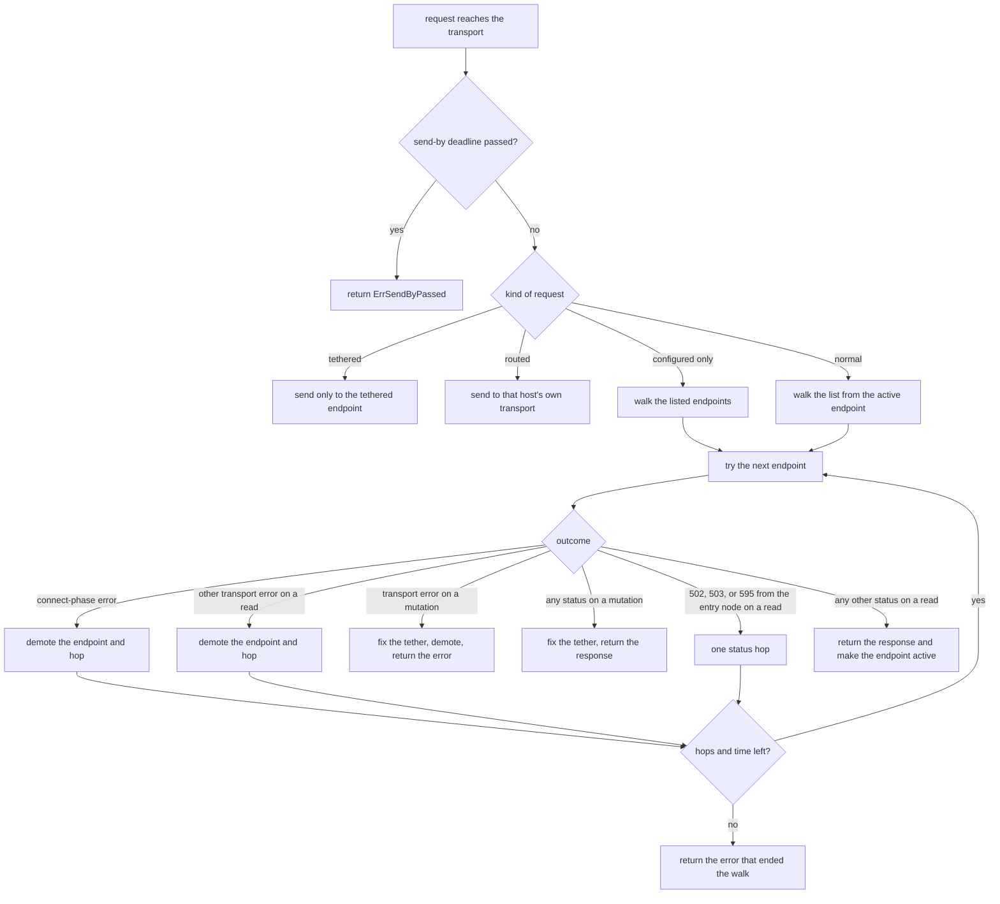

# PVE Endpoint Failover

This document covers how the CPI keeps working when the Proxmox node it talks to goes away, for example during a rolling upgrade. We start with the ordered list of API endpoints you can give each cluster and with the rules the CPI follows when it walks that list. The later sections cover tethers, which keep a write from running twice, the TLS checks, the reset, and the log lines you will see. [PVE Transient Transport Faults](pve-transient-transport.md) covers how the CPI's retry layers behave on top of this.

## The problem this solves

A Proxmox cluster has no API address that survives the loss of a node. Every node serves the cluster-wide API, but a client that points at one hostname stops working when that node reboots. During a rolling upgrade that node can be unreachable for several minutes while the rest of the cluster keeps serving guests.

Before the endpoint list existed, the CPI talked to exactly one host per cluster, and every retry went back to the same host. A silently dropped connection could hold one attempt for as long as the operating system allowed, which on Linux is about two minutes. With the list, a call that starts while one node's API is down moves to another node of the same cluster and finishes there.

## Configuring the list

The list lives in `pve.endpoints`. Each entry is a hostname, an IPv4 literal, a bare IPv6 literal, or one of those followed by a port. An IPv6 literal with a port is written `[literal]:port`. An entry without a port takes `pve.port`, which defaults to 8006. The first entry is the preferred endpoint, and the CPI tries the entries in the order you wrote them.

```yaml
properties:
  pve:
    endpoints:
      - pve1.example.com
      - pve2.example.com
      - pve3.example.com:8007
    api_token: ((pve_api_token))
    verify_ssl: true
```

A few rules apply when we validate the list.

- Size
  The list holds at most 16 entries, and no two entries may be equal once the host is lowercased, a trailing dot is removed, and the port is filled in.

- Agreement with `pve.host`
  You can leave `pve.host` out when you set `pve.endpoints`. When you set both, the host and port must match the first entry. For example, `pve.host: a` with `endpoints: [a:9000]` is rejected unless `pve.port` is 9000, and the error tells you to set `pve.port` or drop `pve.host`.

- A host is required
  The job fails to render with `pve.host or pve.endpoints is required` when neither is set.

An existing manifest that sets only `pve.host` needs no change. It renders the same `cpi.json` as before, the CPI builds a pool of one endpoint, and it behaves as it always has.

The list never changes how direct-to-node uploads are routed. `pve.node_endpoints` and `pve.node_endpoints_discovery` keep controlling that, and the CPI does not copy `pve.node_endpoints` values into the failover list. Some deployments list link0 addresses there that pveproxy may not listen on, and we did not want a failover to land on one of them.

A `cpi_config` entry can carry its own `pve.endpoints`, and each entry gets its own pool. An entry keeps the job's credentials only when its whole ordered list matches the job's list, so an entry that adds an endpoint the job never named must carry its own credentials. [Multi-Cluster Configuration](multi-cluster.md) has the rules and the error you see when they are broken.

We recommend API tokens for every deployment that uses failover. A token is a header and nothing more, so it works on every node, and the SDK does not log in again when a token request returns a 401. A ticket login posts your password, and the CPI sends that request only to endpoints you listed.

## How a call walks the list

The CPI installs the failover transport whenever the pool holds more than one endpoint. A pool of one endpoint keeps the SDK's own transport, so it has no dial deadline and no header deadline, exactly as before.

The transport sorts each request into one of four kinds before it does anything else.

- Tethered
  The request is a mutation whose tether key already has a tether. It goes only to the endpoint the tether names, and it never walks the list. The next section explains tethers.

- Configured only
  The request is the ticket login, `POST /access/ticket`. It walks only the endpoints you listed.

- Routed
  A caller already chose the address, which today only the direct-to-node upload router does. The request goes to an owned transport for that host and does not walk the list.

- Normal
  Everything else walks the list.

A walk starts at the active endpoint, which is the one that last answered in this process, and then tries the rest in the order you listed them. An endpoint that failed earlier in this process moves to the end of the order. That only reorders the walk, and a marked endpoint is still tried when everything ahead of it fails.

Each request is copied for each hop, with the host replaced by the endpoint being tried, so the Host header, the TLS server name, and the certificate check all follow that endpoint.



### Reads and writes are treated differently

The CPI moves a request to the next endpoint only when moving it cannot repeat a write. For that reason the transport treats three groups of requests differently.

- Reads
  A GET, HEAD, or OPTIONS request can be repeated safely, so it moves to the next endpoint on any transport error.

- The ticket login
  `POST /access/ticket` creates no state on Proxmox, so we treat it like a read.

- Mutations
  Every other request counts as a mutation. A mutation moves only when the CPI can prove that no byte of it left the machine, which means the failure happened while the connection was still being made. After that proof is gone, the mutation stays tethered to the endpoint it went to.

The proof rests on where the error came from. Every transport the pool owns dials through the pool's own dialer, which tags a failure in the dial, the name lookup, the TLS handshake, the certificate check, or a pin check with the phase that failed. Go writes no request byte before it has a connection, so an error that carries one of those tags proves the request was never sent. The pool also speaks only HTTP/1.1, where one request owns its connection, because the proof depends on that.

### What each outcome does

In this table, a hop means moving the same request to the next endpoint. A tethered request never hops.

| Outcome | Applies to | Hops? | Effect on the endpoint |
|---|---|---|---|
| Failure in the dial, the name lookup, or the TLS handshake | All | Yes, unless a concurrent request with the same key holds the tether | Demoted for this process, and a down mark is written when a cache exists |
| Certificate check fails on a listed endpoint | All | Yes | Demoted, with the class `tls_verify`, and logged at Error |
| Send-by deadline already passed | All | No | The request is refused with `ErrSendByPassed` and nothing is tethered |
| Reset, EOF, or read timeout after the connection was made | Reads and the login | Yes | Demoted for this process |
| No response headers within 60 seconds | Reads, when not on the final hop | Yes | Demoted for this process |
| 502 or 503 caused by the entry node | Reads and the login | Yes, once per request | Demoted for this process |
| 595 caused by the entry node | Reads and the login | Yes, once per request | Demoted for this process |
| 596 caused by the entry node | Reads and the login | No | The response is returned and the endpoint is demoted |
| 502, 503, 595, or 596 for another node | Reads and the login | No | The response is returned with no effect |
| 597 to 599 | Reads and the login | No | The response is returned with no effect |
| Any other status, including 2xx, 4xx, 500, and 504 | Reads and the login | No | The endpoint becomes active and loses any demotion |
| Transport error after the connection was made | Mutations | No | The tether is fixed on this endpoint, the endpoint is demoted, and the error is returned unchanged |
| Any status at all | Mutations | No | The tether is fixed on this endpoint and the response is returned unchanged |
| The caller's own cancellation or deadline before a connection | All | No | The error is returned with no effect |

A status moves a read only when the entry node caused it. The transport treats a response as caused by the entry node when the path names no node, such as `/cluster/resources`, or when the path's node segment is the entry endpoint's own node. A 595 for `/nodes/pve3/...` while `pve3` is down says nothing about the entry node, because every entry would answer the same way, so the response comes back and the entry stays where it is.

### How long a walk can take

A walk ends when a request gets an answer, when it has made four hops, or when it has tried every eligible endpoint once. It also has two time budgets, and the transport checks both before it starts each hop after the first. It starts no new hop once the walk has spent 30 seconds connecting, and it starts none once 90 seconds have passed since the walk began. A hop that has already started finishes.

When every endpoint refuses or drops connections, a hop costs at most 15 seconds, which is the 5-second dial plus the 10-second TLS handshake. The walk then spends at most about 45 seconds before it gives up.

When some endpoints accept TLS and then never answer, a hop can cost up to about 75 seconds, which is up to 15 seconds to connect plus the 60-second header deadline. The walk budget stops new hops at 90 seconds, so such a walk lasts at most about 165 seconds.

The final hop of a walk is the fourth one or the hop to the last eligible endpoint, and it never has a header deadline. A slow but healthy node can still answer a slow read on the walk's last try. The cost is that a pool in which every endpoint hangs after the handshake does no better than a single hung host does today, since the last hop waits for the 30-minute client timeout.

When every hop of a walk fails in the connect phase or on the header deadline, the walk returns one error that lists each endpoint with its cause, in the order tried.

```
no Proxmox endpoint answered (pve1:8006: dial timeout; pve2:8006: connection refused; pve3:8006: i/o timeout)
```

That error unwraps to a single dial error, so the SDK's own retry stops at once and the CPI's retry helpers treat it as a transient connection fault. The one exception is a walk in which every hop failed certificate verification. That walk surfaces the certificate errors, and the SDK reports them as it did before the pool existed, without retrying.

### Timeouts the pool sets

When the pool holds more than one endpoint at construction and you left `pve.api_dial_timeout_sec` and `pve.api_tls_handshake_timeout_sec` at 0, the CPI uses 5 seconds for the dial and 10 seconds for the TLS handshake. A value you set yourself always wins.

The same pools give a read a response-header deadline of 60 seconds. Go starts that timer after the request is fully written, so it measures how long the node takes to start answering. It catches a node whose pveproxy accepts the connection and then stops responding, which used to hold a request for the 30-minute client timeout. The deadline applies only to a read that the entry node would be blamed for and that is not on the walk's final hop. A mutation never gets one, because a synchronous mutation or an upload can run for a long time legitimately.

A healthy pveproxy answers a dial in milliseconds and a read well inside a minute, so we do not expect these values to matter on a healthy cluster.

### Across calls

Every CPI call is a new process, so the active endpoint and the demotions live only for the life of one call. With no cache, each call walks the list in order, and a dead first endpoint costs each call one connect timeout, which is about five seconds with the default dial. When the cache is present, the first connect-phase failure to an endpoint also writes a down mark that lasts two minutes. A mark only moves that endpoint to the end of the walk in other processes. It never removes the endpoint and never pins a process to another one.

## Tethers and their families

Today the CPI replays some mutations on purpose after a dropped connection, on the same host. In the outage this feature targets, that replay usually cannot connect, so nothing gets duplicated. If failover sent the replay to another node, it would connect about a second later while the original might still be running, and a harmless replay would become a real duplicate. A replayed disk create would meet its own volume, and a replayed destroy could find the guest locked by the first destroy.

So the pool ties every mutation that may have been sent to the endpoint it went to. We call that a tether. Every later request with the same key follows the tether to the same endpoint, from any retry layer in the CPI or the SDK, and nowhere else.

The first mutation with a key reserves the tether on the endpoint it is about to try, before any byte can leave. A second mutation with that key, from a concurrent request, follows the reservation at once instead of waiting. The reservation is released only when the request fails in the connect phase, or is refused for its send-by deadline, and no other request still holds it. In every other outcome the tether becomes fixed and stays on its endpoint until the call that made it ends.

A tether is scoped to one CPI call. The dispatcher puts an affinity scope on each call's context, and the `pve-cid` operator commands do the same. Two calls never see each other's tethers, and a tether is dropped when its call returns. A tether that a request still holds at that moment outlives the call, so a late replay still goes only to its endpoint.

### The tether key

A mutation's key is its method and its API route, without the query string. So a `POST` to the same path with a different query shares the tether. A few writers re-plan after an unknown outcome, and the re-plan can change the method or the path of what is logically the same write. For those, the key is the writer's family, so every mutation in the family shares one tether.

| Family | Routes it covers | Why it exists |
|---|---|---|
| `ha` | Everything under `/cluster/ha` | The rule writer re-plans a create into an update after an unknown outcome, and staging and the state setters read and then write again. |
| `replication` | Everything under `/cluster/replication` | The replication writers create a job, set its comment, and delete it first without and then with force. |
| `pools` | Everything under `/pools` | Lock sentinels are pools, and a sentinel create that may have landed can be followed by a cleanup delete of the same sentinel. |

A route belongs to a family when it is the family's route itself or lies below it. So `/cluster/ha/rules/x` is in the `ha` family, and `/cluster/hardware` is not.

### Refusals a tether can cause

A tether can refuse a mutation in two situations, and neither comes from anything an operator configured.

`ErrTetherConflict` means a mutation with this key may have reached two endpoints in one call. The pool then refuses every further mutation with that key for the rest of the call, with the error text `mutation refused because its tether key is conflicted on two endpoints`. The CPI never retries it, because nothing a retry could change would let the next attempt send.

A tether split between calls means two different calls each tethered the same key to a different endpoint, and a request that sees both is refused. The error text starts `endpoint pool: refusing` and names the method, the route, and both endpoints, and it also wraps `ErrTetherConflict`.

If you see either one, keep the CPI log. Both are logged at Error, and the conflict line appears only after a defect in the endpoint pool.

## The cluster lock's send-by deadline

The CPI's cluster lock depends on a stealer's `DELETE` reaching Proxmox within a short window after its last re-read. A failover hop could add up to 15 seconds of dial and handshake before the delete reaches another node, which is exactly the stall the lock cannot tolerate.

So the steal, and the expired-lock sweep for per-disk locks, put a send-by deadline on the sentinel delete. The deadline is the moment the stealer sent its re-read plus the two-second steal budget. The marker names the one request it guards, `DELETE /pools`, so the managed guard's reads before and after the delete are not affected.

The transport checks the deadline immediately before it hands the request to a connection, on every hop and on a reused connection as well, and it bounds connection setup by the same deadline. A request that fails either check is refused with `ErrSendByPassed`, and no byte leaves the machine. The deadline bounds when the request is handed to a connection. It cannot bound a stall between that check and the write, or anything after the write, and the lock's grace pause has to absorb those.

A refused steal is not an error for the caller. The acquire loop treats it as an abandoned steal, so the sentinel stays, the loop waits one poll, and the next poll decides afresh. If the lock still cannot be acquired, the timeout message names the refused steal and not a live holder. The sweep leaves the expired sentinel for the next sweep. At Debug level you see the line `pve endpoints: DELETE /pools not sent, send-by deadline passed`.

Because the refusal is the same on every later attempt, the CPI never counts `ErrSendByPassed` as a transient fault, and its retry helpers do not repeat it. [PVE Transient Transport Faults](pve-transient-transport.md#how-failover-and-the-send-by-deadline-change-the-retry) has the details.

## Task polling

A poll for a Proxmox task is a series of independent GETs, and any live entry node proxies the read to the node that runs the task. A poll can therefore fail over between entry nodes like any other read.

The default poll path now also re-polls on a transient fault at the poll interval until the task's deadline. When the deadline passes, it returns the poll-timeout error that never licenses a resubmit. This matters when the task's own node is the one that is down. Every entry answers 595 for that path, and the transport returns it because it is about another node. The call keeps polling and then returns unresolved, and it does not start the mutation again. The call is slower to fail, but it cannot create a second copy of a task that may still be running.

## Discovery

## The three cache layers

## The cold start

## VIP and IP seeds

## TLS and certificate checks

Every endpoint you list follows the TLS settings you gave `pve.host`. With `verify_ssl: true` and a `ca_cert`, the CPI checks the chain against that CA and checks the name against the endpoint's own host. With `verify_ssl: true` and no CA, the system trust pool applies. With `verify_ssl: false`, nothing is checked. So list names your certificates cover. With stock Proxmox certificates, that is the node name, or the node name plus its search domain.

An endpoint that fails certificate verification is a connect-phase failure, so the walk moves on to the next one and the deploy keeps running. A failed check can also mean that someone is intercepting the connection, so the CPI logs it at Error, once per endpoint per call, with the class `tls_verify`.

```
pve endpoint pve2:8006: TLS verification failed (x509: certificate is valid for pve2, not pve2.lan); this can mean interception; trying the next endpoint
```

Treat that line as a prompt to look at the endpoint, not as noise. If the certificate is legitimate and simply does not cover the name you listed, fix the name in `pve.endpoints` or the certificate. When every endpoint fails verification, the certificate error surfaces to the Director, and the SDK stops retrying at once, as it did before the list existed.

### Redirects are never followed

The CPI uses `proxmox-apiclient-go` v3.13.1, and that SDK refuses every HTTP redirect from the Proxmox API. Go's default policy keeps the Authorization header when a redirect changes only the port or the scheme, which would send your API token to another listener on the same host, in plain text for an `http` target. The SDK turns every 3xx response except 304 into a refusal before Go reads the `Location` header, and the request is attempted once and never retried. The pool's transport is a second line of defense. If a client ever built a follow-up request for a redirect, the pool would refuse it before any dial.

A redirect is an answer from the endpoint, so it never causes a hop or a demotion. The CPI reports it to the Director as an error that is not retriable, with the text `PVE answered with a redirect, which the CPI never follows, so a retry would meet the same answer`. A front proxy that answers a plain `http` request with a 301 to the `https` address of the same host is the case most likely to surprise you. Point `pve.host` or `pve.endpoints` at the `https` address directly.

### What the logs and errors leave out

The same SDK release scrubs credentials and server-chosen values out of error text and debug logs. A URL in an error keeps only its scheme, host, and path, so a query parameter such as a ticket never reaches the log. Control characters, escape sequences, and text-direction overrides in a value the server chose are escaped. A single server-chosen value is cut at 1 KiB, and the whole text of a cause is cut at 8 KiB. The pool applies the same scrubbing to the cause it prints in its own failover and verification lines.

## The reset

Failover keeps nothing on disk by itself. The active endpoint, the demotions, and the tethers all end with the call, so with an explicit list and discovery off there is nothing to reset.

When an endpoint cache exists, it holds the down marks, and it can hold more than that. The cache is plain JSON, and deleting its files, or the whole directory, is the supported reset. The next call that reaches an endpoint writes a fresh file. If you are not sure where the cache lives, [The three cache layers](#the-three-cache-layers) explains how the CPI chooses its directory.

Two things share that directory and are safe to lose. The first is the directory secret, which the CPI recreates, and every cache file written under the old one is rebuilt. The second is the HA recovery episode record. Losing it restarts the grace clock for a VM that is in HA recovery, which only delays the handover to BOSH. That record is written even when discovery is off, so the directory can exist on a deployment that discovers nothing.

## Rolling back to 0.9.6

The release that rolls back cleanly is 0.9.6, and a rollback to it meets these facts.

- A manifest without `pve.host` does not render
  The 0.9.6 template reads `pve.host` with no default, so a manifest that relies on `pve.endpoints` alone fails at deploy time. Keep `pve.host` set alongside `pve.endpoints` until the new release has settled. The agreement rule allows that.

- New keys in a `cpi_config` entry break that entry
  The 0.9.6 release does not know `pve_endpoints` or `pve_api_endpoint_discovery`, so it rejects every call routed through that entry with `context carries ... which the pve_cpi job spec does not define; check the spelling`. That takes the whole AZ down. Keep the new keys out of `cpi_config` entries until the release has settled, or remove them from the CPI config before you roll back.

- Job-level properties are harmless
  The 0.9.6 job spec does not define `pve.endpoints`, `pve.api_endpoint_discovery`, or `pve.endpoint_cache_dir`, so its template never reads them.

- Cache files stay behind
  The 0.9.6 release never reads them. Files in the temporary directory disappear with the ephemeral disk, and the `endpoint-cache` directory beside a journal stays on the persistent disk, where 0.9.6 never looks at it. You can delete either one. If you upgrade again with the same credential, the files are still valid.

## Log lines

The CPI's default log level is `info`, and every CPI call is a new process, so "once per call" below means once per process. Debug lines appear only after you raise the level. The Warn and Error lines show up in `bosh task <id> --cpi` and in `/var/vcap/sys/log/cpi/cpi.log` on the Director.

An upgraded deployment with one `pve.host` and a healthy node logs nothing new at the default level. A new line appears at Info or above only when a failover happens, when a configured endpoint fails its certificate check, or when the pool reports a defect.

| Event | Level | Text | Frequency |
|---|---|---|---|
| Pool built | Debug | `pve endpoints: pool [pve1:8006 configured, pve2:8006 configured], starting on pve1:8006` | Once per call. The line lists each endpoint with its kind, and it ends `, with N cold-start candidates from placement.az_map` when the pool carries candidates. |
| Started away from the first endpoint | Info | `pve endpoints: starting on pve2:8006 because pve1:8006 was marked down 40s ago` | Once per call, and only while a down mark is in effect. |
| Failover | Warn | `pve endpoint failover: pve1:8006 unreachable (dial tcp: i/o timeout), request sent to pve2:8006, which stays active for this call` | Once per change of the active endpoint. An upload that only advances the endpoint for the next request reads `, next request goes to pve2:8006`. |
| Configured endpoint failed verification | Error | `pve endpoint pve2:8006: TLS verification failed (x509: certificate is valid for pve2, not pve2.lan); this can mean interception; trying the next endpoint` | Once per endpoint per call. The text ends `no other endpoint is tried for this request` when the request does not move on. |
| Every endpoint failed | Error, through the call's own error | `no Proxmox endpoint answered (pve1:8006: dial timeout; pve2:8006: connection refused)` | Per failed call. |
| Pool refused its own transport | Error | `pve endpoint pve2:8006: the pool refused to send through its transport (owned transport asked to dial another address: pve3:8006); this is a defect in the endpoint pool; trying the next endpoint` | Once per address for the life of the pool, and only after a defect, with `endpoint`, `class`, and `error` as fields. |
| Mutation tethered | Debug | `pve endpoints: POST /nodes/n3/qemu/101/clone may have reached pve2:8006; retries stay on pve2:8006` | Once per tether. For a family, the text ends `ha mutations stay on pve2:8006` and names the family. |
| Send-by refused | Debug | `pve endpoints: DELETE /pools not sent, send-by deadline passed` | Once per refusal, with `method` and `path` as fields. |
| Tether conflict | Error | `pve endpoints: POST /nodes/n3/qemu may have reached both pve1:8006 and pve2:8006; refusing further mutations with this key for this call` | Once per key per call, and only after a defect. |
| Tether split between calls | Error | `pve endpoints: POST /nodes/n3/qemu is tethered to both pve1:8006 and pve2:8006 by different calls; refusing further mutations with this key that see both` | Once per key for as long as the tethers it saw last, with `other` as a field. |

Each failover line carries `from`, `to`, `class`, and `error` as fields. The `class` is the connect phase that failed, which is `dial`, `dns`, `tls_handshake`, `tls_verify`, or `pin`, or it is `header_deadline`, `transport`, `status`, or `request` for the other failures. The cause text passes through the same credential scrubbing as the rest of the log.

If you read a Warn failover line during a deploy, one node of your cluster was unreachable from the Director. Check that node before the next deploy. The line itself means the call worked.

The lines for discovery, the cache, and the cold start from `placement.az_map` are listed with their own sections above.
