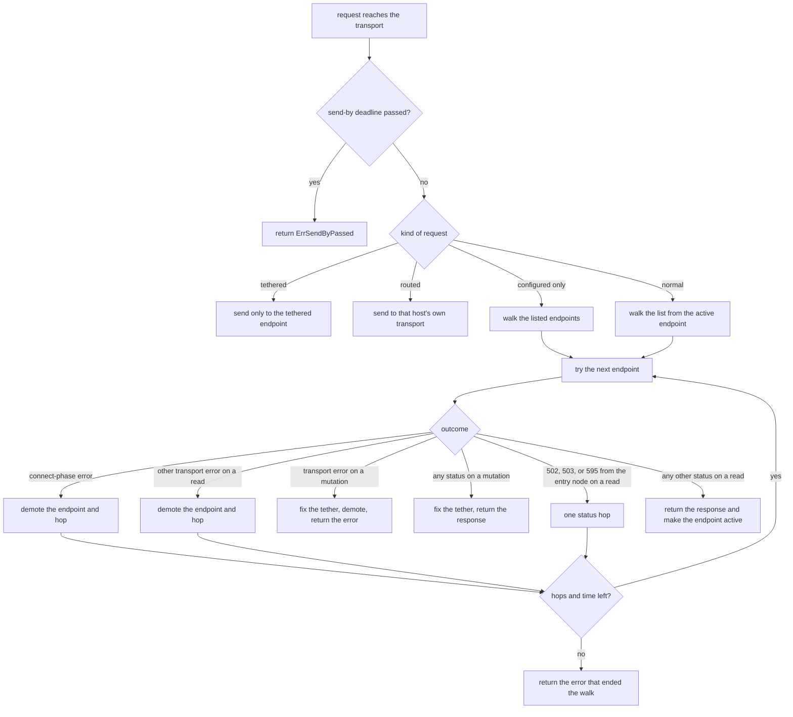
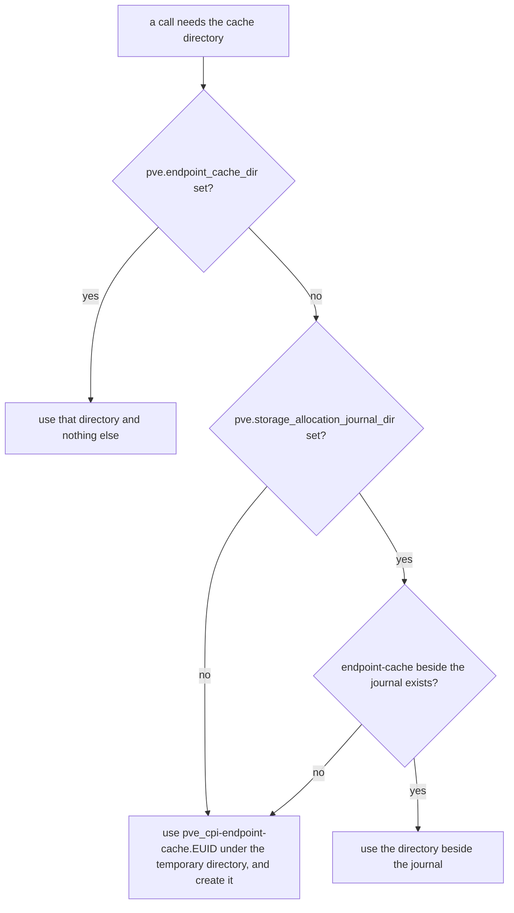
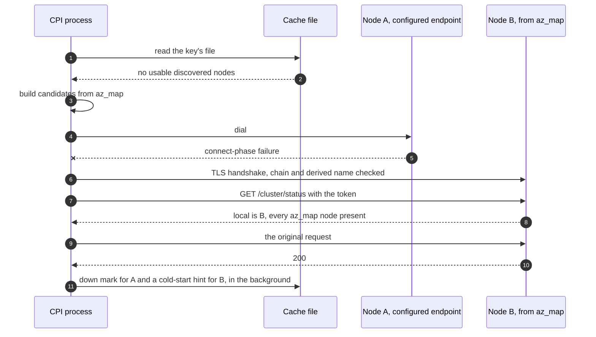

# PVE Endpoint Failover and Discovery

This document covers how the CPI keeps working when the Proxmox node it talks to goes away, for example during a rolling upgrade. We start with the ordered list of API endpoints you can give each cluster and with the rules the CPI follows when it walks that list. The later sections cover tethers, which keep a write from running twice, discovery of the other nodes of a cluster, the cache directory that discovery writes to, the cold start from `placement.az_map`, the TLS checks, the reset, and the log lines you will see. [PVE Transient Transport Faults](pve-transient-transport.md) covers how the CPI's retry layers behave on top of this.

## The problem this solves

A Proxmox cluster has no API address that survives the loss of a node. Every node serves the cluster-wide API, but a client that points at one hostname stops working when that node reboots. During a rolling upgrade that node can be unreachable for several minutes while the rest of the cluster keeps serving guests.

Before the endpoint list existed, the CPI talked to exactly one host per cluster, and every retry went back to the same host. A silently dropped connection could hold one attempt for as long as the operating system allowed, which on Linux is about two minutes. With the list, a call that starts while one node's API is down moves to another node of the same cluster and finishes there.

## Configuring the list

The list lives in `pve.endpoints`. Each entry is a hostname, an IPv4 literal, a bare IPv6 literal, or one of those followed by a port. An IPv6 literal with a port is written `[literal]:port`. An entry without a port takes `pve.port`, which defaults to 8006. The first entry is the preferred endpoint, and the CPI tries the entries in the order you wrote them.

```yaml
properties:
  pve:
    endpoints:
      - pve1.example.com
      - pve2.example.com
      - pve3.example.com:8007
    api_token: ((pve_api_token))
    verify_ssl: true
```

A few rules apply when we validate the list.

- Size
  The list holds at most 16 entries, and no two entries may be equal once the host is lowercased, a trailing dot is removed, and the port is filled in.

- Agreement with `pve.host`
  You can leave `pve.host` out when you set `pve.endpoints`. When you set both, the host and port must match the first entry. For example, `pve.host: a` with `endpoints: [a:9000]` is rejected unless `pve.port` is 9000, and the error tells you to set `pve.port` or drop `pve.host`.

- A host is required
  The job fails to render with `pve.host or pve.endpoints is required` when neither is set.

An existing manifest that sets only `pve.host` needs no change. It renders the same `cpi.json` as before, the CPI builds a pool of one endpoint, and it behaves as it always has.

The list never changes how direct-to-node uploads are routed. `pve.node_endpoints` and `pve.node_endpoints_discovery` keep controlling that, and the CPI does not copy `pve.node_endpoints` values into the failover list. Some deployments list link0 addresses there that pveproxy may not listen on, and we did not want a failover to land on one of them.

A `cpi_config` entry can carry its own `pve.endpoints`, and each entry gets its own pool. An entry keeps the job's credentials only when its whole ordered list matches the job's list, so an entry that adds an endpoint the job never named must carry its own credentials. [Multi-Cluster Configuration](multi-cluster.md) has the rules and the error you see when they are broken.

We recommend API tokens for every deployment that uses failover. A token is a header and nothing more, so it works on every node, and the SDK does not log in again when a token request returns a 401. A ticket login posts your password, and the CPI sends that request only to endpoints you listed.

## How a call walks the list

The CPI installs the failover transport when the pool holds more than one endpoint, and also when discovery is in effect, so the transport sees the first answered request even if the pool starts with one endpoint. A client with neither keeps the SDK's own transport, so it has no dial deadline and no header deadline, exactly as before.

The transport sorts each request into one of four kinds before it does anything else.

- Tethered
  The request is a mutation whose tether key already has a tether. It goes only to the endpoint the tether names, and it never walks the list. The next section explains tethers.

- Configured only
  The request is the ticket login, `POST /access/ticket`. It walks only the endpoints you listed.

- Routed
  A caller already chose the address, which today only the direct-to-node upload router does. The request goes to an owned transport for that host and does not walk the list.

- Normal
  Everything else walks the list.

A walk starts at the active endpoint, which is the one that last answered in this process, and then tries the rest in the order you listed them. An endpoint that failed earlier in this process moves to the end of the order. That only reorders the walk, and a marked endpoint is still tried when everything ahead of it fails.

Each request is copied for each hop, with the host replaced by the endpoint being tried, so the Host header, the TLS server name, and the certificate check all follow that endpoint.



### Reads and writes are treated differently

The CPI moves a request to the next endpoint only when moving it cannot repeat a write. For that reason the transport treats three groups of requests differently.

- Reads
  A GET, HEAD, or OPTIONS request can be repeated safely, so it moves to the next endpoint on any transport error.

- The ticket login
  `POST /access/ticket` creates no state on Proxmox, so we treat it like a read.

- Mutations
  Every other request counts as a mutation. A mutation moves only when the CPI can prove that no byte of it left the machine, which means the failure happened while the connection was still being made. After that proof is gone, the mutation stays tethered to the endpoint it went to.

The proof rests on where the error came from. Every transport the pool owns dials through the pool's own dialer, which tags a failure in the dial, the name lookup, the TLS handshake, the certificate check, or a pin check with the phase that failed. Go writes no request byte before it has a connection, so an error that carries one of those tags proves the request was never sent. The pool also speaks only HTTP/1.1, where one request owns its connection, because the proof depends on that.

### What each outcome does

In this table, a hop means moving the same request to the next endpoint. A tethered request never hops.

| Outcome | Applies to | Hops? | Effect on the endpoint |
|---|---|---|---|
| Failure in the dial, the name lookup, or the TLS handshake | All | Yes, unless a concurrent request with the same key holds the tether | Demoted for this process, and a down mark is written when a cache exists |
| Certificate check fails on a listed endpoint | All | Yes | Demoted, with the class `tls_verify`, and logged at Error |
| Send-by deadline already passed | All | No | The request is refused with `ErrSendByPassed` and nothing is tethered |
| Reset, EOF, or read timeout after the connection was made | Reads and the login | Yes | Demoted for this process |
| No response headers within 60 seconds | Reads, when not on the final hop | Yes | Demoted for this process |
| 502 or 503 caused by the entry node | Reads and the login | Yes, once per request | Demoted for this process |
| 595 caused by the entry node | Reads and the login | Yes, once per request | Demoted for this process |
| 596 caused by the entry node | Reads and the login | No | The response is returned and the endpoint is demoted |
| 502, 503, 595, or 596 for another node | Reads and the login | No | The response is returned with no effect |
| 597 to 599 | Reads and the login | No | The response is returned with no effect |
| Any other status, including 2xx, 4xx, 500, and 504 | Reads and the login | No | The endpoint becomes active and loses any demotion |
| Transport error after the connection was made | Mutations | No | The tether is fixed on this endpoint, the endpoint is demoted, and the error is returned unchanged |
| Any status at all | Mutations | No | The tether is fixed on this endpoint and the response is returned unchanged |
| The caller's own cancellation or deadline before a connection | All | No | The error is returned with no effect |

A status moves a read only when the entry node caused it. The transport treats a response as caused by the entry node when the path names no node, such as `/cluster/resources`, or when the path's node segment is the entry endpoint's own node. A 595 for `/nodes/pve3/...` while `pve3` is down says nothing about the entry node, because every entry would answer the same way, so the response comes back and the entry stays where it is.

### How long a walk can take

A walk ends when a request gets an answer, when it has made four hops, or when it has tried every eligible endpoint once. It also has two time budgets, and the transport checks both before it starts each hop after the first. It starts no new hop once the walk has spent 30 seconds connecting, and it starts none once 90 seconds have passed since the walk began. A hop that has already started finishes.

When every endpoint refuses or drops connections, a hop costs at most 15 seconds, which is the 5-second dial plus the 10-second TLS handshake. The walk then spends at most about 45 seconds before it gives up.

When some endpoints accept TLS and then never answer, a hop can cost up to about 75 seconds, which is up to 15 seconds to connect plus the 60-second header deadline. The walk budget stops new hops at 90 seconds, so such a walk lasts at most about 165 seconds.

The final hop of a walk is the fourth one or the hop to the last eligible endpoint, and it never has a header deadline. A slow but healthy node can still answer a slow read on the walk's last try. The cost is that a pool in which every endpoint hangs after the handshake does no better than a single hung host does today, since the last hop waits for the 30-minute client timeout.

When every hop of a walk fails in the connect phase or on the header deadline, the walk returns one error that lists each endpoint with its cause, in the order tried.

```
no Proxmox endpoint answered (pve1:8006: connect phase dial failed for pve1:8006: dial tcp 192.0.2.11:8006: i/o timeout; pve2:8006: connect phase dial failed for pve2:8006: dial tcp 192.0.2.12:8006: connect: connection refused; pve3:8006: connect phase tls_handshake failed for pve3:8006: net/http: TLS handshake timeout)
```

That error unwraps to a single dial error, so the SDK's own retry stops at once and the CPI's retry helpers treat it as a transient connection fault. The one exception is a walk in which every hop failed certificate verification. That walk surfaces the certificate errors, and the SDK reports them as it did before the pool existed, without retrying.

### Timeouts the pool sets

When the pool holds more than one endpoint at construction and you left `pve.api_dial_timeout_sec` and `pve.api_tls_handshake_timeout_sec` at 0, the CPI uses 5 seconds for the dial and 10 seconds for the TLS handshake. A value you set yourself always wins.

The same pools give a read a response-header deadline of 60 seconds. Go starts that timer after the request is fully written, so it measures how long the node takes to start answering. It catches a node whose pveproxy accepts the connection and then stops responding, which used to hold a request for the 30-minute client timeout. The deadline applies only to a read that the entry node would be blamed for and that is not on the walk's final hop. A mutation never gets one, because a synchronous mutation or an upload can run for a long time legitimately.

A healthy pveproxy answers a dial in milliseconds and a read well inside a minute, so we do not expect these values to matter on a healthy cluster.

### Across calls

Every CPI call is a new process, so the active endpoint and the demotions live only for the life of one call. With no cache, each call walks the list in order, and a dead first endpoint costs each call one connect timeout, which is about five seconds with the default dial. When the cache is present, the first connect-phase failure to an endpoint also writes a down mark that lasts two minutes. A mark only moves that endpoint to the end of the walk in other processes. It never removes the endpoint and never pins a process to another one.

## Tethers and their families

Today the CPI replays some mutations on purpose after a dropped connection, on the same host. In the outage this feature targets, that replay usually cannot connect, so nothing gets duplicated. If failover sent the replay to another node, it would connect about a second later while the original might still be running, and a harmless replay would become a real duplicate. A replayed disk create would meet its own volume, and a replayed destroy could find the guest locked by the first destroy.

So the pool ties every mutation that may have been sent to the endpoint it went to. We call that a tether. Every later request with the same key follows the tether to the same endpoint, from any retry layer in the CPI or the SDK, and nowhere else.

The first mutation with a key reserves the tether on the endpoint it is about to try, before any byte can leave. A second mutation with that key, from a concurrent request, follows the reservation at once instead of waiting. The reservation is released only when the request fails in the connect phase, or is refused for its send-by deadline, and no other request still holds it. In every other outcome the tether becomes fixed and stays on its endpoint until the call that made it ends.

A tether is scoped to one CPI call. The dispatcher puts an affinity scope on each call's context, and the `pve-cid` operator commands do the same. Two calls never see each other's tethers, and a tether is dropped when its call returns. A tether that a request still holds at that moment outlives the call, so a late replay still goes only to its endpoint.

### The tether key

A mutation's key is its method and its API route, without the query string. So a `POST` to the same path with a different query shares the tether. A few writers re-plan after an unknown outcome, and the re-plan can change the method or the path of what is logically the same write. For those, the key is the writer's family, so every mutation in the family shares one tether.

| Family | Routes it covers | Why it exists |
|---|---|---|
| `ha` | Everything under `/cluster/ha` | The rule writer re-plans a create into an update after an unknown outcome, and staging and the state setters read and then write again. |
| `replication` | Everything under `/cluster/replication` | The replication writers create a job, set its comment, and delete it first without and then with force. |
| `pools` | Everything under `/pools` | Lock sentinels are pools, and a sentinel create that may have landed can be followed by a cleanup delete of the same sentinel. |

A route belongs to a family when it is the family's route itself or lies below it. So `/cluster/ha/rules/x` is in the `ha` family, and `/cluster/hardware` is not.

### Refusals a tether can cause

A tether can refuse a mutation in two situations, and neither comes from anything an operator configured.

`ErrTetherConflict` means a mutation with this key may have reached two endpoints in one call. The pool then refuses every further mutation with that key for the rest of the call, with the error text `mutation refused because its tether key is conflicted on two endpoints`. The CPI never retries it, because nothing a retry could change would let the next attempt send.

A tether split between calls means two different calls each tethered the same key to a different endpoint, and a request that sees both is refused. The error text starts `endpoint pool: refusing` and names the method, the route, and both endpoints, and it also wraps `ErrTetherConflict`.

If you see either one, keep the CPI log. Both are logged at Error, and the conflict line appears only after a defect in the endpoint pool.

## The cluster lock's send-by deadline

The CPI's cluster lock depends on a stealer's `DELETE` reaching Proxmox within a short window after its last re-read. A failover hop could add up to 15 seconds of dial and handshake before the delete reaches another node, which is exactly the stall the lock cannot tolerate.

So the steal, and the expired-lock sweep for per-disk locks, put a send-by deadline on the sentinel delete. The deadline is the moment the stealer sent its re-read plus the two-second steal budget. The marker names the one request it guards, `DELETE /pools`, so the managed guard's reads before and after the delete are not affected.

The transport checks the deadline immediately before it hands the request to a connection, on every hop and on a reused connection as well, and it bounds connection setup by the same deadline. A request that fails either check is refused with `ErrSendByPassed`, and no byte leaves the machine. The deadline bounds when the request is handed to a connection. It cannot bound a stall between that check and the write, or anything after the write, and the lock's grace pause has to absorb those.

A refused steal is not an error for the caller. The acquire loop treats it as an abandoned steal, so the sentinel stays, the loop waits one poll, and the next poll decides afresh. If the lock still cannot be acquired, the timeout message names the refused steal and not a live holder. The sweep leaves the expired sentinel for the next sweep. At Debug level you see the line `pve endpoints: DELETE /pools not sent, send-by deadline passed`.

Because the refusal is the same on every later attempt, the CPI never counts `ErrSendByPassed` as a transient fault, and its retry helpers do not repeat it. [PVE Transient Transport Faults](pve-transient-transport.md#how-failover-and-the-send-by-deadline-change-the-retry) has the details.

## Task polling

A poll for a Proxmox task is a series of independent GETs, and any live entry node proxies the read to the node that runs the task. A poll can therefore fail over between entry nodes like any other read.

The default poll path now also re-polls on a transient fault at the poll interval until the task's deadline. When the deadline passes, it returns the poll-timeout error that never licenses a resubmit. This matters when the task's own node is the one that is down. Every entry answers 595 for that path, and the transport returns it because it is about another node. The call keeps polling and then returns unresolved, and it does not start the mutation again. The call is slower to fail, but it cannot create a second copy of a task that may still be running.

## Discovery

A deployment that names one API host has nothing to fail over to. Discovery fixes that without a manifest change. The CPI asks the cluster which nodes it has, remembers the answer in a small cache file, and adds those nodes to the pool behind the endpoints you listed. This section covers the modes and their defaults, what discovery reads, which nodes it accepts, how it decides what to trust, and when it tries again. [The three cache layers](#the-three-cache-layers) says where the file lives.

### The modes

You choose the mode with `pve.api_endpoint_discovery`, and a `cpi_config` entry can set its own as `pve_api_endpoint_discovery`. The property controls the API endpoint pool only. It never changes the direct-to-node upload routing that `pve.node_endpoints` and `pve.node_endpoints_discovery` control, and setting `pve.node_endpoints_discovery` to `false` does not turn it off.

| Value | What it does |
|---|---|
| Unset, which means `auto` | Discovers only when the effective endpoint list holds exactly one endpoint and the CPI authenticates with an API token. |
| `auto` | The same as unset. |
| `on` | Discovers even when the list holds several endpoints, and seeds from the first one. With password authentication it needs `pve.verify_ssl: true`, and the job fails to render without it. |
| `off` | Never discovers. |

Quote the value in a manifest, because YAML 1.1 reads a bare `on` or `off` as a boolean. The template accepts a boolean and renders `true` as `on` and `false` as `off`. An empty string and any other spelling fail the render.

```yaml
properties:
  pve:
    host: pve1.example.com
    api_token: ((pve_api_token))
    api_endpoint_discovery: "off"
```

The CPI turns the configured mode into an effective mode once per call, and the first rule that matches wins.

- The mode is `off`
  Nothing is discovered, and nothing is read from or written to the cache for discovery.

- The entry inherits the job's credentials with looser TLS settings than the job
  Discovery is off, with a Debug line under `auto`. Under `on` the job fails validation instead, because we will not send inherited credentials to hosts that a looser check accepted.

- The mode is `auto` and the list holds more than one endpoint
  Discovery is off and nothing is logged, because you already told the CPI where to go.

- The mode is `auto` and the CPI logs in with a password
  Discovery is off, with a Debug line. Every CPI call logs in afresh, and we did not want a default to start sending tickets to a new class of hosts. You can still choose `on` with a password when `verify_ssl` is true, and even then the password goes only to endpoints you listed.

- The cache directory is unusable
  Discovery is off, with a Debug line under `auto` and a Warn line under `on`. A directory counts as unusable when it fails the checks in [What the CPI requires of the directory](#what-the-cpi-requires-of-the-directory), and when the process has already started its exit drain, which is always a Debug line.

- None of the above
  Discovery is on.

An existing deployment that sets one `pve.host` and an API token therefore discovers by default. We recommend turning it off, with `api_endpoint_discovery: "off"`, when `pve.host` is a VIP or a load balancer name. [VIP and IP seeds](#vip-and-ip-seeds) explains why.

### What discovery adds to the pool

Discovered nodes join the pool after the endpoints you listed, so the preference order is always yours first. A walk reaches them like any other endpoint, with the rules in [How a call walks the list](#how-a-call-walks-the-list), and a pool that holds a second endpoint at construction gets the dial, handshake, and header deadlines from [Timeouts the pool sets](#timeouts-the-pool-sets).

Two things never go to a discovered node. The ticket login stays on the endpoints you listed, so a password never leaves them, and a discovered node only ever receives a token or a ticket. Discovery's own requests also walk the endpoints you listed and nothing else, so only an address you chose can change what the CPI trusts. A consequence is that a refresh cannot run while every endpoint you listed is down.

### When a refresh runs

A refresh is due in any of these cases.

- The file holds no verified node list
  This is the state after an upgrade, a wiped directory, or a file that failed validation.

- The node list is older than one hour
  A refresh that found nodes asks again an hour later.

- A discovered endpoint failed its pin
  The failure can come from this process or from another one, which reaches this process through a `pin_failed_at` time in the file. In either case the last attempt must be more than 10 minutes old, so a spoofed DNS answer cannot force a refresh on every call.

No refresh is due while the stored identity holds a conflict, whatever the other cases say.

The refresh runs in the background, after the first request that one of your listed endpoints answers. The `info` method dials nothing, so it never starts one. Only one process at a time refreshes a given cache file, because the worker takes a non-blocking lock and skips the refresh when another process holds it. Before the process exits, the CPI waits up to three seconds for a running refresh, a down-mark write, or a cold-start hint write, and a worker that is still running at that point is cancelled. A signal ends the wait at once. The `pve-cid` commands that build a client drain the same way. Most calls pay nothing, because the wait ends as soon as the workers finish.

### What discovery reads

| Read | Privilege | What we take from it | When it fails |
|---|---|---|---|
| `GET /nodes` | Any authenticated user | Node names, the `status` field, and `ssl_fingerprint` | Discovery writes no result, because without fingerprints we cannot trust any discovered address. |
| `GET /cluster/status` | `Sys.Audit` on `/` | The `quorate` flag, each node's `online` flag, and which node is `local` | Discovery continues with the nodes in name order and records the outcome `no_status`. |
| `GET /nodes/{node}/certificates/info` for each node | Any authenticated user | The SHA-256 fingerprints of that node's `pve-ssl.pem` and `pveproxy-ssl.pem`, and from one node the cluster root CA | A node whose read fails keeps its `/nodes` fingerprint as its only pin. When no node answers the root CA read, discovery writes no result. |

The whole set of reads gets 30 seconds. The certificate reads run four at a time, each gets the smaller of five seconds and the time left, and they cover at most 64 nodes. [PVE API Permissions](pve-api-permissions.md#discovery-and-cold-start-reads) lists the same reads next to the other privileges.

### Which nodes become endpoints

Every node name from `/nodes` must be a valid PVE node name before we use it. That means one DNS label of letters, digits, and inner hyphens, at most 63 characters, with no dots. If any name fails, discovery rejects the whole result and writes nothing, because a forged name such as `api.attacker.example` would otherwise become an arbitrary address.

A name that PVE allows but that a resolver could read as another address is left out on its own, and the rest of the result stands. These are a name made only of digits, a name that starts with `0x` and continues in hex digits, and `localhost`, `ip6-localhost`, and `ip6-loopback`, whatever the case.

For each remaining node we derive one address with the seed's port. [VIP and IP seeds](#vip-and-ip-seeds) explains the derivation. The CPI then resolves each derived name, in parallel, with a two-second limit for each, and leaves out a node whose name does not resolve. A name that resolves to the wrong host stays in, so each derived name must resolve to that node's API address, as [A seed with a fully qualified name](#a-seed-with-a-fully-qualified-name) explains. It also leaves out these nodes.

- The node that answered
  The pool already holds it. When `/cluster/status` is missing, a `/nodes` list of one row can only be the node that answered.

- A node whose address is one of your configured endpoints
  It is already in the pool, so it can never sit there twice.

- Nodes past the 64th
  The file holds at most 64.

Nodes that a quorate `/cluster/status` reports online come first, in name order, and the rest follow. When the status is not quorate, a minority node reports every majority member as offline, so we keep every node in name order. Without a status we use the `status` field from `/nodes`.

### Trust rules for identity and pins

Discovery stores two kinds of trust. The identity is the full SHA-256 of the cluster's root CA certificate, which tells the CPI that two answers come from one cluster. A pin set is the certificate fingerprints that one node is allowed to present. A node holds up to three pins, which are its `/nodes` fingerprint plus its `pve-ssl.pem` and `pveproxy-ssl.pem` fingerprints. We pin the set because the fingerprint that `/nodes` reports does not always match the certificate pveproxy serves, for example after an ACME renewal that has not restarted pveproxy.

These rules decide who can change either one.

- Only your configured endpoints write trust
  A discovered node can never add a node, change a pin, or change the identity, so it cannot vouch for itself.

- With `verify_ssl` true
  The endpoint you listed was checked against your own CA, so what it reports is as trustworthy as `pve.host` is today. An identity change replaces the stored node list and pins, logs at Error, and drops every discovered endpoint and every cold-start candidate from the pool for the rest of the call. A changed pin set for a known node replaces the old one.

- With `verify_ssl` false
  Nothing about the endpoint was verified, so discovery is trust on first use, as in SSH's `known_hosts`. The first discovery records the identity and the pins. A later identity change is refused, the CPI drops every discovered endpoint and cold-start candidate, logs at Error, and stops discovering until you delete the cache file. A known node whose pins only grow keeps its stored pins and adds the new ones. A node whose pins only shrink keeps its stored pins, which a timed-out certificate read can cause, and is confirmed again at Debug. A node whose pins both leave out one and add one, or share none with the stored set, is refused and keeps its stored pins until you delete the file.

- Discovered entries expire
  A node that no discovery through a configured endpoint has confirmed in 24 hours is not loaded. A node removed with `pvecm delnode` and left running with its old certificate therefore drops out within a day, even if no refresh can run.

The cache is never an input to the storage journal, which refuses a silent rebinding on its own.

These pins belong to discovery and are not the SDK's TLS fingerprint pinning. No CPI property turns SDK pinning on, and the CPI refuses to build a client that has it enabled together with more than one endpoint or with discovery on, which includes `auto` resolving to on for one endpoint and an API token, because the SDK checks a pin only against `pve.host` and the failover transport would bypass it silently on every other endpoint. The refusal comes from the configuration alone, so it does not depend on the cache or on whether its directory is usable, and the message tells you to list one endpoint and set `pve.api_endpoint_discovery` to `off`, or to disable pinning.

When the CPI connects to a discovered node, it decides before any request byte goes out, so the token never reaches an address that has not proved itself. With `verify_ssl` true, the certificate chain must verify against your CA, or the system pool when you set none, and then the leaf must be in the node's pin set or must pass a hostname check against the derived name. A leaf that passes only the hostname check is accepted for this process, and it makes a refresh due so the next discovery records the new pin. With `verify_ssl` false, the leaf must be in the pin set. A node whose certificate changes outside its pin set, for example after `pvecm updatecerts --force`, is skipped for the process until the next discovery repins it, with a Warn line and a `pin` down mark. Stock certificates often do not carry the derived name, so we accept a pin match without a hostname match, and the HMAC on the cache file is what stops someone without your credential from planting a pin.

### When discovery tries again

| Situation | When the next refresh is due |
|---|---|
| A result with nodes, which has the outcome `ok` or `no_status` | One hour later |
| A result with no nodes, which has the outcome `no_candidates`, `public_suffix`, or `standalone` | 24 hours later |
| A failure before any result | One hour after the attempt |
| An identity change refused under `verify_ssl` false | 24 hours later, and never while the conflict stands |
| A pin failure on a discovered endpoint | At once, when the last attempt is more than 10 minutes old |

A refresh records its attempt in the file before its first read, with `reads_timed_out` as the reason and the next refresh an hour out. A refresh that the exit drain cancels therefore backs off as a failed one does, and a refresh that ends writes over that record. The failure reasons are `nodes_unreadable`, `nodes_empty`, `node_name_invalid`, `root_ca_unreadable`, `reads_timed_out`, and `reads_failed`, and the file never holds raw error text. A failed attempt leaves the stored nodes and pins as they were, so a cluster whose reads keep failing is asked once an hour and not on every call.

When the clock steps back and leaves the stored discovery dated ahead of the clock, the CPI cannot record an attempt. If the section is no more than an hour ahead, the refresh waits until the clock reaches it. If it is further ahead, the refresh runs without a recorded attempt, and only a result replaces the section.

### Discovery log lines

The failure level in this table is Debug under `auto` and Warn under an explicit `on`. The CPI writes many more Debug lines than appear here, and they are the way to see why a refresh did nothing. Raise the log level when you need them.

| Event | Level | Text | Frequency |
|---|---|---|---|
| Discovery succeeded | Info when the node set, the identity, or the outcome changed or the last refresh failed, otherwise Debug | `api endpoint discovery: cached 2 of 3 nodes of cluster 3c5e1b7d via pve1:8006 (quorate, 3 online)` | Once per written result. The closing clause reads `no cluster status` or `not quorate` when the status says so, and a result with no status is at the failure level. |
| Discovery degraded | Info when the outcome changed or the last refresh failed, otherwise the failure level | `api endpoint discovery: 2 of 2 derived names did not resolve (pve2.dc1.example.com, pve3.dc1.example.com); next attempt in 24h` | Once per written result. |
| Discovery failed before it had a result | Info when the reason differs from the stored one, otherwise the failure level | `api endpoint discovery: no result through pve1:8006, because GET /nodes gave no usable node list; next attempt in 1h` | Once per failed refresh. |
| Discovery off | The failure level | `api endpoint discovery off: cache directory /var/vcap/data/director/tmp/pve_cpi-endpoint-cache.1000 (temporary layer): endpoint cache: unsafe ownership: /var/vcap/data/director/tmp/pve_cpi-endpoint-cache.1000 is owned by uid 0, not effective uid 1000` | Once per call. The text after `off:` also reads `cache directory <path> could not be opened`, `the discovery worker could not be built`, or `the cache file could not be read`, and the exit drain's refusal is Debug in both modes. |
| Discovery off by configuration | Debug | `api_endpoint_discovery is auto and the CPI logs in with a password, so endpoint discovery is off; use an API token (pve.api_token), or set pve.api_endpoint_discovery to on with pve.verify_ssl true to discover with a password` | Once per call. |
| Identity changed | Error | `endpoint cache: cluster identity changed from 3c5e1b7d to 91a0c4e2 through configured endpoint pve1:8006; with verify_ssl false this is refused, delete the cache file to accept it` | Once per refresh that detects the change. With `verify_ssl` true the text ends `the cached nodes and pins are replaced`. |
| Identity conflict stands | Warn | `endpoint cache: the cached cluster identity differs from the one the configured endpoints report and was refused because verify_ssl is false, so no cached nodes are used; delete the cache file to accept the new identity` | Once per call while the refusal stands. |
| Pin set changed for a known node | Warn | `endpoint cache: the pin set of known node pve2 changed through configured endpoint pve1:8006; with verify_ssl false the stored pins stay, delete the cache file to accept the new ones` | Once per refresh that sees it. |
| Pin mismatch on a discovered endpoint | Warn | `pve endpoint pve3:8006: certificate is not one of the 2 pinned for node pve3; skipping it until discovery refreshes` | Once per endpoint per call. |
| Discovered endpoint refused before its pins were checked | Warn | `pve endpoint pve3:8006: certificate refused (x509: certificate signed by unknown authority), so it was not checked against the 2 pinned for node pve3; skipping it until discovery refreshes` | Once per endpoint per call. |
| Node left out of a result | Debug | `api endpoint discovery: left out node pve3, because its derived name did not resolve` | Once per node. |

When the lines say `delete the cache file`, [The reset](#the-reset) explains what that removes and what recreates it.

## The three cache layers

The CPI keeps three kinds of file in one cache directory. They are the endpoint cache that discovery writes, the HA profile cache, and the HA recovery episode record. This section is about the directory, and the first layer that applies chooses it.



| Layer | Directory | Who creates it | Survives a Director recreate |
|---|---|---|---|
| The override | The value of `pve.endpoint_cache_dir` | You, before the deploy, or the CPI when [the creation rule](#when-the-cpi-creates-a-missing-directory) allows it | Yes, when you point it at persistent storage |
| Beside the journal | `endpoint-cache` next to the allocation journal directory | `cpi provision-journal`, which pre-start runs, or the CPI when [the creation rule](#when-the-cpi-creates-a-missing-directory) allows it | Yes, because it sits on the persistent disk |
| The temporary directory | `pve_cpi-endpoint-cache.<euid>` under `$TMPDIR` | The CPI, at run time | No, because a Director's `/var/vcap/data` is the ephemeral disk |

### The override

When you set `pve.endpoint_cache_dir`, the CPI uses that directory and no other. The value must be an absolute, clean path, which means it has no `.` or `..` parts, no doubled or trailing slash, no control characters, and no leading or trailing whitespace. It cannot be the root directory. It is process-level, like the journal directory, so a `cpi_config` entry cannot change it.

Create this directory before the deploy with mode `0700`, owned by the user that runs the CPI, which is `vcap` on a Director. When it is missing, the CPI creates it if [the creation rule](#when-the-cpi-creates-a-missing-directory) allows it, using the journal directory as the mount the parent must share, or the temporary directory when no journal directory is set. If the CPI does not create it, or the directory fails the checks below, the endpoint cache has no directory, discovery is off for the call, and the CPI does not fall through to another layer, because a directory that someone else controls is exactly the case the checks exist for. A missing directory that the CPI does not create therefore leaves the endpoint cache without a home until you create it again. The HA recovery episode record is the one exception. When the override directory does not exist and the CPI does not create it, and only then, the record falls back to the layers after the override, which are the directory beside the journal and the temporary directory, and the CPI logs one Warn line that says so and why the CPI did not create it. A directory that exists but fails the checks gets no such fallback. [HA and Resurrection](ha-and-resurrection.md) describes the record.

Under BPM, list the directory in `director.cpi_additional_volumes` with `writable: true`. BPM mounts those volumes but never creates them, and a path outside every mounted volume lands in the worker's private filesystem. The Director's own persistent directory, `/var/vcap/store/director`, needs neither step, because every worker already sees it writable. It is a volume of its own, though, separate from the one that holds the journal, so the CPI never creates a missing override there. Create that directory yourself.

### Beside the journal

When `pve.storage_allocation_journal_dir` is set and you set no override, the cache lives in a directory named `endpoint-cache` next to the journal directory, never inside it. For a journal at `/var/vcap/store/pve_cpi/allocations`, the cache is `/var/vcap/store/pve_cpi/endpoint-cache`. This layer gives a durable cache with no new property.

The `cpi provision-journal` command, which the job's pre-start runs as root with `--owner vcap`, creates this directory with the same owner and mode as the journal. When the directory is missing at run time, the CPI creates it if [the creation rule](#when-the-cpi-creates-a-missing-directory) allows it, using the journal directory as the mount the parent must share. Otherwise the call falls through to the temporary layer, with a Debug line that names the directory and the reason the CPI did not create it, so until the next pre-start creates the directory the cache lives only in the temporary layer. A directory that exists but fails the checks gives no cache at all, with no fall through. One consequence is that an operator command run as root, such as `cpi storage-journal`, finds a directory owned by `vcap` and runs with no cache.

The layer is skipped when the journal directory's own base name is `endpoint-cache`, because the two names would collide, and when the journal path is not absolute or is the root. Provisioning is gentle with an existing sibling. If it cannot provision the directory, for example because an operator made it by hand as root, the command prints one warning on standard error that names the directory and the reason, and its exit status stays what the journal's provisioning made it, so pre-start still succeeds and the Director starts. The CPI's checks then find the bad directory and use no cache.

Under BPM, the workers must see the directory. List the journal's parent directory, such as `/var/vcap/store/pve_cpi`, in `director.cpi_additional_volumes` with `writable: true` and `mount_only: true`, which exposes the journal and the cache together, or list the two directories separately. If you list only the journal directory, the cache uses the temporary directory, which is safe and only loses durability. [Provisioning the storage allocation journal](storage-journal-provisioning.md) covers the commands.

### When the CPI creates a missing directory

The CPI creates a missing override or a missing directory beside the journal only when it can show that the new directory persists as long as the directory it would otherwise use. It creates only the last part of the path, with mode `0700`, and it does so only when all of these hold.

- The process runs as the CPI's user
  When a journal directory is set, the process must run as the journal directory's owner, which is the user pre-start provisions it for. With no journal directory, nothing names the CPI's user, so a process that runs as root never creates the override. A command run as root, such as `sudo cpi stemcell-refs`, therefore never leaves a directory owned by root that the CPI's own calls would refuse.

- The parent directory is safe
  The parent exists, is a directory and not a symbolic link, belongs to the CPI's user, and grants no write access to a group or others. Every directory the CPI passes through to reach it, including one that holds a symbolic link on the way, belongs to root or the CPI's user, and it grants no write access to a group or others unless it is sticky. That is the rule `cpi provision-journal` applies above the journal.

- The parent sits on the same mount as a directory that persists
  For the directory beside the journal, that is the journal directory. For the override, it is the journal directory when one is set, and the temporary directory otherwise, because the record would fall back there anyway. On Linux the CPI compares the mount as well as the device, because a bind mount keeps the device of the filesystem it comes from. It reads the mount ID with the `statx` system call, which reports one from kernel 5.8 on. On an older kernel, or under a seccomp profile that refuses `statx`, the CPI never creates either directory, and the reason it gives names the error.

- The guards accept the path
  The check that keeps the cache out of the allocation journal, and every check that applied before, run before the CPI creates anything.

The mount rule matters under BPM. A directory made outside every mounted volume lands in the worker's private filesystem and vanishes on the next call, so the CPI declines to create one there and behaves as it did when the directory was missing. Inside the worker, every volume is a mount of its own, even when the volumes share one disk. That covers `/var/vcap/store/director` and each entry in `director.cpi_additional_volumes`, so the same mount means the same volume. A journal directory that BPM mounts on its own is a mount of its own, so its parent is on another mount and the CPI never creates the directory beside it. Listing the journal's parent directory in `director.cpi_additional_volumes` puts both on one mount. An override is created only inside the volume that holds the journal, so an override under `/var/vcap/store/director` is never created while the journal lives in `/var/vcap/store/pve_cpi`.

When another worker creates the directory first, the CPI goes on to the usual checks. A directory the CPI creates takes the CPI's own group, which is the group `cpi provision-journal` gives it, even under a parent with the setgid bit. When the directory the CPI just made fails the checks anyway, for example on a filesystem that forces its own mode or owner, the CPI removes it and declines, so the layer behaves as it did when the directory was missing. When the CPI declines, the reason is part of the refusal, so the Debug and Warn lines and `pve-cid ha` can name it. `pve-cid ha` also says whether the CPI would create a missing directory, judging as the owner of the journal directory. It sees the host's mounts and not the worker's, so under BPM its answer holds only when the parent directory sits inside the same volume as the journal directory. It says so in the finding, and it reports an override whose parent sits in a different directory below `/var/vcap/store` from the journal as one the CPI does not create. With no journal directory, it compares the parent with its own temporary directory, and the finding says that its answer holds only when the CPI's `TMPDIR` names the same directory.

### The temporary directory

Otherwise the cache is `pve_cpi-endpoint-cache.<euid>` under the CPI's temporary directory, where the suffix is the effective user ID of the process. On a Director that is `/var/vcap/data/director/tmp/pve_cpi-endpoint-cache.1000`, shared by every worker, where 1000 is the `vcap` user's ID on current stemcells. Under `bosh create-env` on macOS it sits under the operator's private per-user temporary directory, and on Linux, where `TMPDIR` is often unset, it sits under `/tmp`.

The CPI creates this directory itself, one component deep, with mode `0700`, and it refuses a relative temporary directory. The suffix keeps processes that run as different users, such as an operator running a command as root, in separate directories. If another user created the name first, the owner check fails and the call runs without a cache.

This layer has one limit. `/var/vcap/data` is the ephemeral disk, so a Director recreate or a stemcell update empties it, and the next call that reaches a configured endpoint rediscovers. The other two layers, and [the cold start](#the-cold-start), answer that limit.

### What the CPI requires of the directory

Whichever layer applies, the CPI opens the directory through the same private checks that the storage journal uses. It refuses the directory when any of these is true.

- The owner is not the CPI's effective user
  The checks compare the directory's owner with the user that runs the CPI, so a directory made by root for `vcap` is refused when `vcap` is not the owner.

- The mode grants any group or other access
  The directory must be `0700`. The owner also needs read, write, and search access.

- The path is a symlink, or is not a directory
  This applies to the final component, and the CPI opens the directory again after the check to catch a swap.

- The directory equals the allocation journal directory, sits inside it, or contains it
  The CPI resolves symlinks in both paths before it compares them, so a link in an ancestor can make an otherwise fine directory unusable.

Files inside get the same treatment. Each must be a regular file owned by the CPI's user, with no group or other bits and a single link. A directory that fails any check gives no cache for the call. Discovery is off, with the Debug or Warn line from [Discovery log lines](#discovery-log-lines), and the call carries on. The `pve-cid ha` command checks every layer for these faults, judging as the CPI's user, and [Reading the cluster with `pve-cid ha`](operations.md#reading-the-cluster-with-pve-cid-ha) shows its advice.

### What the directory holds

Each cache key gets one file, named after a sanitized form of the first endpoint's host and 16 hex characters of the key digest, such as `pve1.dc1.example.com-5b0e6c2f4a1d9e07.json`, so you can tell which file belongs to which cluster. The key covers the ordered endpoint list, `verify_ssl`, the CA, and a credential identifier, so two entries that reach one cluster with different tokens keep separate files. Each file has a `.lock` file and a `.discover.lock` file beside it.

A file holds the cluster identity, the discovered nodes with their pins and confirmation times, the outcome and times of the last discovery, down marks, and an optional cold-start hint. A down mark lasts two minutes and a hint lasts an hour. The file is plain JSON, and you can read it with `jq` as `vcap`. It never holds a raw error, a password, or a token.

Three protections keep a file honest. The file carries an HMAC that is derived from your credential and a per-directory secret, so someone who can write the directory but does not hold the credential cannot forge one, and rotating the credential invalidates every file. The secret is 32 random bytes in a file named `secret` in the directory, which the first process that needs it creates, and a secret with the wrong length is replaced with one Warn line. Writers merge under a lock with a one-second wait, and a write that waits it out is skipped. A file is at most 64 KiB, and a writer also removes cache and lock files that nobody has modified for 30 days, along with abandoned temporary files, and it never removes `secret`, `secret.lock`, or a name the cache did not make.

A file that fails validation is treated as missing and the next successful discovery overwrites it. A record dropped on read is hidden and never deleted.

| Event | Level | Text | Frequency |
|---|---|---|---|
| Cache directory chosen | Debug | `pve endpoints: cache directory /var/vcap/store/pve_cpi/endpoint-cache, beside the allocation journal directory` | Once per call. The text after the comma is `from pve.endpoint_cache_dir`, `beside the allocation journal directory`, or `in the temporary directory`. |
| A layer declined | Debug | `pve endpoints: cache directory /var/vcap/store/pve_cpi/endpoint-cache (journal layer): the directory beside the allocation journal is missing, so the next layer applies: file does not exist` | Once per layer that declines, in every mode. |
| Directory secret replaced | Warn | `endpoint cache: replaced the directory secret, which had the wrong length; every cache file written under the old one is rebuilt` | Once per call that meets it. |
| Cache file not usable | The failure level | `endpoint cache: the cache file is not usable and is ignored` | Once per call. |
| Cache write skipped | The failure level | `endpoint cache lock wait expired; skipping the cache write` | Once per write that waits out the lock. |
| Background worker panicked | Error | `endpoint cache: background worker panicked` | Once per panicked worker at exit. |

## The cold start

Discovery needs one successful call to fill the cache. The cold start covers the case where it has not, which is a process that starts with no usable cache while the configured endpoint is down. That happens after a Director recreate with the temporary layer, after someone deletes the file, and on the first calls after an upgrade. In that case the CPI may try the nodes that your `placement.az_map` already names, under rules that keep the trust model of discovery intact.

### When the cold start is possible

A pool carries cold-start candidates only when all of these hold. A pool that misses one has none and behaves exactly as it would without them.

- The effective discovery mode is `on`
  An unusable cache directory, password authentication under `auto`, and an explicit `off` all rule it out.

- `verify_ssl` is true and `pve.ca_cert` is set
  A candidate must chain to your own trust anchor.

- The CPI authenticates with an API token
  A password never goes to a node you did not list, even under an explicit `on`.

- The cache holds no usable discovered node
  A file counts as holding none when it is missing, fails validation, holds only a cold-start hint, or holds only nodes older than 24 hours. A file with the outcome `no_candidates` or `public_suffix` holds none, so the cold start stays possible. A file with the outcome `standalone` turns it off, because a configured endpoint told us the host has no peers.

- The entry has a non-empty `placement.az_map`, and owns it
  A `cpi_config` entry uses its own `az_map` only when it names `pve_placement` itself or when its endpoint list equals the job's. Otherwise the cold start is off for that entry, because an inherited map may name another cluster's nodes.

### How candidates are built

The CPI flattens the `az_map` node lists in AZ-name order, and in your order within each AZ, and drops duplicates. A name must pass the same node-name check as a discovered node, so a value such as `pve2.example.com` never becomes an address, and it is dropped with a Debug line. Each surviving name becomes an address by the derivation in [VIP and IP seeds](#vip-and-ip-seeds), with the seed's port. A candidate whose address is one of your configured endpoints is dropped. The list keeps at most 64 candidates, and a node named in a cold-start hint moves to the front but is still probed.

### Where candidates sit in a walk

Candidates come after every configured endpoint, and a down mark never moves one ahead. A normal request reaches a candidate only after every configured endpoint has failed in the connect phase in the current walk, and the cold start begins at that moment and not before. These cases never reach a candidate.

- A failure after a connection was made
  A header-deadline expiry or any other failure after the connection was made is not a connect-phase failure.

- A TLS verification failure on a configured endpoint
  That failure can mean interception, so the walk does not reach for a candidate.

- The login, discovery requests, routed requests, and requests tethered to a configured endpoint
  Upload routing does not use a candidate either.

A walk makes at most four hops in all, so with one configured endpoint it tries at most three candidates, and with four or more configured endpoints it never reaches one. Candidates do not count toward "more than one endpoint", so the configured endpoints keep the timeouts and the final hop they would have without candidates. A candidate's connection uses the 5-second dial and the 10-second handshake. A candidate costs at most 25 seconds before its request, and a walk that reaches the cold start and accepts no candidate ends within about 55 seconds. A request with a send-by deadline, or with less than 25 seconds left on its context, never starts it.

### The probe

A candidate must earn trust in every process before it carries a request. The handshake checks the leaf's chain against your CA and the leaf's name against the derived name, with no pin set, and a failure of either rejects the candidate before any request byte goes out. Only then does the token go out, with `GET /cluster/status` under a 10-second header deadline of its own.

The CPI accepts the candidate only when the answer is a 2xx whose single `local` node is the `az_map` name the candidate came from, and whose node list includes every name in your `az_map`. A 403, any other status, a transport error, or a mismatch makes the candidate ineligible for the rest of the process. That is why the token needs `Sys.Audit` on `/` for the cold start, as [PVE API Permissions](pve-api-permissions.md#discovery-and-cold-start-reads) notes. A probe that the request's own cancellation ended is not counted against its candidate, and a later request probes it again.



### What a success changes

The request that triggered the walk goes to the accepted candidate, and the candidate stays active for the rest of the process. A later walk still reaches it only under the conditions above. It is a discovered entry in every other way, so it never runs discovery, adds a node, or changes an identity or a pin, and it never receives a password.

The pool writes the down mark for the failed endpoint as usual, and it writes a `cold_start` section to the key's file. The section holds the candidate's node name and probe time and nothing else, because a reader derives the address and port from the name. It is an ordering hint. A later process tries that candidate first among the candidates, still only after the configured endpoints, and still probes it. The hint expires an hour after the probe, and the next discovery that writes a result removes it.

If an accepted candidate later fails TLS verification, the pool revokes it and logs at Error, because that can mean interception. An identity change found by discovery also ends the cold start for the rest of the call.

### Cold-start log lines

| Event | Level | Text | Frequency |
|---|---|---|---|
| Failover to a candidate | Warn | `pve endpoint failover: pve1:8006 unreachable (dial tcp 192.0.2.11:8006: i/o timeout) and no cached nodes, request sent to pve2.dc1.example.com:8006 from placement.az_map after it proved membership` | Once per change of the active endpoint. |
| A configured endpoint takes over again | Warn | `pve endpoint failover: pve1:8006 is used again, so requests go to it again rather than to the cold-start candidate pve2.dc1.example.com:8006 from placement.az_map` | Once per change of the active endpoint. |
| A candidate was refused | Debug under `auto`, Warn under `on` | `pve endpoint pve3.dc1.example.com:8006 from placement.az_map refused: certificate is not valid for that name` | Once per candidate per call. |
| A candidate was revoked | Error | `pve endpoint pve2.dc1.example.com:8006: the cold-start candidate for node pve2 from placement.az_map failed TLS verification (x509: certificate signed by unknown authority); this can mean interception; the pool no longer sends to it` | Once per candidate per call. |
| The cold start begins | Debug | `pve endpoints: no configured endpoint could connect, so this request tries the cold-start candidates from placement.az_map` | Once per run. |
| No cold start for this call | Debug | `pve endpoints: no cold start from placement.az_map, because the cache holds usable discovered nodes or its last discovery found a standalone host` | Once per call that has `az_map` names and a cache that rules it out. |
| Cold start barred for a request | Debug | `pve endpoints: no configured endpoint could connect, and DELETE /pools does not start the cold start from placement.az_map, because it carries a send-by deadline` | Once per request. |
| A cold-start hint could not be recorded | The failure level | `endpoint cache: the cold-start hint could not be recorded` | Once per hint whose write fails. |

## VIP and IP seeds

Discovery turns the first endpoint, which we call the seed, into addresses for the other nodes. The shape of the seed decides whether that works, and it is worth checking before you leave discovery on.

### A seed with a fully qualified name

When the seed holds a dot and is not an IP address, the address of each node is the node name followed by the seed's domain, which is everything after the seed's first label. A seed of `pve1.dc1.example.com` gives `pve2.dc1.example.com` for a node named `pve2`. Every derived address uses the seed's port.

Before we derive anything, we check the domain against the public suffix list. A domain that is itself a public suffix gets no derived names, because anyone could register `pve2` there. The list treats an unlisted single-label domain such as `lan` or `internal` as a public suffix, so those are refused too, and the outcome is `public_suffix`. The check also runs on each derived host, so a wildcard rule such as `*.sch.uk` cannot turn a name under a registrable domain into a name under a suffix. A seed whose last label is all digits is not a name at all, and it gets no derived names. The list is frozen at the version vendored in the release.

Stock node certificates carry the node name and the node name plus its own search domain, so a derived name matches a certificate only when the seed's domain equals that search domain. That is why a discovered node is accepted on its pin even when the name does not match, as [Trust rules for identity and pins](#trust-rules-for-identity-and-pins) describes.

Each derived name must resolve, from the CPI's host, to that node's own API address. Discovery checks only that a name resolves, not where it points. A name that resolves somewhere else, such as a public proxy in front of your domain, reaches a host that does not present the node's certificate. The CPI then refuses the address at TLS before any request goes out, skips the node until discovery refreshes, and logs a Warn line like this one.

```
pve endpoint pve2.dc1.example.com:8006: certificate is not one of the 3 pinned for node pve2; skipping it until discovery refreshes
```

That is the line under `verify_ssl: false`, and under `verify_ssl: true` when the proxy's chain verifies but its certificate does not cover the derived name. When the chain fails your CA, the line reads `certificate refused (<cause>), so it was not checked against the 3 pinned for node pve2` in the middle instead. One case gets through. With `verify_ssl: true` and no `ca_cert`, a proxy whose certificate chains to a public CA and covers the derived name passes the hostname check, so the CPI accepts it and sends calls for that node through the proxy. The fix is in DNS. Make the node names resolve to the nodes when the Director looks them up, for example through a private zone, or set `api_endpoint_discovery: "off"` and list the endpoints yourself.

### A seed that is an IP address or a bare name

When the seed is an IP literal or a bare name, the derived address is the bare node name. That resolves only through the Director's search domain, and on most Directors it resolves to nothing. The first refresh then finds that no derived name resolves, records the outcome `no_candidates`, logs one Info summary line, and does not refresh for 24 hours. The pool stays a single endpoint with today's timeouts, and nothing else changes. The file never holds a usable discovered node, so the cold start stays possible in every process when you also set an `az_map`, a CA, and `verify_ssl: true`. It changes nothing until the seed fails in the connect phase.

We do not use the address that `/cluster/status` reports for a node. That address is the one corosync uses, which may not be where pveproxy listens.

### A VIP or a load-balancer name

A VIP or a load balancer is a seed with a name, so discovery derives names from the VIP's domain. There are three cases.

- The derived names do not exist
  This is the IP case above. Nothing resolves, and discovery sits idle for a day at a time.

- The derived names happen to name your nodes
  Discovery works, and the pins protect every request.

- The derived names point at unrelated hosts
  The pins reject them, and calls work as they do today through the VIP.

None of these breaks a call, but none of them helps either, and the VIP may answer from a different node each time. A refresh leaves out the node that answered, so which node is missing from the cache can change from one refresh to the next. We recommend setting `api_endpoint_discovery: "off"` when `pve.host` is a VIP or a load balancer name. If you want failover, list the node names in `pve.endpoints` yourself, with the VIP first or last as you prefer.

## TLS and certificate checks

Every endpoint you list follows the TLS settings you gave `pve.host`. With `verify_ssl: true` and a `ca_cert`, the CPI checks the chain against that CA and checks the name against the endpoint's own host. With `verify_ssl: true` and no CA, the system trust pool applies. With `verify_ssl: false`, nothing is checked. So list names your certificates cover. With stock Proxmox certificates, that is the node name, or the node name plus its search domain.

An endpoint that fails certificate verification is a connect-phase failure, so the walk moves on to the next one and the deploy keeps running. A failed check can also mean that someone is intercepting the connection, so the CPI logs it at Error, once per endpoint per call, with the class `tls_verify`.

```
pve endpoint pve2:8006: TLS verification failed (x509: certificate is valid for pve2, not pve2.lan); this can mean interception; trying the next endpoint
```

Treat that line as a prompt to look at the endpoint, not as noise. If the certificate is legitimate and simply does not cover the name you listed, fix the name in `pve.endpoints` or the certificate. When every endpoint fails verification, the certificate error surfaces to the Director, and the SDK stops retrying at once, as it did before the list existed.

### Redirects are never followed

The CPI uses `proxmox-apiclient-go` v3.13.1, and that SDK refuses every HTTP redirect from the Proxmox API. Go's default policy keeps the Authorization header when a redirect changes only the port or the scheme, which would send your API token to another listener on the same host, in plain text for an `http` target. The SDK turns every 3xx response except 304 into a refusal before Go reads the `Location` header, and the request is attempted once and never retried. The pool's transport is a second line of defense. If a client ever built a follow-up request for a redirect, the pool would refuse it before any dial.

A redirect is an answer from the endpoint, so it never causes a hop or a demotion. The CPI reports it to the Director as an error that is not retriable, with text that starts `PVE answered with a redirect, which the CPI never follows` and tells you to point `pve.host` or `pve.endpoints` at the PVE API itself and not at a proxy that redirects. A front proxy that answers a plain `http` request with a 301 to the `https` address of the same host is the case most likely to surprise you. Point `pve.host` or `pve.endpoints` at the `https` address directly.

### What the logs and errors leave out

The same SDK release scrubs credentials and server-chosen values out of error text and debug logs. A URL in an error keeps only its scheme, host, and path, so a query parameter such as a ticket never reaches the log. Control characters, escape sequences, and text-direction overrides in a value the server chose are escaped. A single server-chosen value is cut at 1 KiB, and the whole text of a cause is cut at 8 KiB. The pool applies the same scrubbing to the cause it prints in its own failover and verification lines.

## The reset

Failover keeps nothing on disk by itself. The active endpoint, the demotions, and the tethers all end with the call, so with an explicit list and discovery off there is nothing to reset.

When an endpoint cache exists, it holds the down marks, and it can hold more than that. The cache is plain JSON, and deleting its files is the supported reset. The next call that reaches an endpoint writes a fresh file. Deleting the whole directory also resets the cache, but the CPI creates only the temporary layer at run time. After that deletion, a directory beside the journal is recreated by the next pre-start, so until then the CPI uses the temporary layer, and a directory you named with `pve.endpoint_cache_dir` stays missing, so discovery is off until you create it again. If you are not sure where the cache lives, [The three cache layers](#the-three-cache-layers) explains how the CPI chooses its directory.

Two things share that directory and are safe to lose. The first is the directory secret, which the CPI recreates, and every cache file written under the old one is rebuilt. The second is the HA recovery episode record. Losing it restarts the grace clock for a VM that is in HA recovery, which only delays the handover to BOSH. That record is written even when discovery is off, so the directory can exist on a deployment that discovers nothing.

## Rolling back to 0.9.6

The release that rolls back cleanly is 0.9.6, and a rollback to it meets these facts.

- A manifest without `pve.host` does not render
  The 0.9.6 template reads `pve.host` with no default, so a manifest that relies on `pve.endpoints` alone fails at deploy time. Keep `pve.host` set alongside `pve.endpoints` until the new release has settled. The agreement rule allows that.

- New keys in a `cpi_config` entry break that entry
  The 0.9.6 release does not know `pve_endpoints` or `pve_api_endpoint_discovery`, so it rejects every call routed through that entry with `context carries ... which the pve_cpi job spec does not define; check the spelling`. That takes the whole AZ down. Keep the new keys out of `cpi_config` entries until the release has settled, or remove them from the CPI config before you roll back.

- Job-level properties are harmless
  The 0.9.6 job spec does not define `pve.endpoints`, `pve.api_endpoint_discovery`, or `pve.endpoint_cache_dir`, so its template never reads them.

- Cache files stay behind
  The 0.9.6 release never reads them. Files in the temporary directory disappear with the ephemeral disk, and the `endpoint-cache` directory beside a journal stays on the persistent disk, where 0.9.6 never looks at it. You can delete either one. If you upgrade again with the same credential, any files that remain are still valid, though the sweep that removes files unmodified for 30 days may already have taken some of them.

## Log lines

The CPI's default log level is `info`, and every CPI call is a new process, so "once per call" below means once per process. Debug lines appear only after you raise the level. The Warn and Error lines show up in `bosh task <id> --cpi` and in `/var/vcap/sys/log/cpi/cpi.log` on the Director.

An upgraded deployment with one `pve.host` and a healthy node logs nothing new at the default level. A new line appears at Info or above only when a failover happens, when a configured endpoint fails its certificate check, or when the pool reports a defect.

| Event | Level | Text | Frequency |
|---|---|---|---|
| Pool built | Debug | `pve endpoints: pool [pve1:8006 configured, pve2:8006 configured], starting on pve1:8006` | Once per call. The line lists each endpoint with its kind, and it ends `, with N cold-start candidates from placement.az_map` when the pool carries candidates. |
| Started away from the first endpoint | Info | `pve endpoints: starting on pve2:8006 because pve1:8006 was marked down 40s ago` | Once per call, and only while a down mark is in effect. |
| Failover | Warn | `pve endpoint failover: pve1:8006 unreachable (dial tcp 192.0.2.11:8006: i/o timeout), request sent to pve2:8006, which stays active for this call` | Once per change of the active endpoint. An upload that only advances the endpoint for the next request reads `, next request goes to pve2:8006`. |
| Configured endpoint failed verification | Error | `pve endpoint pve2:8006: TLS verification failed (x509: certificate is valid for pve2, not pve2.lan); this can mean interception; trying the next endpoint` | Once per endpoint per call. The text ends `no other endpoint is tried for this request` when the request does not move on. |
| Every endpoint failed | Error, through the call's own error | `no Proxmox endpoint answered (pve1:8006: connect phase dial failed for pve1:8006: dial tcp 192.0.2.11:8006: i/o timeout; pve2:8006: connect phase dial failed for pve2:8006: dial tcp 192.0.2.12:8006: connect: connection refused)` | Per failed call. |
| Pool refused its own transport | Error | `pve endpoint pve2:8006: the pool refused to send through its transport (owned transport asked to dial another address: pve3:8006); this is a defect in the endpoint pool; trying the next endpoint` | Once per address for the life of the pool, and only after a defect, with `endpoint`, `class`, and `error` as fields. |
| Mutation tethered | Debug | `pve endpoints: POST /nodes/n3/qemu/101/clone may have reached pve2:8006; retries stay on pve2:8006` | Once per tether. For a family, the text ends `ha mutations stay on pve2:8006` and names the family. |
| Send-by refused | Debug | `pve endpoints: DELETE /pools not sent, send-by deadline passed` | Once per refusal, with `method` and `path` as fields. |
| Tether conflict | Error | `pve endpoints: POST /nodes/n3/qemu may have reached both pve1:8006 and pve2:8006; refusing further mutations with this key for this call` | Once per key per call, and only after a defect. |
| Tether split between calls | Error | `pve endpoints: POST /nodes/n3/qemu is tethered to both pve1:8006 and pve2:8006 by different calls; refusing further mutations with this key that see both` | Once per key for as long as the tethers it saw last, with `other` as a field. |

Each failover line carries `from`, `to`, `class`, and `error` as fields. The `class` is the connect phase that failed, which is `dial`, `dns`, `tls_handshake`, `tls_verify`, or `pin`, or it is `header_deadline`, `transport`, `status`, or `request` for the other failures. The cause text passes through the same credential scrubbing as the rest of the log.

If you read a Warn failover line during a deploy, one node of your cluster was unreachable from the Director. Check that node before the next deploy. The line itself means the call worked.

The lines for discovery, the cache, and the cold start from `placement.az_map` are listed with their own sections above.
