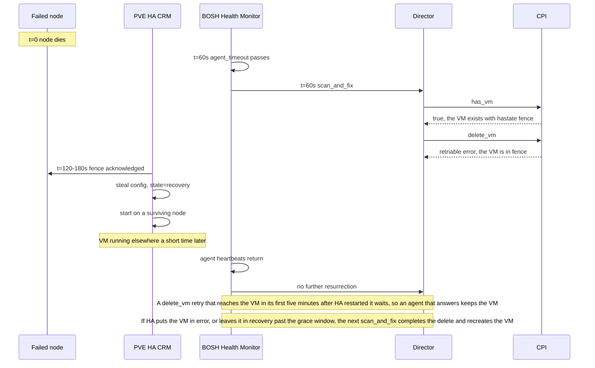

# HA and Resurrection

Two systems can restart a BOSH-managed VM that has stopped responding. PVE HA works at the cluster level, and the BOSH resurrector works at the Director level. This page explains who recovers a VM in each configuration, how the CPI keeps the two from fighting, what the CPI needs from the cluster before it hands a VM to PVE HA, and what we can and cannot promise about data when a node fails.

For the property reference, see [Configuration, HA](configuration.md#ha). For the commands and procedures an operator runs, see [Operations, PVE HA](operations.md#pve-ha).

## Who recovers a VM

PVE HA is the first responder for every VM it manages, and the BOSH resurrector stays on as the fallback. The CPI defers `delete_vm` while PVE HA is fencing or recovering a VM, so the resurrector cannot tear down a guest that PVE HA is about to restart. We no longer ask operators to turn the resurrector off.

| Mode | VM state | First responder | Fallback |
|---|---|---|---|
| `off` | Any | BOSH resurrector, once the VM's node is back or an operator has moved the config | None |
| `auto` or `managed` | Not HA-managed, such as local volumes with `local_policy: none`, or a cluster that failed a prerequisite | BOSH resurrector, once the VM's node is back or an operator has moved the config | None |
| `auto` or `managed` | HA-managed, shared volumes | PVE HA | BOSH resurrector, when HA puts the VM in `error`, or leaves it in recovery past the grace window and the VM meets the [dead-node completion's preconditions](#when-the-grace-window-expires-on-a-dead-node). Otherwise the operator follows [the dead-node procedure](operations.md#the-dead-node-procedure) |
| `auto` or `managed` | HA-managed with `hold` | PVE HA, which restarts the VM in place once the node returns. The CPI holds the resurrector's `delete_vm` until the restarted VM has had time to settle, as [After PVE HA restarts the VM](#after-pve-ha-restarts-the-vm) describes | Operator, because the disks cannot leave the node |
| `auto` or `managed` | HA-managed with `replicate` | PVE HA, onto the partner node | BOSH resurrector, when HA puts the VM in `error`, or leaves it in recovery past the grace window and the VM meets the [dead-node completion's preconditions](#when-the-grace-window-expires-on-a-dead-node). Otherwise the operator follows [the dead-node procedure](operations.md#the-dead-node-procedure) |

With a stock configuration, where `pve.ha.mode` stays at `off`, the CPI never registers a VM as a PVE HA resource. The BOSH resurrector is the only recovery mechanism, and it works as it always has. The CPI still reads HA state in that mode where doing so is safer. It also still handles a VM that is already HA-managed correctly when BOSH deletes it, because PVE routes a stop or a destroy of an HA-managed VM through its HA manager whatever the CPI's mode is.

Setting `pve.ha.mode` to `auto` or `managed` opts VMs into PVE HA. The two modes differ only in how they treat a gap. In `auto` the CPI probes the cluster, does exactly what it can safely do, and falls back to a smaller set of features with a log line when a probe fails or a prerequisite is missing. In `managed` the same probe turns a gap into an error, which suits operators who would rather see a failed deploy than an unprotected VM.

### What the CPI registers

At each `create_vm` the CPI decides whether the VM can run under HA, from its volumes, its devices, and what the cluster profile allows. A VM it registers gets these things.

- **An HA resource**

  The CPI adds the resource as `ignored`, so PVE HA does not start the VM before its confinement exists. It writes the pin and any anti-affinity rule, reads them back, and only then requests `started`. The `bosh-ha-managed` tag marks the VM.

- **A node-affinity pin**

  The rule `bosh-na-<vmid>` holds every node the VM may run on, and its comment records the storages of the VM's volumes. When nothing constrains the VM, the pin is not strict. When the VM's volumes, its CPU type, a PCI device, or a strict AZ narrow the nodes, the pin is strict and names only the nodes that remain. On a cluster with `ha-rebalance-on-start` on, a VM with no constraint gets a pin that is not strict and names only the node the CPI placed it on, so PVE starts the VM there. A VM in an anti-affinity rule is the exception, as the next paragraphs explain.

- **A failback flag**

  The resource's `failback` flag is on when the HA decision registers the VM as shared, which means that every volume the VM holds, its persistent disks included, sits on storage that at least two placeable nodes reach. A `hold` VM, a `replicate` VM, a VM that only one node can take, and any VM with a volume on node-local storage get `failback` off, and so does every VM when `pve.ha.failback` is `false`. [Failback](#failback) explains what PVE does with the flag and when the CPI changes it.

- **An ownership marker**

  Every rule and resource the CPI writes carries a marker in its comment with the Director's UUID. The CPI edits or deletes only objects whose marker matches its own Director, so an operator's resource or another Director's stays untouched.

- **An anti-affinity rule, when it applies**

  With `placement.anti_affinity.enabled` and `pve.ha.anti_affinity` at `auto` or `on`, the members of an instance group join a negative resource-affinity rule named `bosh-aa-<hash12>`. The hash covers the Director UUID, the deployment, and the instance group, so two deployments that both have a `router` group never share a rule.

  PVE refuses a rule that names a VM it does not manage as an HA resource yet, and the Director creates a group's VMs in parallel. So each `create_vm` adds itself to the rule along with the siblings that are already HA resources, and a sibling whose create has not staged its resource yet joins when its own create writes the rule. Every create stages its resource before it reads the resources and plans its write, so of any two siblings the one that staged second sees the other, and the group ends up in one rule without failing any create. Each write carries the digest of the read it was planned from, so a write that a sibling's write overtook is refused and planned again from a fresh read, and a create never removes a member the rule already holds. Under the default `pve.cluster_lock: off` the digest is what keeps the writes apart. A create that is about to drop a member whose guest it didn't find scans the group again first, because a sibling may have joined the rule after the first scan. PVE takes no digest on a rule delete, though, so a writer that leaves a rule with fewer than two members deletes it without that check. A sibling that joined the rule between the delete's read and the delete loses its place. Five writers make such a delete. They are `delete_vm`, the `delete_vm` of a VM on a dead node, the prune that follows when a create falls back to running without HA, the re-add that takes a VM out of its rules, and a create whose plan drops a rule the group no longer needs. Each of them writes the group's rules again from a fresh scan once its delete lands. The repair of a strict pin that a rule write put out of effect can take out a sibling in the same way, because it puts back or rewrites the group's rule from its own read under a fresh digest. So any writer whose repair changed one of a group's rules writes the group's rules again as well, and that write leaves out the VM whose pin the repair kept in effect, since adding it back would put the pin out of effect again. Every write of the group's rules also checks each member it adds against the pins, and it leaves out a member whose join would make the rules conflict, such as a second member whose strict pin allows only the node that another member's pin already needs. Every writer makes that check from the rules it reads, so none of them puts the member back while the conflict lasts, and the first write after its pin goes away or allows more nodes adds it. A create whose own VM would conflict still fails in managed mode, and in auto mode it logs the refusal and runs the VM without HA. With `pve.ha.anti_affinity_overflow: split`, a member whose join would conflict with one of the group's rules is tried in each later rule that has room, and it joins the first one where it fits. It stays out only when every rule with room would conflict, and no new rule opens for it, because a new rule opens only once every rule is full. A rule that already conflicts, which only a change made outside the CPI can cause, takes no sibling at all, because the CPI refuses to write a rule that conflicts whether or not the sibling is the cause. A sibling also tries every rule that already has members before it fills the gap a deleted rule left behind. A sibling that some rule refused never fills such a gap, because it would sit there alone in no rule, so it stays out and the CPI logs it. PVE can also find a conflict that the CPI's check doesn't see. Then the repair of the sibling's pin undoes the create's write, and the create writes the rule again without that sibling, up to four times in all. It logs a warning that names the sibling and its pin, because the sibling is then in no rule of the group until its pin goes away or allows more nodes. After such a repair the create goes on only when the rule its last write placed it in holds its VM, is enabled, and has no error, with or without the rules lock. Otherwise it fails in managed mode, and in auto mode it runs the VM without HA, because a VM never runs under HA without the spread rule it was meant to join. The error says what the last read of that rule showed. When the pin that PVE flags belongs to the create's own VM, the create isn't written again, and the repair has already taken the VM back out of the rule. So the create fails in managed mode, and in auto mode it logs that and runs the VM without HA. An auto create whose four writes run out while a repair still takes its VM out of the rule also runs the VM without HA, and in managed mode that create fails with the last repair's error. That write adds every member that is an HA resource at the time, and it reads the resources again on every attempt, so a member that another `delete_vm` purges meanwhile drops out instead of blocking the write. The group goes without its rule only until that write lands. When the write deletes a rule of its own, or a repair undoes it, the CPI writes the rules again, up to four times in all, in managed mode as in auto mode. A create whose second write fails only logs a warning, because its own place in the rule is already written. With `pve.cluster_lock: pool` the creates and deletes take turns under the CPI's rules lock, and none of this can happen. When PVE still refuses a write, for example because a sibling's create rolled back its resource a moment earlier, the CPI waits a growing backoff of a quarter of a second to about three seconds before it reads the resources and plans the write again. Under the rules lock it releases the lock for that wait as long as it has written nothing yet, so a create that waits doesn't hold up the other rule writes in the cluster. A wait that the request's deadline leaves no room for fails the call with an error the Director retries.

Each VM gets at most one node-affinity rule, because PVE disables both rules when one resource appears in two of them. The CPI builds that one rule from every node constraint that applies. The constraints that remove nodes are hard, and they make the rule strict. The constraints that only express a preference become priorities inside the rule, so a preference can never turn into confinement by being merged with one.

A VM in a resource-affinity rule gets no preference at all. That covers each member that the CPI writes into an anti-affinity group's rule. A VM that has no such rule, such as a member of a group in `skip` mode or a lone member that a `split` plan leaves out of every rule, keeps the ordinary pin with its priorities. PVE refuses a node-affinity rule with several priorities for such a VM and disables both rules, so the CPI gives its pin one priority. A pin that is not strict also names every configured node, because a pin that leaves nodes out behaves like one with two priorities. PVE gives each node the pin leaves out a priority below the nodes it names, and the HA manager picks a VM's candidate nodes from the highest priority among the online nodes before it applies the anti-affinity rule. It never falls back to the lower priority. So when another member of the group runs on the node a one-node pin names, the HA manager has no node left for the VM. A maintenance of the node the VM runs on then cannot move it, and the maintenance never finishes. The pin that names every node lets PVE choose where the VM starts and where it goes, and it keeps every confinement, because a strict pin keeps its nodes.

On a cluster with `ha-rebalance-on-start` on, the flat pin means PVE may start a group member on a node other than the one the CPI placed it on. That is the default, and it is what we want for a member that sets no `target_node`. When the vm_type sets `target_node`, the CPI creates the member on that node and registers its HA resource with `auto-rebalance` off, so PVE's dynamic load balancer leaves it alone after that. That holds even when the dynamic load balancer is on for the cluster or the VM names the DLB sentinel AZ, because `target_node` wins for that VM, and the CPI logs one Info line saying so. The flag doesn't govern `ha-rebalance-on-start`, though. So `target_node` on a group member is a placement hint, because PVE may start the member on another node when that option is on. The CPI writes the flag only when it registers the resource, and a later touch, widen, or `pve-cid ha` run neither rewrites it nor reports it as drift. We can't give such a member a higher priority on its `target_node`, because PVE refuses several priorities for a VM in a resource-affinity rule.

Releases before this change wrote the one-node pin for group members too. The CPI rewrites such a pin when it next plans the VM's anti-affinity group, which happens on every `create_vm` in the group, and when it next writes the VM's pin for an `attach_disk`, a re-registration, or a replica step. It rewrites only pins that carry its own Director's marker. Until then, `pve-cid ha` reports each such pin as a `soft_pin_resource_affinity` advice. To clear one by hand before a maintenance, we add the missing nodes to the pin with `ha-manager rules set node-affinity bosh-na-<vmid> --nodes <node1>,<node2>,<node3>`, listing every node of the cluster.

Under the default `pve.ha.local_policy: none`, a VM with a node-local volume or a PCI passthrough device stays out of HA. Earlier releases registered every PCI VM with a strict pin, and that no longer happens unless `local_policy` is `hold`. A VM that HA would hold on node-local storage gets a full clone of the stemcell, because a linked clone's base template stays on one node. An explicit `clone_mode: linked` keeps the linked clone and runs the VM without HA in `auto` mode, and it fails `create_vm` in `managed` mode.

The DLB features need the same mode. See [DLB-Aware Placement](dlb-aware-placement.md). The earlier `pve.placement` keys for these features are gone, and [Removed placement keys](configuration.md#removed-placement-keys) maps each one to its replacement.

### Failback

PVE 9 gives every HA resource a `failback` flag, and the flag is on when a resource doesn't set it. With the flag on, the HA manager moves a started VM to the best node its rules allow whenever the VM runs anywhere else. The best nodes are the online nodes with the highest priority in the VM's node-affinity rule, once its resource-affinity rules have removed the nodes they forbid. With the flag off, the HA manager keeps the VM on its current node for as long as its rules still allow that node. It makes that check before it looks at the node the VM left for a maintenance, so a VM with `failback` off stays where a drain put it after the maintenance ends, and such a VM also stays where HA recovered it after its old node returns. PVE's documentation says that services move back when a maintenance ends, but the HA manager moves back only a resource with `failback` on.

Failback never takes a VM outside its rules. A strict pin allows only the nodes it names, and an anti-affinity rule removes every node where another member of the group runs, so failback moves a VM only to a node it could start on anyway. A stopped VM never fails back. A pin that names every node with one priority, which is the pin of each member of an anti-affinity group, gives failback no better node to move to. For such a VM, the only move failback makes is the return to the node it left for a maintenance. A pin with priorities, such as a pin that is not strict and names only the node the CPI placed the VM on, moves the VM back to that node once the node is online again.

A shared VM loses nothing when it moves back, because its disks stay where they are and the move is a live migration. Without failback, a rolling maintenance of every node leaves the CPI's VMs on the nodes that came back first, and the node we drain last ends up nearly empty. With failback on, each VM goes back to its node when that node's maintenance ends.

A `replicate` VM keeps `failback` off. After a failover, a move back to the old node would run the reversed replication job at once, and that job's first run receives with `zfs recv -F`, which destroys the writes that existed only on the old node before we can save them. [The replicate data-loss window](#the-replicate-data-loss-window) covers what happens instead. A `hold` VM and every other VM with a volume on node-local storage keep the flag off as well, because only the node the VM runs on holds that volume. A VM that only one node can take keeps the flag off too, because failback has nowhere else to move it. A parker whose disks all sit on shared storage gets the flag on, which changes nothing, because a parker stays stopped and PVE never moves a stopped resource back.

The CPI writes the flag when it registers the resource, and it keeps the flag in step with the VM's volumes after that. `attach_disk` turns the flag off before a disk lands that leaves the VM no longer shared, and it fails with a retriable error when it can't. It turns the flag on after a disk lands that keeps the VM shared. `detach_disk`, `reboot_vm`, and `set_vm_metadata` set the flag that the VM's current volumes call for, so a VM that loses its last node-local volume gets the flag turned on again. Each of them writes only when the flag reads otherwise, and a failure there only logs a warning, because a later call sets the flag again. The CPI changes the flag only on a resource that carries its own Director's marker.

No lock covers both an `attach_disk` and the `set_vm_metadata` or `reboot_vm` that another CPI process runs on the same VM at the same time, so the CPI guards the flag in other ways. A call that turns the flag on reads the HA resource before it reads the VM's config, and it sends the write with that read's digest, so PVE refuses the write when an attach has changed the resource in between. That digest covers every HA resource, so a write to another VM's resource refuses the call's write as well. The call then reads everything again and decides once more, up to four times in all, before it leaves the flag off for a later call. The call leaves alone a resource that the narrowing barrier holds. Once the flag is on, the call reads the VM's config again and turns the flag off when the VM's volumes or its replicate tag changed. For its part, `attach_disk` turns the flag off right before a disk that must not fail back lands, and it checks the flag once more after the disk lands.

When `attach_disk` finds a VM outside the node set that its new disk allows, it asks PVE HA to move the VM into that set first. The VM's pin still names its old placement at that point, so the attach turns `failback` off before the move, or the HA manager would pull the VM straight back to the node the old pin prefers. In the same write, it adds a `bosh-failback-hold=<unix time>` token to the resource's comment. While that token is less than 30 minutes old, no `set_vm_metadata`, `reboot_vm`, or `detach_disk` turns the flag on, and `pve-cid ha` doesn't report the resource, because the attach is still moving the VM. The attach drops the token and turns the flag on again after it has written the pin that names the node the VM moved to. An attach that stops part way leaves the token behind, and the first call after it expires sets the flag.

A manual `ha-manager migrate` of a VM with `failback` on doesn't last when the target node has a lower priority in the VM's pin than another online node, because the HA manager moves the VM back within a round or two. To move such a VM for good, we change its pin rather than migrate it. We keep every node the pin names and give the target node the highest priority, for example with `ha-manager rules set node-affinity bosh-na-<vmid> --nodes <target>:2,<other>:1`. PVE then moves the VM to the target by itself, and the pin keeps the CPI's comment, so the CPI still owns it. For a short move that we expect to undo, we can instead turn the flag off with `ha-manager set vm:<vmid> --failback 0` and then migrate the VM, but the next `set_vm_metadata` or `reboot_vm` turns the flag on again, and the VM then goes back. `pve-cid` only reads the cluster, so it changes neither the pin nor the flag.

Releases before this change registered every resource with `failback` off. Such a VM gets the flag its volumes call for at its next `set_vm_metadata`, `reboot_vm`, `attach_disk`, or `detach_disk`, or when `bosh recreate` creates it again. Until then, `pve-cid ha` reports its resource as `failback_drift` advice. That first call can move a VM at once. When a shared VM runs on a node other than the top-priority node of its pin, PVE live-migrates it to that node as soon as the flag turns on, and any deploy that touches the instance sends a `set_vm_metadata`. To choose when those moves happen, we set `pve.ha.failback: false` before the upgrade, so no call turns the flag on, and during a maintenance window we set it back to `true` or remove it. The next call that touches each VM then turns the flag on.

Setting `pve.ha.failback` to `false` turns the flag off on every resource the CPI writes. That suits an operator who wants VMs to stay where a maintenance put them and who moves them back by hand. The next call that touches each VM writes the new value. The doctor reports each resource whose flag differs from the value the CPI writes as `failback_drift`, and it reports `failback` on for a `replicate` VM as the `failback_on_replica` problem.

### The cluster has to pass the profile first

The CPI probes the cluster before it writes any HA state. It reads the fast-moving facts, such as node health, the watchdog answers, and the QDevice's connection status, live on every call, so those answers are always current. The slow-changing facts can come from a small cache, as "The profile cache and when it is off" below describes. In mode `auto` or `managed` the CPI logs one line at Info level with the result. In mode `off` it skips the probe and logs only `mode=off effective=off` at Debug level, so a stock cluster does not show the line at the default log level.

```
ha: mode=auto effective=full topology=mixed pve=9.2.4 rules=yes crm=master@pve1 quorum=yes votes=3/3 survives_one=yes qdevice=no nodes=3/3 sys_console=yes crs=static rebalance_on_start=no
```

The effective state is `full`, `observe-only`, or `off`. In `observe-only` the CPI reads HA state, filters nodes by health, and defers deletes during recovery, but it registers nothing and writes no rules. The line then carries `reason=` with the first gap it found. The gates are these.

- **Quorum**

  The entry node must be quorate, and the cluster resource manager must have a master with a fresh timestamp. A cluster with no HA resources passes with an idle manager, because PVE's manager goes idle and stops refreshing its timestamp when it has nothing to manage. The profile line then prints `crm=idle`. An idle manager and a stopped one look the same in the manager's status, so the gate also needs the `pve-ha-crm` service to run on the entry node.

- **Survival of one failure**

  The configured votes must survive the loss of any one node. We explain the arithmetic below.

- **PVE 9 or later**

  PVE 9 replaced HA groups with node-affinity and resource-affinity rules, and the CPI writes only rules. Every online node must report PVE 9 or later, and the rules endpoint must answer. A cluster in the middle of an upgrade stays without CPI HA until its last node finishes. The dynamic load balancer needs PVE 9.2. The `auto-rebalance` key of an HA resource arrived with pve-manager 9.1.14, so on PVE 9.0, and on 9.1 before 9.1.14, the CPI leaves the key out of every resource it writes and reads no resource as a DLB VM. [DLB-aware placement](dlb-aware-placement.md) has the details.

- **Sys.Console**

  The token must hold `Sys.Console` on `/`, because every HA write needs it. [PVE API Permissions](pve-api-permissions.md#2-privileges-the-cpi-actually-uses) lists the two tiers of access.

- **Two online nodes**

  At least two nodes must be online.

In `auto`, a failed gate leaves the call running as observe-only. In `managed`, it fails the call with an error that lists every gap.

### The profile cache and when it is off

The slow-changing facts are the node versions and CPU models, the configured votes, the QDevice's configuration, the token's privileges, and the storage definitions. The CPI keeps a copy of them in a file named `ha_profile-<host>-<digest>.json` in the endpoint cache directory, and it answers from that copy for 60 seconds. A call that finds the copy stale, damaged, or written for a different cluster name reads the facts live and writes a new copy. The copy never holds node health, watchdog answers, or the QDevice's connection status, because those must be current. A cache that cannot be used for any reason, such as a refused directory or a busy lock, only makes the call read live, which is correct and slower.

The CPI writes this cache only when the effective discovery mode for the cluster entry is on. An entry whose effective mode is off keeps no profile cache and reads the slow facts live on every call, because that mode promises to write no cache files and a cache only saves reads. The effective mode is off in these cases.

- `pve.api_endpoint_discovery` is `off`.

- The mode is `auto` and the entry lists more than one endpoint.

- The mode is `auto` and the CPI logs in with a password.

- The mode is `on`, the CPI logs in with a password, and `pve.verify_ssl` is false.

- The entry inherits the job's credentials and sets looser TLS than the job.

The recovery episode record in the next section is a different file, and the mode does not switch it off. It is written in every discovery mode, because a missing record would keep a grace window from ever starting.

### Quorum, votes, and the QDevice

PVE HA is only as safe as the quorum behind it. A cluster that loses quorum fences its nodes, and the CPI will not register a VM on a cluster that one more failure would put in that state. The check works on configured votes. A cluster passes when it keeps a majority of its expected votes after the loss of the heaviest node. The expected votes include every vote the QDevice is configured with, whether the QDevice is connected or not, so a configured QDevice that is disconnected or in an unknown state still lets a two-node cluster pass. Only the votes that are present right now decide whether any single node is fragile. Those votes count the QDevice's votes only while it is connected.

Some consequences follow from that arithmetic.

- **A cluster of two nodes**

  Two nodes survive the loss of one only with a QDevice. We accept a two-node cluster with a QDevice, and we recommend three or more nodes for any cluster that runs HA VMs.

- **An even number of voting nodes**

  A cluster with an even number of voting nodes and no QDevice can split evenly, and neither half would hold quorum. The profile line then ends with `advice=add-qdevice(4 voting nodes can split evenly)`. This is a recommendation. It changes nothing else about the line, and the CPI never prints it for an odd number of voting nodes.

- **One failure from losing quorum**

  Even a passing cluster can be one failure from losing quorum, for example when a node is already down. The doctor names the node whose loss would cost quorum, and the watchdog check below applies.

The CPI reads the QDevice from the cluster's QDevice status. An answer with a body that does not state a connection is treated as one configured vote with an unknown status. That vote counts toward the expected votes in the survives-one check, and it does not count as participating. The first lab pass against a real QDevice is the place to confirm the response shape, so treat the QDevice reading as best effort until then.

### Test each node's watchdog before you turn HA on

A node that loses quorum while its local resource manager holds an active HA service stops renewing its watchdog and resets itself. That reset is what lets the quorate side of the cluster treat the node as fenced and recover its services. The cluster resource manager trusts the watchdog completely, so a node whose watchdog is missing, misconfigured, or blocked can keep its guest running after the survivors have recovered that guest elsewhere, and then two writers share one disk. The CPI cannot detect that from the API.

The watchdog is armed only while a node's resource manager counts an active service, and a service that is `stopped`, in `error`, frozen, or waiting to start does not count. The first HA service on a node therefore arms its watchdog. To avoid arming one by surprise, the CPI makes a check at activation. Suppose the cluster is one failure from losing quorum, and a node the VM may start on shows no armed watchdog. In `auto` mode the CPI then removes the staged resource and the VM runs without HA. In `managed` mode the CPI logs a warning that the node will reboot itself if it loses quorum, and it carries on. The check covers every node of the VM's admissible set.

Before we enable HA on a cluster, we test the watchdog of each node with a throwaway VM that is not a BOSH instance. We put the VM under HA on one node, stop corosync on that node, and confirm that the node resets itself and that the survivors start the VM. The node reboots during this drill, so we run it during a maintenance window. We also confirm that the `watchdog-mux` service is running and that the node has a watchdog module loaded, `softdog` by default or a hardware watchdog.

## The timeline of a node failure

PVE fences a node no sooner than about two minutes after it loses quorum, and then the cluster resource manager steals the config and starts the VM elsewhere. The BOSH Health Monitor sees the agent go quiet after its `agent_timeout` (the Director's `hm.intervals.agent_timeout` property), which defaults to 60 seconds, and the resurrector then runs a scan-and-fix that calls `has_vm`, then `delete_vm`, then `create_vm`. Without coordination, the resurrector would start about a minute before PVE HA has even fenced the node. The times in the diagram are estimates from the PVE fencing defaults.



### Set `agent_timeout` above the HA recovery time

We set the Director's `hm.intervals.agent_timeout` property above the time PVE HA takes to recover a VM from a failed node, and we recommend 300 seconds. The CPI neither reads nor checks the property, so it is an operator setting in the Director manifest. When `create_vm` has registered a VM as a PVE HA resource, it logs an Info line that says so and recommends this timeout. It logs the line only after PVE HA has started the VM, so a VM that the HA decision keeps out of HA, or one that runs without HA because its confinement or its node's watchdog failed a check, never gets it, even when `pve.ha.dlb`, `pve.ha.anti_affinity`, or `pve.ha.pin_az` is on. The `manifests/bosh/hm-tuning.yml` ops file in this repository sets 180 seconds, but it also turns the resurrector off for a single-host test deployment, so we don't copy its value into an HA deployment.

PVE HA recovers a VM in two stages. When a node loses quorum, its local resource manager stops renewing the node's watchdog, and the watchdog resets the node about 60 seconds later. The cluster resource manager on the quorate side waits until the failed node's lock has expired, treats the node as fenced, and then starts the node's VMs on the surviving nodes. From the failure to the VM running again takes about two to four minutes. In our node-failure tests in November 2026 it took between 178 and 188 seconds, and a 300-second timeout leaves room above that.

When `agent_timeout` is shorter than the recovery, the Health Monitor reports the instance before PVE HA has finished, and the resurrector starts its scan-and-fix. Its `delete_vm` defers while the VM is in `fence` or `recovery`, as [When `delete_vm` defers](#when-delete_vm-defers) describes. A retry that arrives after PVE HA has started the VM again finds it running. Because the CPI deferred that VM's delete during the outage, the retry waits until the VM has run for five minutes, as [After PVE HA restarts the VM](#after-pve-ha-restarts-the-vm) describes, and the Director's next scan normally finds the agent answering and keeps the VM.

Earlier releases had no such wait. Their retry found an ordinary running VM, so `delete_vm` destroyed the VM that PVE HA had just recovered, and `create_vm` built a replacement. The persistent disk stayed safe on a parker, and the cost was downtime. In one of our tests the Director ran with the default 60-second `agent_timeout`, and fence and recovery took about three minutes. The delete and the recreate that followed kept the instance down for about nine and a half minutes, where a timeout above the recovery time would have had it back after about two and a half.

Raising `agent_timeout` does not cover an outage that outlasts it. When a node stays down for longer than the timeout, as a `hold` VM's node does until someone brings it back, the resurrector's retries are already running when the node returns, and one of them can reach the VM while its guest is still booting. The settle wait covers that case whatever the timeout is. We still recommend 300 seconds, because a timeout above the recovery time spares the deferral loop for the common failure and keeps the Director's task list quiet.

## How the CPI prevents double recovery

Double recovery happens when PVE HA starts the VM on a new node while the resurrector creates a replacement with the same persistent disk attached. The CPI closes it in four places.

- **`has_vm`**

  It never returns false while a VM is in fence or recovery. It answers false only after an absence proof. The proof needs three things to hold. Two clean sweeps of every online node must find the VMID nowhere, PVE must have no HA resource or CRM service for the VMID, and no open allocation journal record may put the VMID on a node the sweeps had to skip. Absence that the CPI cannot prove is a retriable error, never false. If `has_vm` returned false for a VM that PVE HA was recovering, the Director would skip `delete_vm` and go straight to `create_vm`, which is the most dangerous path. A VM that none of those sources ties to an offline node can still read as absent, as it did before. Such a VM is not HA-managed, so PVE never moves it.

- **`delete_vm`**

  It defers with a retriable error in the cases below, and it never removes an HA resource while the resource is in `fence`. Every other path that destroys a VM, which includes the `create_vm` rollbacks and the sweep of unfinished teardowns, goes through the same teardown protocol, so none of them can bypass the rule.

- **`attach_disk`**

  The guard that refuses a second holder of a disk is a retriable error that names the holder's HA state when the holder is in fence or recovery, or when its node is not online. The Director retries rather than failing the deploy.

  When the new disk sits on a storage that the VM's pin doesn't record yet, the CPI requests `ignored` for the VM's HA resource, runs the whole attach, and then requests the state the resource had before. PVE HA doesn't act on an ignored VM, so it won't recover the VM from a node failure during that window. When the disk sits on a parker whose lock another request holds, the attach can spend up to about 235 seconds of that window waiting for the lock, as [A parker lock wait runs out](troubleshooting.md#a-parker-lock-wait-runs-out) explains. That window already holds the attach's waits for HA motion, each of which can take up to `pve.ha.motion_wait_sec`, and any disk move the attach makes, so it could already run for minutes. The lock wait is one more step inside it. With `pve.operation_timeout` on, the attach's time limit bounds the attach and its waits, but not the two steps that close the window. In the first step, the CPI puts the old pin back when the attach failed and changed nothing. In the second, it requests the state the resource had before. Each step runs on a time limit of its own. A step that starts while the call is still running gets the longer of 30 seconds and the time the call has left, and that time has no bound when `pve.operation_timeout` is off. A step that starts after the call has ended gets 30 seconds. When a stop signal such as SIGTERM ends the call while a step runs, that step gets at most 30 more seconds, whether `pve.operation_timeout` is on or not. The CPI finishes the call it is running before it exits, so the window, and the call's answer with it, can run up to about a minute past the time limit or the stop signal. A step that fails, for example because PVE doesn't answer within its 30 seconds, is logged. A pin the CPI couldn't put back stays narrower, which only confines the VM to fewer nodes. A state it couldn't put back leaves the resource `ignored`, with the CPI's marker in its comment, and PVE HA won't recover the VM until a later `attach_disk` to the VM finishes the step and requests that state.

  When the storage allocation journal manages the disk, these HA writes run inside the disk's journal lifecycle, and the journal judges each one against the VM the attach names. It lets a write through only for that VM's pin and that VM's HA resource, and only when they carry this Director's marker. A new pin must be absent, must carry the marker, and must name the VM's resource alone. A change to the VM's HA resource may set its requested state to `started`, `stopped`, or `ignored`, and it may set its comment as long as the marker stays, but it may not delete any setting. It may set `disabled` only when the barrier puts back a resource that was disabled before the barrier held it. The resource must then be `ignored` with the barrier's token naming `disabled`, and the change must drop the token. A removal of the resource must also purge it from the HA rules. The journal refuses anything else before PVE sees it. A refusal doesn't close the disk's lifecycle, so the next call can still write inside it. The attach still fails, though, and a failed attach leaves the disk's record asking for reconciliation, whether the journal refused a write or PVE rejected one. The next call that resolves the disk takes it up again. The journal still refuses to register a VM with HA inside a disk's lifecycle, because a registration also rewrites the VM's tags and description.

  An HA migration that PVE HA had already queued when the CPI requested `ignored` can still move the VM, and it can leave the VM on a node outside the narrower set. That set holds only the nodes that reach every volume of the VM, the new disk included. When the CPI finds the VM on such a node, it changes nothing, puts the resource's requested state back under the old pin, and asks PVE HA to migrate the VM to a node of the set. That is the request `ha-manager migrate` sends, so the CRM moves the VM the way it moves any HA resource, and the VM stays under HA the whole time. The CPI first waits for the VM to settle, so it never sends the request while a migration, a relocation, or a lock is in flight. It picks the online node of the set that the pin ranks highest, and it waits up to `pve.ha.motion_wait_sec` for the VM to run there. The CRM reads its commands at the start of a round, and the first round after the request may have started before it, so the CPI counts the request as dropped only when a second round still leaves the VM where it was. Once the VM runs inside the set, the CPI starts the narrowing again, and it moves the VM at most once in a call. A retry that finds the VM outside the set moves it the same way before it decides anything else.

  When the VM's node is offline, fenced, or gone, no migration can start from it, so the attach fails with a retriable error in every mode and waits for PVE HA to recover the VM or for the node to return. When PVE refuses the move or the move doesn't finish, `managed` mode keeps the VM in HA and fails with a retriable error. In `auto` mode the VM leaves HA only when its node reaches the new disk's storage, because only then can the attach run there, and the CPI logs a warning that names the VM, the set, and the reason. Otherwise `auto` mode also keeps the VM in HA and fails with a retriable error. Each of these errors names the set and a command such as `ha-manager migrate vm:<vmid> <node>` that moves the VM into it. The request needs `Sys.Console` on `/`, like every other HA write. When the storage allocation journal manages the disk, it lets the request through only for the attach's own VM, only while the VM's HA resource carries this Director's marker and requests `started` or `stopped`, and only when the request names a target node.

  When the HA decision for the VM with the new disk is that it gets no HA, as it does for a disk on node-local storage under the default `pve.ha.local_policy: none`, the attach takes the VM out of HA instead. It removes the VM's HA resource, its HA-managed tag, and its pin before the attach begins, so a wait for a parker's lock, like every other wait in the attach, runs while the VM is already out of HA rather than `ignored`. An attach that then fails, including one whose lock wait runs out, leaves the VM out of HA, which is where the decision was taking it anyway. The rerun's decision finds no HA resource and no pin, so it simply attaches the disk. Only `create_vm` registers a VM with HA, so the VM stays out of HA until the Director recreates it.

- **The delete-time foreign-disk step**

  It returns a retriable error instead of detaching when the VM's node is not online or its HA state is fence or recovery, and it never treats a config-missing answer from a node other than the owner as proof that the VM is gone.

### When `delete_vm` defers

`delete_vm` reads the cluster's status once before it does anything else. When the entry node doesn't report the cluster quorate, no quorate entry node can give a view of any VM's HA state, and PVE refuses every write, so the delete defers right away with the unknown-state deferral and a reason that names the node that answered, such as `the entry node pve3 does not report the cluster quorate`. A status read that fails lets the delete carry on. When quorum is lost after that read, and PVE refuses the delete's cluster lock with `no quorum!`, the delete returns the same deferral, because PVE never took the lock. That deferral reads `the entry node does not report the cluster quorate`, because the delete read no status to learn the node's name. In both cases the delete writes nothing to PVE. It records the deferral as [After PVE HA restarts the VM](#after-pve-ha-restarts-the-vm) describes, because the members on the other side of the split may hold quorum and recover the VM. A retry after quorum returns proceeds, unless PVE HA has just restarted the VM, and then it waits for the VM to settle.

The CPI reads one normalized view of the VM's HA state, built from the cluster resource manager's service state and the resource's configured request. It trusts that view only when it is fresh and comes from one quorate entry node. A stale, partial, or mixed view means the state is unknown, and an unknown state defers in every mode. A decision that acts on a live node also needs the node's local resource manager timestamp to be fresh.

The CPI judges how old the manager's timestamps are against a node's clock, and it reads the entry node's clock first. A node that systemd is shutting down can keep answering the API while its own clock read fails with a 500, because `timedatectl` fails once the shutdown starts. The manager status that node serves still comes from the cluster file system, so the view itself is still good. When the entry node answers its clock read with a 5xx, the CPI reads the clock of another member that cluster status lists online, through the same entry node. It tries the manager's master first, because the master wrote the timestamp on its own clock, and then the other members in name order, once each. The walk asks at most the master and two other members, and it stops after about 15 seconds, so a member that accepts the call and never answers cannot hold a decision. The borrowed clock judges the age of the manager's timestamp and of each node's LRM timestamp exactly as the entry node's clock would. The view is unreadable only when none of them answers. A failure to reach the entry node, a 4xx, or an answer that carries no clock never borrows another member's clock. An entry node in a minority partition sees no other member online, so it has no clock to borrow, and the quorum check makes its view unknown anyway. When the CPI borrows a clock, the `ha:` log line ends with `clock=<node>`, which usually means the entry node is shutting down or broken. While the clock is borrowed, the CPI treats the entry node as not placeable for new VMs and migrations, because its LRM reports a shutdown only on its next write, and the node stays a target for reads. `pve-cid ha` reports the borrowed clock as `entry_clock_unreadable`.

An old manager timestamp is not always a stale view. PVE's cluster resource manager goes idle after the cluster has had no HA resources for a while, and an idle manager stops writing its status, so its timestamp keeps the time of its last round for as long as the cluster stays without HA. PVE's own `ha-manager status` reports that manager as idle. The CPI reads the same state as idle when the entry node is quorate, the cluster lists no HA resources, and the manager's last round held no service and no disarm request. Those are the conditions PVE checks before its manager goes idle.

The CPI also needs proof that the entry node's copy of the HA state is current, because a node that has just rejoined the cluster can serve an old copy for a short time. PVE's HA status must report the entry node quorate, the manager idle with the same timestamp, and no HA service. Every online node that the manager's last round knew must report a fresh local resource manager timestamp, and at least one of them must be a node other than the entry node. A one-node cluster or a standalone host has no other copy that could be newer, so there the node's own fresh timestamp is enough. That exception holds only when cluster status lists the entry node alone and the last round knew the entry node and no other, so a cluster status that lists no node never proves the copy current. A node whose `pve-ha-lrm` service is stopped never refreshes its timestamp, so the view stays stale until that service runs again, and the delete's error names the node where we should start it.

No VM is HA-managed on such a cluster, so `delete_vm` proceeds as it does on a cluster without HA. When a resource for the VM appears after the CPI has read the resource list, the CPI treats it as one the manager has not processed yet and waits for motion, unless its requested state is `ignored`. A manager that woke between the reads makes the state unknown, and the delete defers. The delete also defers when the cluster still lists any HA resource, when the resource list cannot be read, when the last round held a service or a disarm request, or when the CPI cannot prove that the entry node's copy is current, because the CPI then treats the old timestamp as a stale view. The table shows what `delete_vm` does for each raw state.

| Raw state | Node | `delete_vm` does |
|---|---|---|
| Not in the CRM's state, and the request is `ignored` | Online | Proceeds, because the CRM never fences or moves an ignored resource |
| Not in the CRM's state, and any other request | Not dead or fenced | Waits for motion, because the CRM has not processed the service yet |
| `stopped`, `started`, or `error` | Online | Proceeds through the teardown protocol. A `started` VM whose delete the CPI deferred for fence or recovery in the last 15 minutes first waits to settle, as [After PVE HA restarts the VM](#after-pve-ha-restarts-the-vm) describes |
| `request_stop`, `request_start`, `request_start_balance`, `migrate`, or `relocate` | Online | Waits for motion |
| `freeze` | Online | Waits for motion, because the LRM is restarting and will unfreeze the service |
| `fence`, or any state while the node is in `fence` | Any | Defers |
| Any state except `recovery`, while the node is dead or fenced, which includes a service that is not in the CRM's state | Dead or fenced | Defers |
| `recovery` | Fenced | Runs the grace window |
| A VM that is not HA-managed | Dead or fenced | Defers, because PVE gives no proof of death for such a node |
| Unknown, which includes a node that is not online but not dead or fenced either, so its state is unusable | Any | Defers |

Waiting for motion and deferring both return a retriable error, and the error text says what the CPI is waiting for. Waiting for motion has a budget, which is `pve.ha.motion_wait_sec`. A defer has no time limit, and the text tells the operator to resolve the fence or bring the node back.

The grace window applies only to a service in `recovery`, which means PVE has fenced the node but has not yet placed the service anywhere. The CPI measures the window from the moment it first saw that recovery episode, not from the last heartbeat, because a long fencing delay could otherwise use up the whole window before HA had its first chance. The service ID together with the CRM's `uid` names an episode, and the CPI records the time it first saw the pair in a small file. A lost or unreadable record restarts the clock, which only delays the handover to BOSH. The window is as long as `pve.ha.motion_wait_sec`, 600 seconds by default. While it runs, PVE HA keeps trying to recover the VM, and the CPI logs the expiry when it comes. A VM whose strict pin admits only the dead node, such as a `hold` VM, cannot be recovered anywhere else. For such a VM the error says that PVE HA restarts it in place once the node returns, and that the delete keeps deferring after the window for the same reason.

The record is `ha-recovery-episodes.json` in the same cache directory as the endpoint cache and the profile cache, and it follows `pve.endpoint_cache_dir` when we set one. Each entry is keyed by the VM's service ID, an at sign, and a 16-character digest of the cluster entry's configured endpoints. The digest sorts the endpoints, gives each an explicit port, and ignores discovery, so a cluster that grows keeps its key, and two entries that reach one cluster through the same endpoints share one. Two clusters that each hold a service with the same ID therefore keep separate entries. The CPI prunes an episode seven days after it first saw it.

Two deletes for VMs on the same fenced node can observe at once, so every change to the record happens under the lock file `ha-recovery-episodes.lock` beside it. An observation that finds its episode already recorded reads without the lock. One that waits more than a second for the lock gives the same answer as an unreadable record, which is that the clock starts at this observation.

When `pve.endpoint_cache_dir` does not exist and the CPI does not create it, the CPI logs a Warn line that names it and the reason, and it records the episode in the next directory that works. When no directory works, the record is not kept, so the grace window never starts and the dead-node handover cannot begin. `pve-cid ha` checks the directory for this, as [Reading the cluster with `pve-cid ha`](operations.md#reading-the-cluster-with-pve-cid-ha) describes.

### When the grace window expires on a dead node

After the window expires, the CPI can finish a `delete_vm` on a dead node, but only for a legacy VM, meaning a VM that the allocation journal does not record. The CPI requests the state `stopped`, which PVE accepts during recovery. It then narrows the VM's pin to a strict rule that names only the live nodes the VM's recorded storages reach, and removes the VM from its anti-affinity rule. The cluster resource manager steals the config onto one of those nodes and, because the request is `stopped`, leaves the VM stopped. The CPI waits for the scan to show it there and runs the normal teardown. It never removes the pin outright, because recovery would then pick any node, including one without the VM's volumes.

This path has preconditions, and a missing one leaves the delete deferring with an error that names it.

- **The mode writes HA state**

  `pve.ha.mode` must be `auto` or `managed`, and the request must carry a `director_uuid`.

- **The token holds Sys.Console**

  The rule edits need it.

- **The VM and its resource are ours**

  The scan must prove this Director owns the VM, and the HA resource must carry this Director's marker. A resource in an HA group is refused, because the CPI cannot narrow a group.

- **The rules can be edited**

  Rules that the CPI does not own and cannot edit must not block the narrowing.

- **A live node reaches every volume**

  The VM's recorded storages must be reachable from at least one online node with a fresh timestamp. A VM with a node-local volume, a `hold` VM, a VM whose pin records no storages, and a VM that the allocation journal records all keep deferring. For a `replicate` VM, the destination is the partner only when its job is this Director's, enabled, and between the dead node and the partner.

For every case the completion does not cover, an operator follows [the dead-node procedure](operations.md#the-dead-node-procedure).

### After PVE HA restarts the VM

The resurrector keeps retrying while a node is down, and each retry's `delete_vm` defers. When the node comes back, PVE HA restarts the VM, either in place or on the node it recovered to, and the guest takes a minute or so to boot. A retry that scanned the agent during that minute still sends `delete_vm`, and by the time it arrives the service reads `started` on a live node. On its own, that state lets the delete proceed, so the VM that PVE HA had just restarted would be destroyed and rebuilt.

The CPI prevents that with a record of its own. Every `delete_vm` that defers an HA-managed VM because it is in `fence`, on a dead or fenced node, or in `recovery` records the time of that deferral. So does every `delete_vm` that defers because the VM's HA state is unknown or the cluster has lost quorum, because PVE HA may be recovering the VM on members the CPI can't see. A record for a VM that turns out not to be HA-managed changes nothing, because only a VM that PVE HA holds `started` waits on it. A later `delete_vm` that finds the service `started` looks for the record. When the last deferral is less than 15 minutes old and the VM has run for less than five minutes, the delete returns a retriable error that stops and destroys nothing. The error says how long ago PVE HA restarted the VM and when a retry will proceed. If the agent answers by then, the Director's next scan finds the instance healthy and sends no delete. If it never answers, the first delete after five minutes of uptime proceeds and the resurrector replaces the VM.

The wait has a hard bound. A settle deferral never refreshes the record, so no delete waits more than 15 minutes after the last recorded deferral, even for a guest that crashes and restarts in a loop. A VM that PVE HA holds `started` but that is not running yet waits too, under the same bound. The five minutes come from the VM's uptime, which the node measures, and the 15 minutes come from the Director's own clock at both ends, so no clock comparison between hosts enters the decision.

The record never slows an ordinary delete. A VM whose delete never deferred, such as one that a failed deploy cleans up seconds after it started, has no record, so its delete reads one small local file and proceeds. A delete clears the record when PVE HA holds the VM stopped, when the record has aged past 15 minutes, when the VM has run past the window, and after the dead-node completion moves the config. A status read that fails while a fresh deferral is recorded defers again, because the stop and the destroy need the same API. A record that cannot be read lets the delete proceed as it did before the record existed. Only `delete_vm` reads or writes the record, so the `create_vm` rollbacks, the sweep of unfinished teardowns, and an operator's storage-journal cleanup never wait.

An operator's `bosh delete-deployment` or `bosh recreate` that reaches such a VM within the window waits as well, and the error says when to run it again. That happens only when the same VM's delete deferred for an outage in the last 15 minutes.

The record is `ha-recovery-deferrals.json` beside the episode record, with the lock `ha-recovery-deferrals.lock`, and it uses the same directory, the same keys, and the same private-file checks. The CPI prunes an entry a day after it was written.

### Clearing an HA error

PVE refuses every state request for a resource in `error` except `disabled`, and `disabled` stops the guest. The CPI therefore chooses by what happens to the VM next.

- **A delete, or a VM that is already stopped**

  The CPI requests `disabled`, waits until the service shows `stopped`, checks on the owner node that the VM is stopped and still ours, and destroys it with `purge`. Without `Sys.Console`, a stopped VM can still be destroyed with `purge`, and a running VM gets a retriable error that names the privilege and the command `ha-manager set vm:<vmid> --state disabled`.

- **A running VM that BOSH keeps**

  `disabled` would stop it, so the CPI removes the resource and registers it again, which leaves the guest running. It marks the work with a `bosh-ha-readd-<unix seconds>` tag until the registration finishes. It does the work only while the VM runs on its own pin, holds no lock, and has no migration, relocation, or disk move task. Without `Sys.Console` it returns a retriable error that names `ha-manager remove vm:<vmid>` followed by `ha-manager add vm:<vmid>`. The VM is unmanaged between the removal and the return to `started`, so a node failure in that window leaves it down until the node returns or the resurrector acts. A crash inside the window extends it until the next call that touches the VM, and the tag keeps it visible to the doctor.

## What happens to the disks

A VM is only as recoverable as its volumes. The CPI computes the VM's access set, which is the intersection of the node sets of every volume the VM holds, including its config-drive ISO and its snapshot and state volumes. It narrows that set by the hardware and network needs placement already enforces. A VM is eligible as shared only when the set holds at least two placeable nodes, and when the set is smaller than the cluster, it joins the pin as a strict constraint. A strict AZ doesn't narrow the set for that check. It narrows the pin after the check, so a VM whose strict AZ holds one node is still eligible as shared, and HA restarts it in place on that node. A later call that decides the VM's eligibility again, such as an `attach_disk` or the re-registration of a VM in the error state, can't read the VM's AZ, so it reads the strict AZ from the VM's strict pin. That call applies the pin after the check, as `create_vm` does, so it reaches the same decision for the same volumes.

### Shared storage

With shared storage, PVE HA moves a VM by live migration or by stealing its config onto a surviving node and starting it there. The disks stay where they are. The CPI re-reads the config after any move, because a rename can change a volume ID, and it resolves persistent disks by their serial. A disk without a stable ID depends on its volume ID, and the CPI warns once per such disk at attach time in `auto` mode.

A cluster whose every volume lives on NFS, such as one backed by a NetApp array, resolves to shared for every VM, so it never reaches the local-disk policies and `local_policy` can stay at `none`. The one volume such a cluster can still get wrong is the config-drive ISO, so `pve.iso_storage` should point at the same shared storage. [ConfigDrive](configdrive.md#migration-and-ha-interaction) explains why.

Parker VMs, which hold persistent disks for stopped instances, are registered as `stopped` HA resources when every disk they hold sits on shared storage that at least two placeable nodes reach. Their config then follows a failover of their node, and because a parker never runs, there is no second writer. A park never puts a disk into a registered parker unless the disk's storage reaches every node of that parker's access set. When the last disk leaves a registered parker, the next parker sweep on its node destroys the parker and its HA resource, once it has proved that the parker is empty, stopped, free of snapshots, and still this Director's. A later park of a disk on node-local storage therefore creates a new parker that PVE HA does not manage, and the empty registered one is gone.

### Local storage

Local disks live on one node. A planned maintenance migration can copy them, but a failure recovery cannot, because the source node is gone. The CPI therefore never registers a local-disk VM for HA without a pin that keeps it where its disks are. The three policies are these.

- **`none`, the default**

  The VM is not HA-managed. HA maintenance mode does not touch it, so it keeps running until the node is rebooted, and then it goes down with the node. After a hard failure, `delete_vm` defers while the node is down, and the resurrector recreates the VM once the node is back. An operator who cannot wait uses the dead-node procedure.

- **`hold`**

  The VM is HA-managed with a strict pin that names only its own node. After a failure, HA waits for the node and restarts the VM in place, which is faster than waiting for the resurrector. HA cannot evacuate such a VM for maintenance, because the pin forbids every other node, so the maintenance request on the node never completes while the VM runs. Operators stop `hold` VMs before node maintenance, as [the maintenance procedure](operations.md#node-maintenance-with-hold-vms) describes. The same wait hits a member of a full anti-affinity group and a `replicate` VM whose pin has not widened, and [the wider maintenance procedure](operations.md#node-maintenance-when-a-vm-cannot-leave-the-node) covers how to find and clear those blockers. Since a `hold` VM never leaves the node it was created on, its anti-affinity spread has to be right when the CPI places it. Parallel creates of an instance group count each other's picks through the spread claims, so two `hold` siblings that the Director creates at the same moment land on different nodes.

- **`replicate`**

  The CPI creates a ZFS storage replication job from the VM's node to a partner node. During maintenance, HA migrates the VM to the partner, and the replica makes that quick. After a hard failure, HA recovers the VM on the partner from the last replica, and every write since the last sync is lost.

  The policy has prerequisites, and a VM that misses one gets no HA. The token needs `VM.Replicate` on `/vms`. Every node-local disk of the VM must sit on a ZFS pool storage that is enabled, is not shared, holds images, and is defined on the VM's node. The volume must not have its replicate flag turned off. A placeable partner node must have a ZFS storage with the same ID, and it must reach the VM's shared volumes. The VM must hold at least one node-local disk, and it must not be a linked clone. Its config-drive ISO must be on shared storage, because replication does not copy a node-local ISO, and a node-local ISO is an error in `managed` mode and when `pve.require_shared_iso_for_ha` is on. A missing prerequisite leaves the VM without HA in `auto` mode, with a warning that names it, and it fails `create_vm` in `managed` mode.

#### The replicate data-loss window

The window runs from the last successful sync, not from the schedule. With the default schedule of every five minutes, a small delta, and a job that keeps succeeding, we expect to lose up to about six minutes of writes on a hard failure. A job that keeps failing makes the window grow without limit, and a failed sync is invisible to BOSH. The doctor does not print the age of the last successful sync or the failure count as fields. It reports a `replica_job_failing` problem when the failure count is above zero, and a `replica_job_stale` problem when the last successful sync is more than twice the schedule old. A schedule it cannot measure, such as a weekday list, gets `replica_schedule_unjudged`. The schedule is only a target. The window applies to hard failures, because a maintenance migration syncs before it moves. BOSH operators may assume a persistent disk never loses data, and a `replicate` VM breaks that assumption, so we state it plainly. PVE replicates only the volumes the VM itself owns. A CPI persistent disk on node-local ZFS pool storage enters the VM by a reassignment, which renames the volume for the VM, so the VM owns it and the job copies it with the VM's other volumes. Such a disk shares the VM's data-loss window, and the pin names the partner again once a sync that covers the disk counts. After a failover the disk's live copy is on the partner, while its CID still names the node the disk was created on. `create_vm` therefore finds a disk on ZFS pool storage by a live search, the same one `attach_disk` and `detach_disk` make, and places the recreated or resurrected VM on the node that holds the live copy. When copies sit on several nodes and the node of the VM or parker that holds the disk doesn't settle which one is live, `create_vm` fails with a retriable error that names the nodes, and it never falls back to the node in the CID, whose copy may be the stale one. A persistent disk on any other node-local storage is never replicated. `create_vm` with such a disk leaves the VM without HA in `auto` mode and fails in `managed` mode, and `attach_disk` refuses it permanently for a VM that already has its job.

After a failover, PVE reverses the replication job so that it runs from the partner back to the old node. The job's next run receives with `zfs recv -F`, which rolls the old node's dataset back to the last common snapshot, so any writes that still existed on the old node's disk are destroyed on that first sync. The CPI registers every `replicate` VM's resource with `failback` off, whatever `pve.ha.failback` says, so the VM stays on the partner when the old node returns. The next `reboot_vm` or `set_vm_metadata` call that touches the VM narrows its pin to the partner alone, and the CPI asks the job to sync from the partner in the same step. The VM then behaves like a `hold` VM on the partner, and the destructive first sync can start at the CPI's next touch of the VM, not only on the job's schedule. When those older writes matter, [the replicate failover procedure](operations.md#replicate-failover-and-the-old-nodes-writes) saves them before the job runs.

A maintenance migration also moves a `replicate` VM to its partner, but it loses nothing. PVE runs a last sync before the move, hands the job's state to the partner, and reverses the job so that it runs back to the old node. The next `reboot_vm` or `set_vm_metadata` call looks for that state before it narrows anything. When this Director's job is enabled and runs from the VM's node back to the old node, the old node is online, and a sync from the VM's node is verified to cover its volumes on the old node, the pin keeps both nodes. The VM's node becomes the source with the higher priority, and the old node becomes the partner. A job that is gone, disabled, marked for removal, or not yet reversed, or an old node that is offline, means a failover, and the pin narrows as described above.

When the job runs back to the old node but no sync from the VM's node is verified yet, the CPI can't tell the migration from a failover. That happens when the job hasn't synced from its new source, reports an error or failures, or lacks a volume on the old node, and when the old node doesn't answer the check. The CPI then takes the safe reading and narrows the pin to the VM's node, and its warning says that it could not tell the two apart. A pin that still named the old node would let HA start the VM there on a copy that may be behind. The narrowing costs nothing lasting, because the next verified sync from the VM's node widens the pin back to the old node.

A verified sync shows only that the old node's copy matches the VM again. It doesn't show how the VM got to the partner, because after a failover whose first reversed sync has already run, the old node's copy matches too. So the CPI also reads the `qmigrate` tasks of the VM on both nodes. A planned migration, whether `qm migrate` or an HA migrate or relocate, leaves a `qmigrate` task on the node it leaves, and an HA recovery leaves none. A task that ended with PVE's `WARNINGS: n` status succeeded, as PVE itself counts it. The CPI calls the move a planned migration only when a `qmigrate` task on the old node succeeded and ended more than five minutes after the pin's last change, no `qmigrate` task on the VM's node succeeded after it, and nothing shows that the VM started outside a migration since the pin's last change. The two tasks come from two node clocks, so a migration away from the VM's node that ended up to five minutes before the arrival counts too. Two migrations closer together than that read as a move that no migration explains, which warns rather than stays silent.

That last check matters because an HA recovery restarts the VM from its replica and leaves no migration task. Suppose a planned migration takes the VM to the partner, the partner fails and HA recovers the VM on the old node, and then the old node fails and HA recovers it on the partner again, all before the CPI touches the VM. The first migration's task is still the latest one, so the task alone would call the move planned, although each recovery may have lost writes. So once a migration task explains the move, the CPI also reads the VM's `qmstart` tasks on both nodes, because PVE runs every start in a `qmstart` task, and an HA recovery starts the VM through it as `root@pam`. Any start on the old node at or after the migration ended means the VM came back there. On the VM's node, the CPI reads the log of each start since the pin's last change or the migration's start, whichever came first, with five minutes allowed for the two clocks. That reaches back before the migration, because an HA recovery to the partner, a migration back to the old node, and then the migration that proves the move leave the recovery's start before that migration. The target of a live migration lists a start of its own inside the migration's window, because it receives the VM with `qm start --migratedfrom`. PVE 9.2 lists that start as `root@pam` with the status `OK`, the same as a recovery start, so the list alone can't tell them apart. The log can. PVE writes `migration listens on` in the log of a start that receives a migration and in no other, so the CPI skips such a start, and any other start counts as a restart. That also covers the incoming starts of an earlier attempt that failed. An offline migration is different. An HA relocation stops the VM, moves it offline, and starts it on the target with a start of its own, so one start inside the window of each migration from the old node, widened by five minutes on each side, is allowed when that migration's log shows that it moved a stopped VM. PVE logs `starting VM <vmid> on remote node` only for a live migration, so that line tells the two kinds apart. A reboot or a manual restart after the migration leaves a start too, and the CPI can't tell it from a recovery, so it warns in that case as well. When the CPI can't read a log it needs, it warns that it couldn't prove a planned migration. One case stays out of reach. When the target lists no start for an offline relocation and the old node lost its record of the recovery start when it failed, a recovery that starts on the VM's node within five minutes of the migration's end looks like the relocation's start. A recovery back and a second recovery to the partner take two fencing rounds, though, and each round waits about two minutes for the failed node's HA lock to expire, so that case is unlikely. The CPI also doesn't warn when an HA recovery takes the VM to the partner and a migration brings it back to the old node before any call touches the VM. The VM then runs on the node its pin names as the source, and the CPI reads no task lists for such a VM.

When the migration task and the start tasks prove a planned migration, the CPI logs no data-loss warning. Otherwise the pin still keeps both nodes, because the old node's copy is current, but the CPI logs a warning. When no migration task exists, the warning says that the VM got there by a failover and that writes made on the old node after its last sync before the failover were lost. When the VM started outside a migration, the warning says that writes made after the last sync before that start were lost if the start was an HA recovery. When the CPI can't read the task lists, the warning says that it couldn't prove a planned migration and that the move may have lost those writes. Reading another user's tasks needs `Sys.Audit` on each node, because PVE runs an HA migration as `root@pam`.

A replication job that exists is not yet a replica HA can recover from. While the job exists but has not copied every current volume, the VM's pin names its own node alone, and it behaves like `hold`. The pin names the partner too only after the job reports a sync that started more than five minutes after the last change to the VM's volumes, with no error, a failure count of zero, and every volume on the partner. While `attach_disk` changes the VM's volumes, the pin records as the last change the latest time the attach could land, which is three times `pve.ha.motion_wait_sec` after the attach starts, or the call's deadline when that comes first. So no sync that starts while the attach runs can count, and once the attach finishes the pin records the time it finished. When another call widens the pin to the partner after the attach has decided, the attach narrows the pin back to the source before it changes the VM, so the widening doesn't fail the attach. The five minutes is a fixed bound on clock skew between the Director and the PVE nodes. The CPI measures no real skew, so a node whose clock runs further off than that can delay or wrongly allow the widening. Before the pin names the partner, the CPI turns `failback` off on the VM's HA resource, and it does the same before a pin swap after a migration keeps both nodes. When that write fails, the pin keeps the VM's own node alone, and a later call tries again, so no pin names a partner while the flag may still be on.

The CPI requests the first sync when it creates the job, and `create_vm` returns without waiting for it. A sync that starts within five minutes of the change cannot count anyway, so every new `replicate` VM leaves `create_vm` on the narrow pin. Three paths widen the pin later, and all three make the same check. A `reboot_vm` or `set_vm_metadata` call on the VM checks it as part of the call. Every CPI call that takes the HA rules lock and succeeds, such as `create_vm`, `delete_vm`, or `attach_disk` on an HA VM, also sweeps this Director's `replicate` VMs after its own work is done, and it widens a pin that a verified sync now covers. And `pve-cid ha --widen-replicas --apply` runs that sweep on demand. The doctor reports the VM as awaiting its first sync until one of them widens the pin. Plan for the first several minutes of a new `replicate` VM to behave like `hold`.

The sweep is best-effort, so it never fails the call that runs it or changes the call's answer, and a sweep that panics is logged and recovered. It lists the cluster's VMs once and reads the HA rules, the replication jobs, and the HA manager's status once each. It then looks only at VMs that carry the `bosh-ha-replica` tag and whose pin carries this Director's marker and still names the source node alone. A pin whose last volume change is less than five minutes old is skipped without a status read, because no sync could count yet. For each VM that is left, the sweep reads the VM's config, makes the ownership check that every VM call makes, and checks that the VM's HA resource carries this Director's marker. It then tries the VM's allocation journal record once and makes the check that `reboot_vm` makes. Before it writes, it tries a claim of its own on the VM's VMID once, and inside the claim it tries the HA rules lock once. The claim has a 12-second lease. A `delete_vm`, `set_vm_metadata`, or `ha_reregister` that waits for the claim waits up to 20 seconds, so it gets the VM inside its own wait even when the process that took the claim died. The rules lock covers only the sweep's last config read and the pin write, so the claim's own PVE calls never hold up the other rule writes in the cluster. Because each lock is tried once, the sweep never waits on a lock, and a VM whose record, VMID, or rules lock another call holds is skipped. Under both locks, the sweep reads the VM's config again and skips the VM when its volumes changed since the sync was verified, and the rule write refuses a pin that changed since the check read it. The sweep starts the pin write only while its claim has more than three seconds of its lease left, and it skips the VM otherwise, so a slow cluster delays a widening rather than failing it. Once the write has started, it runs to the end even when the claim's lease or the sweep's own time runs out, and the sweep reports what the write did. Every other change that could make the widened pin wrong reaches the pin first. The narrowing barrier and a replica rebuild write the pin before they change the VM, and so does an `attach_disk`, which records on the pin the latest time it could land. The sweep also skips a VM that runs away from its pinned node, a VM with a config lock, and a VM whose HA resource is ignored or held by the narrowing barrier. A VM whose HA state is anything other than `started` or `stopped` is skipped too, so a VM that is migrating, relocating, or recovering keeps its pin. A pin that the CPI narrowed after a failover records the narrowing as its last change, so the sweep widens it again only after a sync that started more than five minutes later is verified, as `reboot_vm` would. One sweep widens at most one pin, checks at most three VMs, and reads at most twelve job statuses. It stops after 60 seconds, or sooner when the call's deadline is near, because it sets aside 60 seconds for its lock releases and takes at most half of the time that is left. It doesn't run when that leaves less than 30 seconds, because every lock it takes must leave 15 seconds before its deadline, and it doesn't run after a call that failed. A VM it reaches with too little time left for a lock is skipped with that reason. The next call that takes the lock checks the VMs it skipped or left. The sweep reads the cluster of the first call in the request that took the lock. It logs each widening at Info as `replica widen sweep: widened the VM's pin to its partner`, each VM it could not check at Warn, and a summary line at Info.

A deploy's last `replicate` VMs often finish before any sync can count, and no later call may come for a while. After a deploy that adds `replicate` VMs, we wait until each new job has completed a scheduled sync, which is at least five minutes after its `create_vm`, and then we run `pve-cid ha --widen-replicas --apply` on the Director. [Widening replica pins after a deploy](operations.md#widening-replica-pins-after-a-deploy) shows the command and its output.

Three more facts matter for `replicate`.

- **The partner's capacity is not charged**

  The partner holds a full copy of the VM's volumes, and placement does not reserve that space against the partner. Leave room in the partner's pool, because a pool that fills makes the job fail and the data-loss window grow.

- **Deleting the job**

  `delete_vm` retires the job before it destroys the VM. When the partner is offline, or the job is still there after `pve.ha.motion_wait_sec`, the CPI drops it with `force=1`, which leaves the partner's copy behind as an orphan. It logs the node and the volumes to remove by hand, and the doctor reports them. A job that names no node besides the VM's own is never forced.

- **The journal records the job**

  A `replicate` VM that the allocation journal manages has a `replication` section in its record. Older releases refuse a record with that section, which creates a downgrade hazard that the [changelog](../CHANGELOG.md) names.

### What to expect

| Scenario | Shared disks | Local disks, `none` | Local disks, `hold` | Local disks, `replicate` |
|---|---|---|---|---|
| Node enters maintenance | HA live-migrates the VM with no downtime, within its CPU migration domain when its CPU type is `host` or `max` | The VM keeps running until the node is rebooted, then goes down with it | The VM keeps running, and maintenance never completes until the operator stops the VM | HA migrates the VM to the partner after a sync, with a short downtime |
| Node leaves maintenance | HA moves the VM back with a live migration, because its `failback` is on unless `pve.ha.failback` is `false` | Nothing moves, because the VM never left | Nothing moves, because the VM never left | The VM stays on the partner, because its `failback` is off |
| Node fails hard | HA restarts the VM elsewhere, usually within a few minutes | The VM stays down until the node returns or an operator moves its config | HA restarts the VM in place when the node returns | HA restarts the VM on the partner and loses the writes since the last sync |
| Data loss on a hard failure | None | None, but the disk is unavailable | None, but the VM waits | Everything since the last successful sync, and the old node's newer writes are destroyed on its first sync after it returns |

## Choose a CPU type for HA

The CPI writes `cpu: host` by default. That is the fastest choice, and it is safe on a cluster of identical nodes, because every node then has the same CPU. A live migration of a `host` VM to a node of an older CPU generation can crash the guest, and HA maintenance moves VMs by live migration. When the CPU type is `host` or `max`, the CPI therefore treats the nodes that report the same CPU model and the same flags as the VM's CPU migration domain, and it confines the VM's pin to that domain. A cluster whose nodes all share one model loses nothing. When the domain leaves fewer than two placeable nodes, `auto` gives that VM no HA and logs a warning that names `pve.cpu_type`, and `managed` fails the call with the same text.

We recommend setting `pve.cpu_type` to the newest CPU model that every node of the cluster supports, such as `x86-64-v3` or a named model like `Cascadelake-Server`, with `x86-64-v2-AES` as the floor. Even the floor keeps AES-NI, so TLS-heavy jobs such as routers keep their hardware crypto, and what a VM loses is mainly AVX and AVX2. A VM with a named model keeps the full set of nodes.

HA never moves a VM from one cluster to another, and BOSH never live-migrates a VM between AZs, so CPU differences between the clusters that serve as AZs do not matter. Differences inside one cluster do. Two nodes of one generation can be different SKUs, and when their model strings or their flags differ, they form separate domains, which in a small cluster can leave a `host` VM with too few nodes for HA. Setting `pve.cpu_type` to the named model for that generation joins them into one domain. The CPI never changes the CPU type of an existing VM, so a changed value applies to VMs created afterward. The `pve-cid ha` command prints the cluster's CPU migration domains, so you can see a split and pick the common model.

## Placement under HA

- **The AZ pin**

  With `pve.ha.pin_az` at `auto` or `on` and a non-empty `placement.az_map`, a registered VM's pin includes its AZ's node set. BOSH does not pass the cloud-config AZ name to `create_vm`, so the CPI learns a VM's AZ only from `cloud_properties.availability_zone`, which must name a key of `az_map`. Put it on the AZ's `cloud_properties` so every VM in the AZ receives it. Without it the VM gets no AZ pin, and with `pin_az: on` the CPI warns once per VM. On Proxmox an AZ is a separate cluster or a standalone host, so `az_map` only spreads VMs across the nodes inside one AZ's cluster. See [Multi-Cluster Deployments](multi-cluster.md#per-entry-placement-and-node-spreading).

  ```yaml
  azs:
  - name: z1
    cpi: pve-cluster-a
    cloud_properties:
      availability_zone: z1   # must be a key in pve.placement.az_map
  ```

- **The small-node-set wedge**

  `pve.ha.pin_az_strict` defaults to `true`, so the AZ part of the pin is a hard guarantee. PVE HA will not relocate the VM off its AZ node set even when every node in that set is down. The CPI warns when a strict AZ pin resolves to one or two nodes, because when every pinned node is down or drained at once, PVE HA has nowhere in the AZ left to fail over to, and the VM stays down until a pinned node returns. The VM still runs under HA with its pin, so HA restarts it once a pinned node returns, and an `attach_disk` that adds a disk on shared storage keeps it under HA. The warning advises mapping the AZ to three or more nodes, or setting `pve.ha.pin_az_strict` to `false`. We map each AZ that uses a strict pin to at least three nodes. Setting `pve.ha.pin_az_strict: false` lets HA leave the AZ instead.

- **Full anti-affinity groups**

  A negative rule with more members than the cluster has nodes cannot be satisfied, and PVE disables it silently. `pve.ha.anti_affinity_overflow` decides what the CPI does. The default `skip` writes no rule and logs why, and `split` divides the group into rules that each fit. With `split`, a member that the plan puts alone in a rule is in no rule at all, because a negative rule needs two members. That happens when the group has one member more than its full rules hold, as with four members on three nodes. The create logs a warning that names the member and that rule, and the next member of the group that joins the rule writes it with both. With `skip`, nothing on the PVE side keeps the members apart, so the spread at create time is what keeps them on different nodes. On a cluster with `ha-rebalance-on-start` on, PVE can move a skip-mode VM when it starts, so the spread the CPI chose at placement can be undone. Parallel creates of the group still spread, because each create claims the node it picks whether or not it writes a rule. A group whose size equals the node count fits, but it leaves no legal target for a member whose node fails, so PVE cannot recover that member. It waits in `recovery`, the grace window then hands it to BOSH, and the replacement shares a node with another member until the failed node returns. A group that fills every node gets no anti-affinity protection during a node failure.

- **N+1 headroom**

  A cluster can only absorb a failed node if the survivors have room for its VMs. With `pve.ha.headroom` at `warn`, the default, `create_vm` logs a warning when the VM it places would leave some single-node failure without room, and it places the VM anyway. With `enforce`, it skips nodes that fall short. It refuses the placement with a retriable error when none is left or when it cannot read the estimate, and it never falls back to the configured node. The number is an estimate. It counts only the configured memory of every guest. It ignores host overhead, ballooning, and the order in which the cluster resource manager recovers services, so a cluster that passes can still fail to restart every VM. That is one reason `warn` is the default. The check runs only for a node where the VM would be registered with HA, and only when placement scores the cluster's nodes. See the `pve.ha.headroom` row in [Configuration](configuration.md#ha) for the cases where it does not run. A `replicate` VM is one of them. Its replicated disk pins it to the node that holds the disk, so `create_vm` never estimates headroom for it, and `pve-cid ha` reports the margin with those VMs counted.

- **A pin written while a node was down**

  `create_vm` pins a VM only to nodes that it can show hold every plain bridge the VM's NICs use. When a node is down, its bridge list can't be read, so the pin leaves that node out and `create_vm` logs a warning that names the node and the bridge. The VM therefore never lands on a node that may lack its network. Once the node is back, the next `set_vm_metadata` or `reboot_vm` on the VM reads every online node that the pin leaves out. It gives a node back to the pin when the node lists the VM's bridges and shows every storage the VM's disks use as active, and when the HA decision for the VM's disks, CPU type, PCI devices, and AZ admits it. The CPI widens only a strict pin that carries this Director's marker, on a VM it registered with HA, and it never widens the pin of a `replicate` VM. A deploy that touches the VM is enough to trigger the widening, and `ha-manager rules config` on any node shows the pin's nodes before and after.

- **PCI passthrough**

  PCI passthrough is incompatible with live migration, so a VM with a PCI device stays out of HA under `local_policy: none`. Under `hold` it is registered with a strict pin to its node.

## Sizing a small cluster

A cluster that serves as one AZ needs room on its survivors for the VMs of a failed node. A three-node cluster needs roughly a third of its capacity free, and a five-node cluster needs about a fifth. Size for that before splitting a large cluster into several small ones. The `headroom` field of `pve-cid ha` reports the margin as `headroom=ok(42%)`, or it reads `short(<node>)` or `short(<node>+N)`, which names the first node whose loss leaves a VM with nowhere to go and counts the others. The `headroom_short` findings list each short node.

When several clusters that serve as AZs mount one storage array, an outage of the array takes every AZ down at once, and neither PVE HA nor BOSH can work around it. We treat the array as a shared failure domain, and we recommend a separate array or storage path per AZ where the budget allows. Clusters that mount one export also share a volume namespace, so they need disjoint VMID bands. [Multi-Cluster Deployments](multi-cluster.md#shared-storage-rules) covers that.

## DLB caveats

The Dynamic Load Balancer is one more HA-registering feature, and [DLB-Aware Placement](dlb-aware-placement.md) covers its guard ladder in full. Three points matter for HA ownership.

- **Shared storage is required**

  Live migration needs the root disk, the persistent disks, and the config-drive ISO, which stays at `scsi30` for the VM's whole life, on storage every node reaches. A VM with a node-local volume gets no DLB movement. It is skipped under `local_policy: none`, and it is pinned to its node under `hold` and `replicate`.

- **A multi-node cluster is required**

  PVE HA needs quorum, and we recommend three nodes at least. A single-node cluster fails the profile gate, so the feature stays inert.

- **The Director and bootstrap VMs stay out of HA**

  A `bosh create-env` Director VM that is live-migrated mid-deploy loses its in-flight CPI connections, and the deployment fails. Use a separate `cpi.json` for the `create-env` step that omits the `pve.ha` block or sets `pve.ha.mode: off`.

## Observed timings

We measured these on three-node PVE 9.2.4 clusters, with BOSH instances whose root disk and `scsi30` config-drive ISO sat on shared storage, polled once per second from a surviving node's API. The first two rows come from August and the others from November.

| Failure | Node offline | HA acts | VM running again | Recovered where |
|---|---|---|---|---|
| Abrupt crash (`sysrq-b`), node reboots in about 26 seconds | +8 s | restart in place | +152 s | same node |
| Both of a node's links cut, node stays up | +7 s | services parked in `fence` at +57 s, node reset at +58 s, recovered at +137 s | +147 s | different node |
| Hard power-off of a node | +26 s | fence and recovery at +177 s | +178 s | different node |

None of these runs ever produced a second guest. Five points are worth carrying forward.

A fast reboot never reaches HA failover. The crashed node returned well inside the fence timeout, so the cluster resource manager never fenced it. Recovery was the returning node's own resource manager restarting the VM after it reacquired the agent lock, and that lock wait accounts for most of the 152 seconds.

When the links to a node were cut but the node stayed up, the order of events matched what PVE's fencing depends on. The node lost quorum at +7 s. Its watchdog reset it at +58 s, the cluster resource manager acquired its agent lock and fenced it at +137 s, and the VM ran on another node at +147 s. The node reset itself about 55 seconds before the survivors took its lock, so the old guest was gone before the new one started. An earlier August run of a partition recovered only after an operator restored corosync by hand, and we should not quote its 245 seconds as an unattended failover time.

A power-off of a node recovered in 178 to 188 seconds from the power-off to the VM running on another node, which is where the two to four minutes in the agent timeout section comes from. A VM with replicated local disks restarts from its partner's copy, so it loses the writes made since the last replication sync started. We measured that loss at 40.6 to 103.5 seconds of writes, and each loss stayed inside the time since the last sync began. We should treat the replication interval as the data-loss window.

When every node of a cluster loses quorum at once, each node's resource manager resets its node by itself. In our run every node reset 50 to 90 seconds after quorum was lost. HA had every service started again 18 seconds after the links returned, with each VM restarted in place.

During a partition the guest keeps running on the cut-off node until its watchdog resets the node, while the cluster already considers it lost. That is the widest opening for the double-healing race, and it is why the CPI defers `delete_vm` while a service sits in `fence`. A resurrector without that defer would have built its replacement against an original that was never actually down.

## See also

- [Operations, PVE HA](operations.md#pve-ha)
  This holds the doctor command, the defer runbook, the dead-node procedure, and the maintenance and failover procedures.

- [Configuration, HA](configuration.md#ha)
  This lists every `pve.ha` property.

- [Design Decisions, D11](design-decisions.md#d11-ha-versus-the-bosh-resurrector-warn-document-and-race-test)
  This records how the CPI's approach to the resurrector has changed.

- [DLB-Aware Placement](dlb-aware-placement.md)
  This covers the DLB guard ladder, the CRS cluster option, and the migration prerequisites.

- [ConfigDrive, migration and HA interaction](configdrive.md#migration-and-ha-interaction)
  This explains why the config-drive ISO pool matters for migration and HA recovery.
