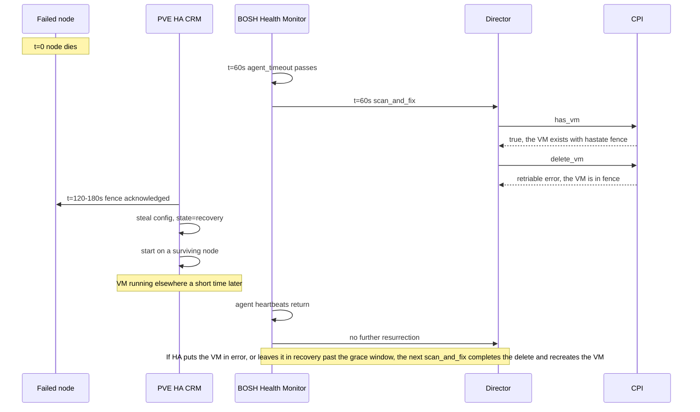

# HA and Resurrection

Two systems can restart a BOSH-managed VM that has stopped responding. PVE HA works at the cluster level, and the BOSH resurrector works at the Director level. This page explains who recovers a VM in each configuration, how the CPI keeps the two from fighting, what the CPI needs from the cluster before it hands a VM to PVE HA, and what we can and cannot promise about data when a node fails.

For the property reference, see [Configuration, HA](configuration.md#ha). For the commands and procedures an operator runs, see [Operations, PVE HA](operations.md#pve-ha).

## Who recovers a VM

PVE HA is the first responder for every VM it manages, and the BOSH resurrector stays on as the fallback. The CPI defers `delete_vm` while PVE HA is fencing or recovering a VM, so the resurrector cannot tear down a guest that PVE HA is about to restart. We no longer ask operators to turn the resurrector off.

| Mode | VM state | First responder | Fallback |
|---|---|---|---|
| `off` | Any | BOSH resurrector, once the VM's node is back or an operator has moved the config | None |
| `auto` or `managed` | Not HA-managed, such as local volumes with `local_policy: none`, or a cluster that failed a prerequisite | BOSH resurrector, once the VM's node is back or an operator has moved the config | None |
| `auto` or `managed` | HA-managed, shared volumes | PVE HA | BOSH resurrector, when HA puts the VM in `error`, or leaves it in recovery past the grace window and the VM meets the [dead-node completion's preconditions](#when-the-grace-window-expires-on-a-dead-node). Otherwise the operator follows [the dead-node procedure](operations.md#the-dead-node-procedure) |
| `auto` or `managed` | HA-managed with `hold` | PVE HA, restart in place only | Operator, because the disks cannot leave the node |
| `auto` or `managed` | HA-managed with `replicate` | PVE HA, onto the partner node | BOSH resurrector, when HA puts the VM in `error`, or leaves it in recovery past the grace window and the VM meets the [dead-node completion's preconditions](#when-the-grace-window-expires-on-a-dead-node). Otherwise the operator follows [the dead-node procedure](operations.md#the-dead-node-procedure) |

With a stock configuration, where `pve.ha.mode` stays at `off`, the CPI never registers a VM as a PVE HA resource. The BOSH resurrector is the only recovery mechanism, and it works as it always has. The CPI still reads HA state in that mode where doing so is safer. It also still handles a VM that is already HA-managed correctly when BOSH deletes it, because PVE routes a stop or a destroy of an HA-managed VM through its HA manager whatever the CPI's mode is.

Setting `pve.ha.mode` to `auto` or `managed` opts VMs into PVE HA. The two modes differ only in how they treat a gap. In `auto` the CPI probes the cluster, does exactly what it can safely do, and falls back to a smaller set of features with a log line when a probe fails or a prerequisite is missing. In `managed` the same probe turns a gap into an error, which suits operators who would rather see a failed deploy than an unprotected VM.

### What the CPI registers

At each `create_vm` the CPI decides whether the VM can run under HA, from its volumes, its devices, and what the cluster profile allows. A VM it registers gets these things.

- **An HA resource**

  The CPI adds the resource as `ignored`, so PVE HA does not start the VM before its confinement exists. It writes the pin and any anti-affinity rule, reads them back, and only then requests `started`. The `bosh-ha-managed` tag marks the VM.

- **A node-affinity pin**

  The rule `bosh-na-<vmid>` holds every node the VM may run on, and its comment records the storages of the VM's volumes. When nothing constrains the VM, the pin is not strict. When the VM's volumes, its CPU type, a PCI device, or a strict AZ narrow the nodes, the pin is strict and names only the nodes that remain.

- **An ownership marker**

  Every rule and resource the CPI writes carries a marker in its comment with the Director's UUID. The CPI edits or deletes only objects whose marker matches its own Director, so an operator's resource or another Director's stays untouched.

- **An anti-affinity rule, when it applies**

  With `placement.anti_affinity.enabled` and `pve.ha.anti_affinity` at `auto` or `on`, the members of an instance group join a negative resource-affinity rule named `bosh-aa-<hash12>`. The hash covers the Director UUID, the deployment, and the instance group, so two deployments that both have a `router` group never share a rule.

Each VM gets at most one node-affinity rule, because PVE disables both rules when one resource appears in two of them. The CPI builds that one rule from every node constraint that applies. The constraints that remove nodes are hard, and they make the rule strict. The constraints that only express a preference become priorities inside the rule, so a preference can never turn into confinement by being merged with one.

Under the default `pve.ha.local_policy: none`, a VM with a node-local volume or a PCI passthrough device stays out of HA. Earlier releases registered every PCI VM with a strict pin, and that no longer happens unless `local_policy` is `hold`. A VM that HA would hold on node-local storage gets a full clone of the stemcell, because a linked clone's base template stays on one node. An explicit `clone_mode: linked` keeps the linked clone and runs the VM without HA in `auto` mode, and it fails `create_vm` in `managed` mode.

The DLB features need the same mode. See [DLB-Aware Placement](dlb-aware-placement.md). The earlier `pve.placement` keys for these features are gone, and [Removed placement keys](configuration.md#removed-placement-keys) maps each one to its replacement.

### The cluster has to pass the profile first

The CPI probes the cluster before it writes any HA state. It reads the fast-moving facts, such as node health, the watchdog answers, and the QDevice's connection status, live on every call, so those answers are always current. The slow-changing facts can come from a small cache, as "The profile cache and when it is off" below describes. In mode `auto` or `managed` the CPI logs one line at Info level with the result. In mode `off` it skips the probe and logs only `mode=off effective=off` at Debug level, so a stock cluster does not show the line at the default log level.

```
ha: mode=auto effective=full topology=mixed pve=9.2.4 rules=yes crm=master@pve1 quorum=yes votes=3/3 survives_one=yes qdevice=no nodes=3/3 sys_console=yes crs=static rebalance_on_start=no
```

The effective state is `full`, `observe-only`, or `off`. In `observe-only` the CPI reads HA state, filters nodes by health, and defers deletes during recovery, but it registers nothing and writes no rules. The line then carries `reason=` with the first gap it found. The gates are these.

- **Quorum**

  The entry node must be quorate, and the cluster resource manager must have a master with a fresh timestamp. A cluster with no HA resources passes with an idle manager, because PVE's manager goes idle and stops refreshing its timestamp when it has nothing to manage. The profile line then prints `crm=idle`. An idle manager and a stopped one look the same in the manager's status, so the gate also needs the `pve-ha-crm` service to run on the entry node.

- **Survival of one failure**

  The configured votes must survive the loss of any one node. We explain the arithmetic below.

- **PVE 9 or later**

  PVE 9 replaced HA groups with node-affinity and resource-affinity rules, and the CPI writes only rules. Every online node must report PVE 9 or later, and the rules endpoint must answer. A cluster in the middle of an upgrade stays without CPI HA until its last node finishes. The dynamic load balancer needs PVE 9.2.

- **Sys.Console**

  The token must hold `Sys.Console` on `/`, because every HA write needs it. [PVE API Permissions](pve-api-permissions.md#2-privileges-the-cpi-actually-uses) lists the two tiers of access.

- **Two online nodes**

  At least two nodes must be online.

In `auto`, a failed gate leaves the call running as observe-only. In `managed`, it fails the call with an error that lists every gap.

### The profile cache and when it is off

The slow-changing facts are the node versions and CPU models, the configured votes, the QDevice's configuration, the token's privileges, and the storage definitions. The CPI keeps a copy of them in a file named `ha_profile-<host>-<digest>.json` in the endpoint cache directory, and it answers from that copy for 60 seconds. A call that finds the copy stale, damaged, or written for a different cluster name reads the facts live and writes a new copy. The copy never holds node health, watchdog answers, or the QDevice's connection status, because those must be current. A cache that cannot be used for any reason, such as a refused directory or a busy lock, only makes the call read live, which is correct and slower.

The CPI writes this cache only when the effective discovery mode for the cluster entry is on. An entry whose effective mode is off keeps no profile cache and reads the slow facts live on every call, because that mode promises to write no cache files and a cache only saves reads. The effective mode is off in these cases.

- `pve.api_endpoint_discovery` is `off`.

- The mode is `auto` and the entry lists more than one endpoint.

- The mode is `auto` and the CPI logs in with a password.

- The mode is `on`, the CPI logs in with a password, and `pve.verify_ssl` is false.

- The entry inherits the job's credentials and sets looser TLS than the job.

The recovery episode record in the next section is a different file, and the mode does not switch it off. It is written in every discovery mode, because a missing record would keep a grace window from ever starting.

### Quorum, votes, and the QDevice

PVE HA is only as safe as the quorum behind it. A cluster that loses quorum fences its nodes, and the CPI will not register a VM on a cluster that one more failure would put in that state. The check works on configured votes. A cluster passes when it keeps a majority of its expected votes after the loss of the heaviest node. The expected votes include every vote the QDevice is configured with, whether the QDevice is connected or not, so a configured QDevice that is disconnected or in an unknown state still lets a two-node cluster pass. Only the votes that are present right now decide whether any single node is fragile. Those votes count the QDevice's votes only while it is connected.

Some consequences follow from that arithmetic.

- **A cluster of two nodes**

  Two nodes survive the loss of one only with a QDevice. We accept a two-node cluster with a QDevice, and we recommend three or more nodes for any cluster that runs HA VMs.

- **An even number of voting nodes**

  A cluster with an even number of voting nodes and no QDevice can split evenly, and neither half would hold quorum. The profile line then ends with `advice=add-qdevice(4 voting nodes can split evenly)`. This is a recommendation. It changes nothing else about the line, and the CPI never prints it for an odd number of voting nodes.

- **One failure from losing quorum**

  Even a passing cluster can be one failure from losing quorum, for example when a node is already down. The doctor names the node whose loss would cost quorum, and the watchdog check below applies.

The CPI reads the QDevice from the cluster's QDevice status. An answer with a body that does not state a connection is treated as one configured vote with an unknown status. That vote counts toward the expected votes in the survives-one check, and it does not count as participating. The first lab pass against a real QDevice is the place to confirm the response shape, so treat the QDevice reading as best effort until then.

### Test each node's watchdog before you turn HA on

A node that loses quorum while its local resource manager holds an active HA service stops renewing its watchdog and resets itself. That reset is what lets the quorate side of the cluster treat the node as fenced and recover its services. The cluster resource manager trusts the watchdog completely, so a node whose watchdog is missing, misconfigured, or blocked can keep its guest running after the survivors have recovered that guest elsewhere, and then two writers share one disk. The CPI cannot detect that from the API.

The watchdog is armed only while a node's resource manager counts an active service, and a service that is `stopped`, in `error`, frozen, or waiting to start does not count. The first HA service on a node therefore arms its watchdog. To avoid arming one by surprise, the CPI makes a check at activation. Suppose the cluster is one failure from losing quorum, and a node the VM may start on shows no armed watchdog. In `auto` mode the CPI then removes the staged resource and the VM runs without HA. In `managed` mode the CPI logs a warning that the node will reboot itself if it loses quorum, and it carries on. The check covers every node of the VM's admissible set.

Before we enable HA on a cluster, we test the watchdog of each node with a throwaway VM that is not a BOSH instance. We put the VM under HA on one node, stop corosync on that node, and confirm that the node resets itself and that the survivors start the VM. The node reboots during this drill, so we run it during a maintenance window. We also confirm that the `watchdog-mux` service is running and that the node has a watchdog module loaded, `softdog` by default or a hardware watchdog.

## The timeline of a node failure

PVE fences a node no sooner than about two minutes after it loses quorum, and then the cluster resource manager steals the config and starts the VM elsewhere. The BOSH Health Monitor sees the agent go quiet after its `agent_timeout` (the Director's `hm.intervals.agent_timeout` property), which defaults to 60 seconds, and the resurrector then runs a scan-and-fix that calls `has_vm`, then `delete_vm`, then `create_vm`. Without coordination, the resurrector would start about a minute before PVE HA has even fenced the node. The times in the diagram are estimates from the PVE fencing defaults.



We recommend that operators who use HA raise the Director's `hm.intervals.agent_timeout` property to 240 seconds or more. The CPI neither reads nor checks the property, so it is an operator setting in the Director manifest. The `manifests/bosh/hm-tuning.yml` ops file in this repository sets 180 seconds, but it also turns the resurrector off for a single-host lab, so we do not copy its value into an HA deployment. A longer timeout lets PVE HA finish most recoveries before the resurrector looks at the VM. The defer in `delete_vm` keeps things safe even if the timeout stays at its default, but a longer timeout means fewer deferred tasks to read.

## How the CPI prevents double recovery

Double recovery happens when PVE HA starts the VM on a new node while the resurrector creates a replacement with the same persistent disk attached. The CPI closes it in four places.

- **`has_vm`**

  It never returns false while a VM is in fence or recovery. It answers false only after an absence proof. The proof needs three things to hold. Two clean sweeps of every online node must find the VMID nowhere, PVE must have no HA resource or CRM service for the VMID, and no open allocation journal record may put the VMID on a node the sweeps had to skip. Absence that the CPI cannot prove is a retriable error, never false. If `has_vm` returned false for a VM that PVE HA was recovering, the Director would skip `delete_vm` and go straight to `create_vm`, which is the most dangerous path. A VM that none of those sources ties to an offline node can still read as absent, as it did before. Such a VM is not HA-managed, so PVE never moves it.

- **`delete_vm`**

  It defers with a retriable error in the cases below, and it never removes an HA resource while the resource is in `fence`. Every other path that destroys a VM, which includes the `create_vm` rollbacks and the sweep of unfinished teardowns, goes through the same teardown protocol, so none of them can bypass the rule.

- **`attach_disk`**

  The guard that refuses a second holder of a disk is a retriable error that names the holder's HA state when the holder is in fence or recovery, or when its node is not online. The Director retries rather than failing the deploy.

  When the new disk sits on a storage that the VM's pin doesn't record yet, the CPI requests `ignored` for the VM's HA resource, runs the whole attach, and then requests the state the resource had before. PVE HA doesn't act on an ignored VM, so it won't recover the VM from a node failure during that window. When the disk sits on a parker whose lock another request holds, the attach can spend up to about 235 seconds of that window waiting for the lock, as [A parker lock wait runs out](troubleshooting.md#a-parker-lock-wait-runs-out) explains. That window already holds the attach's waits for HA motion, each of which can take up to `pve.ha.motion_wait_sec`, and any disk move the attach makes, so it could already run for minutes. The lock wait is one more step inside it. With `pve.operation_timeout` on, the attach's time limit bounds the whole window. When that limit runs out inside the window, the CPI still requests the state the resource had before and puts the old pin back if the attach failed. Those steps run on a time limit of their own, which gives each of them at least 30 seconds, so the VM doesn't stay `ignored` after the call ends.

  When the HA decision for the VM with the new disk is that it gets no HA, as it does for a disk on node-local storage under the default `pve.ha.local_policy: none`, the attach takes the VM out of HA instead. It removes the VM's HA resource, its HA-managed tag, and its pin before the attach begins, so a wait for a parker's lock, like every other wait in the attach, runs while the VM is already out of HA rather than `ignored`. An attach that then fails, including one whose lock wait runs out, leaves the VM out of HA, which is where the decision was taking it anyway. The rerun's decision finds no HA resource and no pin, so it simply attaches the disk. Only `create_vm` registers a VM with HA, so the VM stays out of HA until the Director recreates it.

- **The delete-time foreign-disk step**

  It returns a retriable error instead of detaching when the VM's node is not online or its HA state is fence or recovery, and it never treats a config-missing answer from a node other than the owner as proof that the VM is gone.

### When `delete_vm` defers

The CPI reads one normalized view of the VM's HA state, built from the cluster resource manager's service state and the resource's configured request. It trusts that view only when it is fresh and comes from one quorate entry node. A stale, partial, or mixed view means the state is unknown, and an unknown state defers in every mode. A decision that acts on a live node also needs the node's local resource manager timestamp to be fresh.

An old manager timestamp is not always a stale view. PVE's cluster resource manager goes idle after the cluster has had no HA resources for a while, and an idle manager stops writing its status, so its timestamp keeps the time of its last round for as long as the cluster stays without HA. PVE's own `ha-manager status` reports that manager as idle. The CPI reads the same state as idle when the entry node is quorate, the cluster lists no HA resources, and the manager's last round held no service and no disarm request. Those are the conditions PVE checks before its manager goes idle.

The CPI also needs proof that the entry node's copy of the HA state is current, because a node that has just rejoined the cluster can serve an old copy for a short time. PVE's HA status must report the entry node quorate, the manager idle with the same timestamp, and no HA service. Every online node that the manager's last round knew must report a fresh local resource manager timestamp, and at least one of them must be a node other than the entry node. A one-node cluster or a standalone host has no other copy that could be newer, so there the node's own fresh timestamp is enough. That exception holds only when cluster status lists the entry node alone and the last round knew the entry node and no other, so a cluster status that lists no node never proves the copy current. A node whose `pve-ha-lrm` service is stopped never refreshes its timestamp, so the view stays stale until that service runs again, and the delete's error names the node where we should start it.

No VM is HA-managed on such a cluster, so `delete_vm` proceeds as it does on a cluster without HA. When a resource for the VM appears after the CPI has read the resource list, the CPI treats it as one the manager has not processed yet and waits for motion, unless its requested state is `ignored`. A manager that woke between the reads makes the state unknown, and the delete defers. The delete also defers when the cluster still lists any HA resource, when the resource list cannot be read, when the last round held a service or a disarm request, or when the CPI cannot prove that the entry node's copy is current, because the CPI then treats the old timestamp as a stale view. The table shows what `delete_vm` does for each raw state.

| Raw state | Node | `delete_vm` does |
|---|---|---|
| Not in the CRM's state, and the request is `ignored` | Online | Proceeds, because the CRM never fences or moves an ignored resource |
| Not in the CRM's state, and any other request | Not dead or fenced | Waits for motion, because the CRM has not processed the service yet |
| `stopped`, `started`, or `error` | Online | Proceeds through the teardown protocol |
| `request_stop`, `request_start`, `request_start_balance`, `migrate`, or `relocate` | Online | Waits for motion |
| `freeze` | Online | Waits for motion, because the LRM is restarting and will unfreeze the service |
| `fence`, or any state while the node is in `fence` | Any | Defers |
| Any state except `recovery`, while the node is dead or fenced, which includes a service that is not in the CRM's state | Dead or fenced | Defers |
| `recovery` | Fenced | Runs the grace window |
| A VM that is not HA-managed | Dead or fenced | Defers, because PVE gives no proof of death for such a node |
| Unknown, which includes a node that is not online but not dead or fenced either, so its state is unusable | Any | Defers |

Waiting for motion and deferring both return a retriable error, and the error text says what the CPI is waiting for. Waiting for motion has a budget, which is `pve.ha.motion_wait_sec`. A defer has no time limit, and the text tells the operator to resolve the fence or bring the node back.

The grace window applies only to a service in `recovery`, which means PVE has fenced the node but has not yet placed the service anywhere. The CPI measures the window from the moment it first saw that recovery episode, not from the last heartbeat, because a long fencing delay could otherwise use up the whole window before HA had its first chance. The service ID together with the CRM's `uid` names an episode, and the CPI records the time it first saw the pair in a small file. A lost or unreadable record restarts the clock, which only delays the handover to BOSH. The window is as long as `pve.ha.motion_wait_sec`, 600 seconds by default. While it runs, PVE HA keeps trying to recover the VM, and the CPI logs the expiry when it comes.

The record is `ha-recovery-episodes.json` in the same cache directory as the endpoint cache and the profile cache, and it follows `pve.endpoint_cache_dir` when we set one. Each entry is keyed by the VM's service ID, an at sign, and a 16-character digest of the cluster entry's configured endpoints. The digest sorts the endpoints, gives each an explicit port, and ignores discovery, so a cluster that grows keeps its key, and two entries that reach one cluster through the same endpoints share one. Two clusters that each hold a service with the same ID therefore keep separate entries. The CPI prunes an episode seven days after it first saw it.

Two deletes for VMs on the same fenced node can observe at once, so every change to the record happens under the lock file `ha-recovery-episodes.lock` beside it. An observation that finds its episode already recorded reads without the lock. One that waits more than a second for the lock gives the same answer as an unreadable record, which is that the clock starts at this observation.

When `pve.endpoint_cache_dir` does not exist and the CPI does not create it, the CPI logs a Warn line that names it and the reason, and it records the episode in the next directory that works. When no directory works, the record is not kept, so the grace window never starts and the dead-node handover cannot begin. `pve-cid ha` checks the directory for this, as [Reading the cluster with `pve-cid ha`](operations.md#reading-the-cluster-with-pve-cid-ha) describes.

### When the grace window expires on a dead node

After the window expires, the CPI can finish a `delete_vm` on a dead node, but only for a legacy VM, meaning a VM that the allocation journal does not record. The CPI requests the state `stopped`, which PVE accepts during recovery. It then narrows the VM's pin to a strict rule that names only the live nodes the VM's recorded storages reach, and removes the VM from its anti-affinity rule. The cluster resource manager steals the config onto one of those nodes and, because the request is `stopped`, leaves the VM stopped. The CPI waits for the scan to show it there and runs the normal teardown. It never removes the pin outright, because recovery would then pick any node, including one without the VM's volumes.

This path has preconditions, and a missing one leaves the delete deferring with an error that names it.

- **The mode writes HA state**

  `pve.ha.mode` must be `auto` or `managed`, and the request must carry a `director_uuid`.

- **The token holds Sys.Console**

  The rule edits need it.

- **The VM and its resource are ours**

  The scan must prove this Director owns the VM, and the HA resource must carry this Director's marker. A resource in an HA group is refused, because the CPI cannot narrow a group.

- **The rules can be edited**

  Rules that the CPI does not own and cannot edit must not block the narrowing.

- **A live node reaches every volume**

  The VM's recorded storages must be reachable from at least one online node with a fresh timestamp. A VM with a node-local volume, a `hold` VM, a VM whose pin records no storages, and a VM that the allocation journal records all keep deferring. For a `replicate` VM, the destination is the partner only when its job is this Director's, enabled, and between the dead node and the partner.

For every case the completion does not cover, an operator follows [the dead-node procedure](operations.md#the-dead-node-procedure).

### Clearing an HA error

PVE refuses every state request for a resource in `error` except `disabled`, and `disabled` stops the guest. The CPI therefore chooses by what happens to the VM next.

- **A delete, or a VM that is already stopped**

  The CPI requests `disabled`, waits until the service shows `stopped`, checks on the owner node that the VM is stopped and still ours, and destroys it with `purge`. Without `Sys.Console`, a stopped VM can still be destroyed with `purge`, and a running VM gets a retriable error that names the privilege and the command `ha-manager set vm:<vmid> --state disabled`.

- **A running VM that BOSH keeps**

  `disabled` would stop it, so the CPI removes the resource and registers it again, which leaves the guest running. It marks the work with a `bosh-ha-readd-<unix seconds>` tag until the registration finishes. It does the work only while the VM runs on its own pin, holds no lock, and has no migration, relocation, or disk move task. Without `Sys.Console` it returns a retriable error that names `ha-manager remove vm:<vmid>` followed by `ha-manager add vm:<vmid>`. The VM is unmanaged between the removal and the return to `started`, so a node failure in that window leaves it down until the node returns or the resurrector acts. A crash inside the window extends it until the next call that touches the VM, and the tag keeps it visible to the doctor.

## What happens to the disks

A VM is only as recoverable as its volumes. The CPI computes the VM's access set, which is the intersection of the node sets of every volume the VM holds, including its config-drive ISO and its snapshot and state volumes. It narrows that set by the hardware and network needs placement already enforces. A VM is eligible as shared only when the set holds at least two placeable nodes, and when the set is smaller than the cluster, it joins the pin as a strict constraint.

### Shared storage

With shared storage, PVE HA moves a VM by live migration or by stealing its config onto a surviving node and starting it there. The disks stay where they are. The CPI re-reads the config after any move, because a rename can change a volume ID, and it resolves persistent disks by their serial. A disk without a stable ID depends on its volume ID, and the CPI warns once per such disk at attach time in `auto` mode.

A cluster whose every volume lives on NFS, such as one backed by a NetApp array, resolves to shared for every VM, so it never reaches the local-disk policies and `local_policy` can stay at `none`. The one volume such a cluster can still get wrong is the config-drive ISO, so `pve.iso_storage` should point at the same shared storage. [ConfigDrive](configdrive.md#migration-and-ha-interaction) explains why.

Parker VMs, which hold persistent disks for stopped instances, are registered as `stopped` HA resources when every disk they hold sits on shared storage that at least two placeable nodes reach. Their config then follows a failover of their node, and because a parker never runs, there is no second writer. A park never puts a disk into a registered parker unless the disk's storage reaches every node of that parker's access set.

### Local storage

Local disks live on one node. A planned maintenance migration can copy them, but a failure recovery cannot, because the source node is gone. The CPI therefore never registers a local-disk VM for HA without a pin that keeps it where its disks are. The three policies are these.

- **`none`, the default**

  The VM is not HA-managed. HA maintenance mode does not touch it, so it keeps running until the node is rebooted, and then it goes down with the node. After a hard failure, `delete_vm` defers while the node is down, and the resurrector recreates the VM once the node is back. An operator who cannot wait uses the dead-node procedure.

- **`hold`**

  The VM is HA-managed with a strict pin that names only its own node. After a failure, HA waits for the node and restarts the VM in place, which is faster than waiting for the resurrector. HA cannot evacuate such a VM for maintenance, because the pin forbids every other node, so the maintenance request on the node never completes while the VM runs. Operators stop `hold` VMs before node maintenance, as [the maintenance procedure](operations.md#node-maintenance-with-hold-vms) describes.

- **`replicate`**

  The CPI creates a ZFS storage replication job from the VM's node to a partner node. During maintenance, HA migrates the VM to the partner, and the replica makes that quick. After a hard failure, HA recovers the VM on the partner from the last replica, and every write since the last sync is lost.

  The policy has prerequisites, and a VM that misses one gets no HA. The token needs `VM.Replicate` on `/vms`. Every node-local disk of the VM must sit on a ZFS pool storage that is enabled, is not shared, holds images, and is defined on the VM's node. The volume must not have its replicate flag turned off. A placeable partner node must have a ZFS storage with the same ID, and it must reach the VM's shared volumes. The VM must hold at least one node-local disk, and it must not be a linked clone. Its config-drive ISO must be on shared storage, because replication does not copy a node-local ISO, and a node-local ISO is an error in `managed` mode and when `pve.require_shared_iso_for_ha` is on. A missing prerequisite leaves the VM without HA in `auto` mode, with a warning that names it, and it fails `create_vm` in `managed` mode.

#### The replicate data-loss window

The window runs from the last successful sync, not from the schedule. With the default schedule of every five minutes, a small delta, and a job that keeps succeeding, we expect to lose up to about six minutes of writes on a hard failure. A job that keeps failing makes the window grow without limit, and a failed sync is invisible to BOSH. The doctor does not print the age of the last successful sync or the failure count as fields. It reports a `replica_job_failing` problem when the failure count is above zero, and a `replica_job_stale` problem when the last successful sync is more than twice the schedule old. A schedule it cannot measure, such as a weekday list, gets `replica_schedule_unjudged`. The schedule is only a target. The window applies to hard failures, because a maintenance migration syncs before it moves. BOSH operators may assume a persistent disk never loses data, and a `replicate` VM breaks that assumption, so we state it plainly. A CPI persistent disk on node-local storage is not replicated at all, because PVE replicates only the volumes the VM itself owns, and a VM that holds one keeps its pin on its own node.

After a failover, PVE reverses the replication job so that it runs from the partner back to the old node. The job's next run receives with `zfs recv -F`, which rolls the old node's dataset back to the last common snapshot, so any writes that still existed on the old node's disk are destroyed on that first sync. Every resource the CPI registers has `failback` set to 0, so the VM stays on the partner when the old node returns. The next `reboot_vm` or `set_vm_metadata` call that touches the VM narrows its pin to the partner alone, and the CPI asks the job to sync from the partner in the same step. The VM then behaves like a `hold` VM on the partner, and the destructive first sync can start at the CPI's next touch of the VM, not only on the job's schedule. When those older writes matter, [the replicate failover procedure](operations.md#replicate-failover-and-the-old-nodes-writes) saves them before the job runs.

A replication job that exists is not yet a replica HA can recover from. While the job exists but has not copied every current volume, the VM's pin names its own node alone, and it behaves like `hold`. The pin names the partner too only after the job reports a sync that started more than five minutes after the last change to the VM's volumes, with no error, a failure count of zero, and every volume on the partner. The five minutes is a fixed bound on clock skew between the Director and the PVE nodes. The CPI measures no real skew, so a node whose clock runs further off than that can delay or wrongly allow the widening.

The CPI requests the first sync when it creates the job, and `create_vm` returns without waiting for it. A sync that starts within five minutes of the change cannot count anyway. The VM therefore stays on the narrow pin until a later `reboot_vm` or `set_vm_metadata` call finds a verified sync and widens the pin, and the doctor reports the VM as awaiting its first sync until then. Plan for the first several minutes of a new `replicate` VM to behave like `hold`.

Three more facts matter for `replicate`.

- **The partner's capacity is not charged**

  The partner holds a full copy of the VM's volumes, and placement does not reserve that space against the partner. Leave room in the partner's pool, because a pool that fills makes the job fail and the data-loss window grow.

- **Deleting the job**

  `delete_vm` retires the job before it destroys the VM. When the partner is offline, or the job is still there after `pve.ha.motion_wait_sec`, the CPI drops it with `force=1`, which leaves the partner's copy behind as an orphan. It logs the node and the volumes to remove by hand, and the doctor reports them. A job that names no node besides the VM's own is never forced.

- **The journal records the job**

  A `replicate` VM that the allocation journal manages has a `replication` section in its record. Older releases refuse a record with that section, which creates a downgrade hazard that the [changelog](../CHANGELOG.md) names.

### What to expect

| Scenario | Shared disks | Local disks, `none` | Local disks, `hold` | Local disks, `replicate` |
|---|---|---|---|---|
| Node enters maintenance | HA live-migrates the VM with no downtime, within its CPU migration domain when its CPU type is `host` or `max` | The VM keeps running until the node is rebooted, then goes down with it | The VM keeps running, and maintenance never completes until the operator stops the VM | HA migrates the VM to the partner after a sync, with a short downtime |
| Node fails hard | HA restarts the VM elsewhere, usually within a few minutes | The VM stays down until the node returns or an operator moves its config | HA restarts the VM in place when the node returns | HA restarts the VM on the partner and loses the writes since the last sync |
| Data loss on a hard failure | None | None, but the disk is unavailable | None, but the VM waits | Everything since the last successful sync, and the old node's newer writes are destroyed on its first sync after it returns |

## Choose a CPU type for HA

The CPI writes `cpu: host` by default. That is the fastest choice, and it is safe on a cluster of identical nodes, because every node then has the same CPU. A live migration of a `host` VM to a node of an older CPU generation can crash the guest, and HA maintenance moves VMs by live migration. When the CPU type is `host` or `max`, the CPI therefore treats the nodes that report the same CPU model and the same flags as the VM's CPU migration domain, and it confines the VM's pin to that domain. A cluster whose nodes all share one model loses nothing. When the domain leaves fewer than two placeable nodes, `auto` gives that VM no HA and logs a warning that names `pve.cpu_type`, and `managed` fails the call with the same text.

We recommend setting `pve.cpu_type` to the newest CPU model that every node of the cluster supports, such as `x86-64-v3` or a named model like `Cascadelake-Server`, with `x86-64-v2-AES` as the floor. Even the floor keeps AES-NI, so TLS-heavy jobs such as routers keep their hardware crypto, and what a VM loses is mainly AVX and AVX2. A VM with a named model keeps the full set of nodes.

HA never moves a VM from one cluster to another, and BOSH never live-migrates a VM between AZs, so CPU differences between the clusters that serve as AZs do not matter. Differences inside one cluster do. Two nodes of one generation can be different SKUs, and when their model strings or their flags differ, they form separate domains, which in a small cluster can leave a `host` VM with too few nodes for HA. Setting `pve.cpu_type` to the named model for that generation joins them into one domain. The CPI never changes the CPU type of an existing VM, so a changed value applies to VMs created afterward. The `pve-cid ha` command prints the cluster's CPU migration domains, so you can see a split and pick the common model.

## Placement under HA

- **The AZ pin**

  With `pve.ha.pin_az` at `auto` or `on` and a non-empty `placement.az_map`, a registered VM's pin includes its AZ's node set. BOSH does not pass the cloud-config AZ name to `create_vm`, so the CPI learns a VM's AZ only from `cloud_properties.availability_zone`, which must name a key of `az_map`. Put it on the AZ's `cloud_properties` so every VM in the AZ receives it. Without it the VM gets no AZ pin, and with `pin_az: on` the CPI warns once per VM. On Proxmox an AZ is a separate cluster or a standalone host, so `az_map` only spreads VMs across the nodes inside one AZ's cluster. See [Multi-Cluster Deployments](multi-cluster.md#per-entry-placement-and-node-spreading).

  ```yaml
  azs:
  - name: z1
    cpi: pve-cluster-a
    cloud_properties:
      availability_zone: z1   # must be a key in pve.placement.az_map
  ```

- **The small-node-set wedge**

  `pve.ha.pin_az_strict` defaults to `true`, so the AZ part of the pin is a hard guarantee. PVE HA will not relocate the VM off its AZ node set even when every node in that set is down. The CPI warns when a strict AZ pin resolves to one or two nodes, because when every pinned node is down or drained at once, PVE HA has nowhere in the AZ left to fail over to, and the VM stays down until a pinned node returns. The warning advises mapping the AZ to three or more nodes, or setting `pve.ha.pin_az_strict` to `false`. We map each AZ that uses a strict pin to at least three nodes. Setting `pve.ha.pin_az_strict: false` lets HA leave the AZ instead.

- **Full anti-affinity groups**

  A negative rule with more members than the cluster has nodes cannot be satisfied, and PVE disables it silently. `pve.ha.anti_affinity_overflow` decides what the CPI does. The default `skip` writes no rule and logs why, and `split` divides the group into rules that each fit. A group whose size equals the node count fits, but it leaves no legal target for a member whose node fails, so PVE cannot recover that member. It waits in `recovery`, the grace window then hands it to BOSH, and the replacement shares a node with another member until the failed node returns. A group that fills every node gets no anti-affinity protection during a node failure.

- **N+1 headroom**

  A cluster can only absorb a failed node if the survivors have room for its VMs. With `pve.ha.headroom` at `warn`, the default, `create_vm` logs a warning when the VM it places would leave some single-node failure without room, and it places the VM anyway. With `enforce`, it skips nodes that fall short. It refuses the placement with a retriable error when none is left or when it cannot read the estimate, and it never falls back to the configured node. The number is an estimate. It counts only the configured memory of every guest. It ignores host overhead, ballooning, and the order in which the cluster resource manager recovers services, so a cluster that passes can still fail to restart every VM. That is one reason `warn` is the default. The check runs only for a node where the VM would be registered with HA, and only when placement scores the cluster's nodes. See the `pve.ha.headroom` row in [Configuration](configuration.md#ha) for the cases where it does not run.

- **PCI passthrough**

  PCI passthrough is incompatible with live migration, so a VM with a PCI device stays out of HA under `local_policy: none`. Under `hold` it is registered with a strict pin to its node.

## Sizing a small cluster

A cluster that serves as one AZ needs room on its survivors for the VMs of a failed node. A three-node cluster needs roughly a third of its capacity free, and a five-node cluster needs about a fifth. Size for that before splitting a large cluster into several small ones. The `headroom` field of `pve-cid ha` reports the margin as `headroom=ok(42%)`, or it reads `short(<node>)` or `short(<node>+N)`, which names the first node whose loss leaves a VM with nowhere to go and counts the others. The `headroom_short` findings list each short node.

When several clusters that serve as AZs mount one storage array, an outage of the array takes every AZ down at once, and neither PVE HA nor BOSH can work around it. We treat the array as a shared failure domain, and we recommend a separate array or storage path per AZ where the budget allows. Clusters that mount one export also share a volume namespace, so they need disjoint VMID bands. [Multi-Cluster Deployments](multi-cluster.md#shared-storage-rules) covers that.

## DLB caveats

The Dynamic Load Balancer is one more HA-registering feature, and [DLB-Aware Placement](dlb-aware-placement.md) covers its guard ladder in full. Three points matter for HA ownership.

- **Shared storage is required**

  Live migration needs the root disk, the persistent disks, and the config-drive ISO, which stays at `scsi30` for the VM's whole life, on storage every node reaches. A VM with a node-local volume gets no DLB movement. It is skipped under `local_policy: none`, and it is pinned to its node under `hold` and `replicate`.

- **A multi-node cluster is required**

  PVE HA needs quorum, and we recommend three nodes at least. A single-node cluster fails the profile gate, so the feature stays inert.

- **The Director and bootstrap VMs stay out of HA**

  A `bosh create-env` Director VM that is live-migrated mid-deploy loses its in-flight CPI connections, and the deployment fails. Use a separate `cpi.json` for the `create-env` step that omits the `pve.ha` block or sets `pve.ha.mode: off`.

## Observed timings

We measured these on 2026-08-04 on a three-node PVE 9.2.4 cluster (`lab-pve-cpi-az2`), with one BOSH instance whose root disk and `scsi30` config-drive ISO sat on shared NFS, polled once per second from a surviving node's API.

| Failure | Node offline | HA acts | VM running again | Recovered where |
|---|---|---|---|---|
| Abrupt crash (`sysrq-b`), node reboots in about 26 seconds | +8 s | restart in place | +152 s | same node |
| Sustained partition (corosync stopped), node stays up | +2 s | service parked in `fence` | +245 s | different node |

Neither run ever produced a second guest. Three points are worth carrying forward.

A fast reboot never reaches HA failover. The crashed node returned well inside the fence timeout, so the cluster resource manager never fenced it. Recovery was the returning node's own resource manager restarting the VM after it reacquired the agent lock, and that lock wait accounts for most of the 152 seconds.

The partition run recovered only after an operator restored corosync by hand. We have not proved why the node's watchdog did not end the partition sooner. A node whose local resource manager holds active services and loses quorum should stop renewing its watchdog and reset, and the survivors' resource manager should then treat the node as fenced once its agent lock expires. PVE's own documentation puts a fence at three to five minutes after the loss of quorum, so the run most likely ended before the watchdog fired, but this is a guess. The 245 seconds therefore measures operator-assisted recovery. It is not an unattended failover time, and we should not quote it as one. The lesson is the one in the watchdog section above, which is to test each node's watchdog before relying on HA.

For roughly six minutes in that run the guest was still running on the partitioned node while the cluster considered it lost. That is the widest opening for the double-healing race, and it is why the CPI defers `delete_vm` while a service sits in `fence`. A resurrector without that defer would have built its replacement against an original that was never actually down.

## See also

- [Operations, PVE HA](operations.md#pve-ha)
  This holds the doctor command, the defer runbook, the dead-node procedure, and the maintenance and failover procedures.

- [Configuration, HA](configuration.md#ha)
  This lists every `pve.ha` property.

- [Design Decisions, D11](design-decisions.md#d11-ha-versus-the-bosh-resurrector-warn-document-and-race-test)
  This records how the CPI's approach to the resurrector has changed.

- [DLB-Aware Placement](dlb-aware-placement.md)
  This covers the DLB guard ladder, the CRS cluster option, and the migration prerequisites.

- [ConfigDrive, migration and HA interaction](configdrive.md#migration-and-ha-interaction)
  This explains why the config-drive ISO pool matters for migration and HA recovery.
