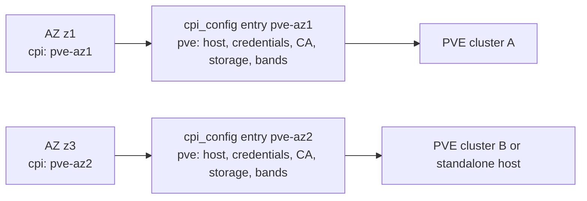

# Multi-Cluster Deployments

On Proxmox, a BOSH availability zone is a separate PVE cluster or a standalone PVE host, and it is never a set of nodes inside one cluster. A single BOSH Director reaches more than one of them through `cpi_config`, with one named `type: pve` entry per cluster or host, and each AZ in the cloud config names the entry that serves it. This document walks through that whole chain in order. We start with the AZ, move to its entry, and end at the cluster or host the entry points at. Along the way we cover the cpi-config manifest, the settings an entry can override, the credential and CA rules, stemcell registration across entries, and, once storage is shared between clusters, how to keep two independent clusters from corrupting each other's data.

If you are running a single PVE cluster, none of this applies to you, so skip straight to [Configuration](configuration.md).

## The model: AZ, entry, cluster or host

Every multi-AZ doc teaches the same order, and we follow it here too.

1. The AZ
   An AZ in the cloud config names a `cpi_config` entry with `cpi:`. Every operation BOSH performs for an instance in that AZ goes through that entry.

2. The entry
   The entry's `pve` block carries that cluster's endpoint, credentials, CA, storages, bridge or SDN settings, pools, and VMID bands. Every entry, including the one for the job's own cluster, carries its own `pve` block with at least `host`.

3. The cluster or host
   The entry points at exactly one PVE cluster or one standalone PVE host, and everything the CPI does for that AZ happens there.



The `az_map` node sets come after all of that, and they are optional. An entry can use `placement.az_map` to spread VMs across the nodes of its own cluster, which makes it a feature inside one AZ and never a way to define a second one. We cover it in [Per-entry placement and node spreading](#per-entry-placement-and-node-spreading).

## How multi-CPI works

BOSH resolves the executable to run for a cpi-config entry from its `type` field, not its `name`. Every `type: pve` entry dispatches to the same colocated `pve_cpi` job binary already installed on the Director VM, no matter how many entries we declare. We need no release code change, no extra job colocation, and no extra release upload to add a second entry. Each entry carries its own independent `properties:` block, so each named CPI targets a genuinely independent PVE cluster or host.

### Worked `cpi-config.yml` example

```yaml
cpis:
- name: pve-az1
  type: pve
  properties:
    pve:
      host: pve-az1.example.com
      user: bosh@pve
      api_token: ((pve_az1_api_token))
      node: pve-az1-n1
      vm_storage: data
      disk_storage: data
      stemcell_storage: nfs-shared
      iso_storage: data
      network_bridge: vmbr0
      vmid_range_start: 100
      vmid_range_end: 4999
      disk_vmid_range_start: 9000
      disk_vmid_range_end: 19999
      stemcell_template_vmid_range_start: 30000
      stemcell_template_vmid_range_end: 30499
      parked_disk_vmid_range_start: 90000
      parked_disk_vmid_range_end: 90499

- name: pve-az2
  type: pve
  properties:
    pve:
      host: pve-az2.example.com
      user: bosh@pve
      api_token: ((pve_az2_api_token))
      node: pve-az2-n1
      vm_storage: data
      disk_storage: data
      stemcell_storage: nfs-shared
      iso_storage: data
      network_bridge: vmbr0
      vmid_range_start: 5000
      vmid_range_end: 8999
      disk_vmid_range_start: 20000
      disk_vmid_range_end: 29999
      stemcell_template_vmid_range_start: 30500
      stemcell_template_vmid_range_end: 30999
      parked_disk_vmid_range_start: 90500
      parked_disk_vmid_range_end: 90999
```

Each entry names its own `host`, and the first entry does so even though its cluster is the same one the job-level configuration points at. A request with no `pve_*` context keys resolves to the job-level configuration unchanged, so an entry that carries no `host` is indistinguishable from a Director with no cpi-config at all.

Apply it the same way as any other cpi-config:

```bash
bosh update-cpi-config cpi-config.yml
```

The repository ships a parameterized version of this manifest at `manifests/cpi-config.yml`. We apply it with `scripts/bosh update-cpi-config`, which layers the active env's vars (`BOSH_PVE_ENV`) and then re-registers the active light stemcell against every entry with `--fix`. An AZ binding of this shape ships as the ops layer `manifests/cf/multi-cpi-azs.yml`, which `scripts/cf cloud-config` applies automatically whenever the Director reports an active cpi-config. That layer binds three AZs against the two shipped entries, with `z1` and `z2` on `pve-az1` and `z3` on `pve-az2`, so the CF deployment keeps three AZs while the second cluster carries one of them.

The two entries above share `stemcell_storage: nfs-shared`, a shared NFS export that both clusters can reach, while every VMID band is disjoint between the two entries. That combination is the multi-cluster safety pattern this document exists to explain, and we cover it in [Disjoint VMID banding](#disjoint-vmid-banding-the-multi-cluster-safety-pattern) below.

### What an entry can override

An entry can set only the keys in a closed registry, and every key in it names something that lives on one cluster or host. Each key arrives in the request context with a `pve_` prefix, so `vm_pool` becomes `pve_vm_pool`, but in a cpi-config entry we write it under `pve:` with its ordinary name. The [Configuration](configuration.md) reference marks each of these properties as overridable per entry.

| Group | Keys | Why the key is per cluster |
|---|---|---|
| Endpoint and trust | `host`, `port`, `user`, `password`, `api_token`, `realm`, `ca_cert`, `verify_ssl` | Each cluster has its own address, identity, and trust root. |
| Where VMs land | `node`, `vm_storage`, `disk_storage`, `stemcell_storage`, `iso_storage`, `network_bridge` | These names exist on one cluster only. |
| Pools and template node | `vm_pool`, `stemcell_template_pool`, `stemcell_template_node` | A token scoped to one cluster's pool needs that cluster's pool name, and node names differ per cluster. |
| Storage sets | `storage_sets`, `storage_capacity_domains`, `ephemeral_storage_set`, `persistent_storage_set`, `root_storage_set`, `storage_placement_namespace`, `require_disjoint_storage_sets`, `storage_status_max_age_seconds` | They bind to one cluster's storages and journal namespace. |
| SDN | `network_mode`, `sdn_zone`, `sdn_zone_type`, `sdn_auto_manage_zone`, `sdn_vxlan_peers`, `sdn_vni_range_start`, `sdn_vni_range_end`, `sdn_zone_mtu` | Zones, peers, and VNI ranges are per cluster by nature, and with auto-manage on the CPI would write cluster A's peer list onto cluster B. |
| VMID bands | `vmid_range_*`, `disk_vmid_range_*`, `stemcell_template_vmid_range_*`, `parked_disk_vmid_range_*` | Disjoint bands keep entries that share storage apart. |
| Stemcells, disks, and naming | `stemcell_strategy`, `stemcell_replicate_local`, `stemcell_replicate_storage_set`, `detached_disk_strategy`, `disk_migration`, `vm_prefix`, `parker_prefix`, `parker_pool`, `vm_disk_format`, `agent_mode`, `agent.mbus` | A standalone host or a cluster without shared template storage may need `import` while the job cluster uses `template`, and the rest describe how that cluster stores and names things. |
| HA and ISO layout | `placement`, `require_shared_iso_for_ha`, `iso_storage_follow_vm_storage` | They describe the cluster's node set and storage layout, and a standalone host has no HA at all. |
| Profiles | `vm_types`, `disk_types` | Profiles can name storages and nodes. An entry's map replaces the whole job-level map, because profile values sit below per-call properties and an AZ could not clear a stale profile key otherwise. |
| Ownership and CIDs | `vm_ownership_guard`, `cluster_stamp_aliases` | The guard answer and the rotation history belong to the cluster. |
| Data safety | `destroy_unreferenced_disks` | See the reset rule below. |

`vm_cid_format` is not in the registry. It is a job-level property, and an entry that sets it does not change the CID form.

Four rules apply when an entry moves a request to another endpoint, meaning it changes `host` or `port`.

- `destroy_unreferenced_disks` resets to `false`
  An entry that does not set it is `false` even when the job sets `true`, because the flag frees same-VMID volumes on shared storage and inheriting `true` into an entry whose cluster shares an export could free another cluster's live disks. The CPI logs the reset at info level. [Design Decisions, D9](design-decisions.md#d9-cross-cluster-delete-safety-destroy_unreferenced_disks-defaults-false) explains why.

- Inherited SDN settings fail the request
  When `network_mode` sends managed networks to SDN and `sdn_auto_manage_zone` is on, an entry that inherits SDN settings it did not name fails with an error that lists the property keys, because the CPI would otherwise write the job cluster's fabric onto the other cluster. We set each listed key on the entry, or set `sdn_auto_manage_zone: false` on it. [Networks](networks.md#sdn-settings-per-cpi-config-entry) covers the settings.

- Inherited names produce one warning
  An entry that inherits `node`, a storage name, `network_bridge`, a profile map, an `az_map` node, or the stemcell template node logs one warning that lists the inherited names. Matching names across clusters are common and legitimate, and our lab uses `vmbr0` on both clusters, so the CPI warns rather than refuses. A name that does not exist on the other cluster then fails there.

- Cluster stamp aliases do not carry over
  An entry on another endpoint gets no `cluster_stamp_aliases` unless it sets them itself, because one cluster's rotation history is not another's.

Everything else is deliberately left at the job level.

| Setting | Why an entry cannot set it |
|---|---|
| `node_endpoints`, `node_endpoints_discovery` | The CPI already drops the explicit map when the entry's host differs, and discovery reads the target cluster, so the only cost is a slower proxied upload path. |
| `cpu_type`, `security_groups`, `hotplug`, `numa`, `balloon` | Per-call `cloud_properties` resolve before the global value, so the AZ's own `cloud_properties` already carry a per-cluster value. |
| `vm_pool_template` | It is a naming pattern, and pools are created on demand. |
| `clone_mode` | `auto` already picks linked or full clones from each storage's backend type. |
| `storage_tiers`, `encrypted` | Tier criteria match live `/storage` data on whichever cluster the request reaches. |
| `cluster_lock_mode` | The pool-sentinel lock works on any PVE, and HA anti-affinity lives in the overridable `placement` block. |
| `agent.blobstore` | The Director sends blobstore settings in each `create_vm` env, and the job value is only a `create-env` fallback. |
| `storage_allocation_journal_dir`, `hooks`, `otel`, `metrics`, `retry`, `operation_timeout`, the `api_*` timeouts, `log_level`, `redact_logs`, `strict_config_validation`, `lb_register`, `external_command` | These are process-level settings with no per-cluster meaning, and the journal directory is deliberately fixed. |
| Fleet-wide policy such as `reboot_mode`, `root_disk_bus`, `disk_performance.*`, `fast_path_delete`, `ephemeral_disk_min_*`, `max_inflight_per_node`, and `storage.max_utilization_*` | These should match across AZs. |

Every property of an entry must sit under `pve:` or `agent:`. An entry with `host` and credentials at the top level, or with a misspelled key, fails the request, and [A cpi-config entry has its properties at the wrong level](troubleshooting.md#a-cpi-config-entry-has-its-properties-at-the-wrong-level) shows the fix.

### Per-entry credentials and CA

Credentials travel with the endpoint as a group. The group is `user`, `password`, and `api_token`, and the realm is handled separately below. When an entry changes `host` or `port`, the CPI never sends the job-level group to that cluster, so the entry must name its own `api_token`, or its own `user` and `password`. Once an entry names any credential key on any host, the CPI uses only the credentials that entry names and never borrows the rest from the job. An entry that names no credentials after an endpoint change, or only part of a group such as a bare `password`, fails its first request with an error that names the entry's host and the property keys it is missing. The first of these reads like this, and it never contains a credential value.

> `config: context entry for host "pve-az2.example.com" changes pve.host but supplies no credentials; set pve.api_token, or pve.user and pve.password, and pve.ca_cert if that cluster uses a private CA`

An entry that stays on the job endpoint and names no credential key keeps the job's whole group. [Troubleshooting](troubleshooting.md#an-entry-fails-with-no-credentials-or-an-incomplete-credential-group) covers both failures.

The host comparison ignores letter case and a trailing dot, and an unset port counts as `8006`, so spelling the job's host differently does not drop its credentials. The `realm` keeps inheriting from the job unless the entry sets it, because it is not a secret and only qualifies a bare `user`. That means a bare `user` on another cluster signs in under the job's realm, which may not exist there, so on every entry for another cluster we set `realm` or write `user` as `user@realm`. An entry that authenticates with `api_token` does not need `user` at all, because the token already carries `user@realm`. The token may be pasted in the `PVEAPIToken=` header form, and the CPI strips that prefix on an entry just as it does in the job config.

The CA follows the endpoint in the same way. An entry can set `ca_cert` to the PEM bundle that signs its cluster's API certificate. When an entry changes `host` or `port` and sets no `ca_cert`, the CPI verifies that cluster against the system trust pool rather than the job-level CA, so a cluster behind a private CA needs its own `ca_cert` on the entry. Without one, an operator reaches for `verify_ssl: false`, which is the downgrade `reject_tls_downgrade_overrides` exists to stop. If the job config has a `ca_cert` that the entry leaves behind this way, the CPI logs a warning that names `pve.ca_cert` and the entry's host. An entry that stays on the job endpoint and sets only `ca_cert` keeps the job credentials and changes the root they are verified against, and the CPI logs that as a warning too. If an entry also turns off `verify_ssl`, the warning the CPI logs says whether the credentials crossing that unverified connection are the job's (`credential_group: inherited`) or the entry's own (`credential_group: entry`).

Before we roll back to 0.9.3 or an earlier release, we put `user` back on every entry that authenticates with only `api_token`, because those releases reject such an entry with "user is required". We also check TLS on every entry that sets `ca_cert`, because those releases ignore the key and verify the entry's cluster against the job-level CA. Before a rollback, we also turn off `sdn_auto_manage_zone` and `destroy_unreferenced_disks` at the job level whenever any entry changes the endpoint, because 0.9.3 does not know the per-entry SDN keys or the reset rule and would apply the job's values to the other cluster.

### Per-entry placement and node spreading

An entry may carry its own `placement` block. This matters most for `az_map`, whose values are PVE node names. Those names mean nothing outside the one cluster that has them, so a single job-level map cannot serve two clusters. Inside one AZ, `az_map` is an optional way to spread VMs across the nodes of that AZ's cluster, as in this entry:

```yaml
- name: pve-az2
  type: pve
  properties:
    pve:
      host: pve-az2.example.com
      # ... connection and VMID settings as above ...
      placement:
        az_map:
          z3: [pve-az2-n1, pve-az2-n2, pve-az2-n3]
        pin_az_via_ha_rules: true
```

An entry's `placement` block replaces the job-level one entirely rather than merging into it, so each entry states its own complete placement policy. Omit the key to inherit the job-level block, and send `null` to run with no placement policy at all. A typo inside the block is rejected rather than ignored, so a misspelled field fails the request instead of silently disabling the feature it was meant to enable. The `az_enforcement` and `bridge_check` keys live inside this block as well, so an entry that carries its own `placement` needs its own copy of each.

The three HA features (`placement.dlb`, `placement.anti_affinity.use_ha_rules`, and `placement.pin_az_via_ha_rules`) are reachable only this way in a multi-cluster deployment. Enabling any of them also means disabling the BOSH resurrector for the affected deployment. The `pin_az_via_ha_rules` feature additionally needs a `cloud_properties.availability_zone` that matches an `az_map` key. BOSH does not hand the CPI the AZ's name, but it merges the AZ's own `cloud_properties` into what the CPI receives, so `availability_zone` belongs on the AZ in the cloud config, where every `vm_type` in that AZ inherits it. [HA and Resurrection](ha-and-resurrection.md) shows the cloud-config block and the warning the CPI logs when the property is missing.

### Never edit a live entry's host or repoint a live AZ

This is a hard rule. When a deployment moves to a new cluster, we add a new entry for the new cluster, with its own name, its own `pve` block, and its own bands, and we bind a new AZ to it. We never edit the `host` or `port` of an entry that serves live instances, and we never change the `cpi:` of a live AZ to point at another entry.

The reason is that a legacy bare CID, which is a bare VMID, carries no cluster identity. After a host edit or an AZ repoint, the old VMIDs usually point at nothing on the new cluster, because the shipped entries use disjoint bands. The CPI then answers `has_vm` with false and answers `delete_vm` with success. The Director drops its record, the real VM keeps running on the old cluster with its IP, and the replacement takes the same IP. That is the duplicate-IP NATS churn we have already seen in our lab.

Stamped CIDs, which are the default for VMs created by this release, name their cluster and catch most of these cases, but they are a backstop and never a license to repoint. The protection is absent for a VM created before the upgrade or under `pve.vm_cid_format: bare`, for two clusters that share a root CA and therefore a stamp, and for a CID stamped `00000000` because the identity read failed at create. [Known Limitations](limitations.md#vm-ownership) lists each case, and [Which cluster does a VM CID name?](operations.md#which-cluster-does-a-vm-cid-name) shows how to read a stamp.

## AZ-to-CPI binding in cloud-config

BOSH's `azs[].cpi` field binds an availability zone to a named cpi-config entry. The AZ's `cloud_properties` can carry `availability_zone` too, which is where that property belongs when `az_map` spreads VMs inside the AZ.

```yaml
azs:
- name: z1
  cpi: pve-az1
- name: z3
  cpi: pve-az2
  cloud_properties:
    availability_zone: z3   # only needed when the entry's placement.az_map has a z3 key
```

Every operation BOSH performs against an instance in a given AZ, including create, delete, cloud-check, and resurrection, is dispatched exclusively through that AZ's bound CPI entry, and so exclusively against that AZ's PVE cluster or host.

## Stemcell registration across CPI entries

A stemcell upload binds to a specific cpi-config entry, so uploading it once does **not** automatically register it against every entry. We upload normally against the first entry and then re-register the same content against each additional entry with `--fix`:

```bash
bosh -e <alias> upload-stemcell <stemcell>.tgz          # registers against the first-seen entry
bosh -e <alias> upload-stemcell <stemcell>.tgz --fix    # re-registers against every other named entry (e.g. pve-az2)
```

Each `--fix` invocation runs `create_stemcell` against that entry's own cluster. Under the eager-cache design in [Design Decisions, D1](design-decisions.md#the-refs-anchor-rule), that call builds the cluster's own cache template immediately, tags it `bosh-stemcell-cache`, and registers the entry's Director UUID as a reference on it.

### The AZ-reassignment trap

An instance group's AZ assignment determines which named CPI, and so which PVE cluster, BOSH uses for every operation against that instance, including cloud-check and resurrection. **Persistent disks do not transfer automatically when an instance's AZ is reassigned across two independent clusters.** A redeploy after an `azs:` change from `z1` to `z3` succeeds with no error at all. BOSH recreates the instance fresh on the new cluster with an empty disk and leaves the old disk orphaned on the original cluster, where it shows only in that Director's orphaned-disk listing. There is no in-place cross-cluster disk move, because the two clusters share no storage state the CPI can move between them.

We treat a cross-cluster AZ reassignment as a blue/green instance-group change with an explicit, out-of-band data migration, and never as an in-place `azs:` edit on an already-deployed instance group.

### `bosh clean-up --all` fails the first time, then succeeds

On a multi-entry Director the first `bosh clean-up --all` reliably fails while deleting stemcells:

```
Task NNN | Deleting stemcells: bosh-proxmox-kvm-ubuntu-noble-go_agent-light/1.383
          L Error: Attempt to delete object did not result in a single row modification
            (Rows Deleted: 0, SQL: DELETE FROM "stemcells" WHERE ("id" = 1))
```

This is a Director-side bug and not a CPI failure. A stemcell is registered once per cpi-config entry, so the Director's cleanup loop walks it once per entry and issues the same `DELETE FROM "stemcells" WHERE ("id" = 1)` twice. The second matches zero rows and Sequel raises, and the stack lands in `cleanup_artifact_manager.rb`'s `delete_stemcells`.

Every CPI call in that same task succeeds. The `delete_stemcell` call returns `ok` for each entry, including the Director's own retry against an entry whose reference was already released, since the CPI is idempotent there. The Director simply cannot commit its own database row twice.

We re-run the command, and the second `bosh clean-up --all` completes normally because the first run already removed the row. The window between the two runs is safe, because the artifacts the failed run deleted stay deleted and nothing is left half-referenced.

## Disjoint VMID banding: the multi-cluster safety pattern

Two safety mechanisms exist inside a single CPI process, and neither one extends across independent CPI processes.

- **VMID-allocation storage scanning** checks the shared storage pool for volumes belonging to VMIDs *outside* this cluster's own resource list before allocating a new one, closing the allocation-time collision for the one pool it scans. It covers VM, stemcell-template, and parker-VM allocation (via `WithStorageScan`), disk allocation (built into `NextDiskVMID`), and the ISO pool (via `WithExtraStorageScan`, and only when `iso_storage` is a distinct third pool, since a scan of `vm_storage` or `disk_storage` under another name would be redundant). But it is a read at allocation time with no cross-cluster lock. Two clusters allocating concurrently can still pick the same VMID, which is a genuine time-of-check-to-time-of-use race, and the scan cannot repair a collision that already existed before this guard was added or one created by non-CPI tooling.

- **The pool-comment cluster lock** (used for VM metadata, disk metadata, stemcell-reference read-modify-write, and delete serialization) relies on PVE's `pmxcfs`, which is a per-cluster, corosync-backed filesystem. Two independent PVE clusters run two independent `pmxcfs` instances, so the same sentinel pool name can be "locked" simultaneously in both clusters. Each cluster's lock is real, but neither serializes against the other.

Because of this, **disjoint VMID banding across CPI entries sharing storage is not optional, since it is the mechanism that makes shared storage safe at all.** We give every CPI entry that shares any storage pool with another entry a non-overlapping range for every band it uses:

| Band | Config keys |
|---|---|
| VM | `vmid_range_start` / `vmid_range_end` |
| Persistent disk | `disk_vmid_range_start` / `disk_vmid_range_end` |
| Stemcell template cache | `stemcell_template_vmid_range_start` / `stemcell_template_vmid_range_end` |
| Parker VM (the band resolves under every `detached_disk_strategy`, and it is allocated into under `parked` and read-only under `free`) | `parked_disk_vmid_range_start` / `parked_disk_vmid_range_end` |

The repository's `manifests/envs/lab/vmid-range.yml` is the existing single-cluster precedent for this pattern, reserving 100 to 199 for hand-managed bastions. We apply the same idea per CPI entry when clusters share storage, as in the worked example above, where no band of one entry touches any band of the other.

### Parker bands

The parker band deserves particular attention after the strategy default became `parked`. An entry that names no parker band inherits the same `90000` to `90999` default as its siblings, so two entries sharing storage will allocate parker VMs from one band. Both parker range keys are per-entry overridable, so we give each entry its own slice as the example above does. For an entry that already parks disks, a new slice must still cover every parker that holds a disk, because the CPI refuses to attach, update, or delete a disk whose parker falls outside the band. [Moving a parker band while parkers hold disks](troubleshooting.md#moving-a-parker-band-while-parkers-hold-disks) gives the safe order. The `detached_disk_strategy` property is overridable per entry as well, which is how we turn parking off for one cluster whose VMID topology has no room for a parker band while the rest of the deployment keeps it.

Parker VMs carry a `director--<uuid>` tag naming the Director that created them, and a park adopts only parkers that are unattributed or attributed to the Director making the call. Two Directors sharing one PVE cluster therefore keep separate parkers rather than filling each other's. They still share the default band unless one of them changes it, and the CPI warns about another Director's parkers in its band without ever advising their removal. A call that has no Director UUID to hand adopts any parker of its own prefix, since attribution gives it no basis on which to prefer one.

### Two entries on one cluster

Pointing two entries at one PVE cluster is not the multi-AZ shape, because each AZ is a separate cluster or host. It can still happen, and the CPI warns about what the two entries then share instead of refusing them.

Parkers carry a `vm-prefix--<value>` tag too, naming the prefix `pve.parker_prefix` resolved to. The parker prefix and the parker pool are both per-entry overridable, as `pve_parker_prefix` and `pve_parker_pool`. Giving an entry its own parker prefix is what lets us tell its parkers apart from a sibling entry's, by name and by tag, and that matters most when two entries point at one PVE cluster. Two entries pointing at separate clusters may carry the same parker pool name without interfering, because a resource pool lives inside a single cluster, while two entries against one cluster share a pool unless we name one of them differently. The pool is a label rather than a boundary, but the prefix is one.

A park chooses its parker by the `bosh-parker` tag, the configured band, the Director attribution, and the prefix together, so two entries that resolve different parker prefixes fill different parkers even when they share a band. Sharing a band still couples them, though, because both allocate parker VMIDs from one range and each counts the other's parkers as foreign guests in its band.

From inside one entry, a sibling's parkers also look exactly like the parkers a parker prefix change leaves behind. The CPI therefore warns whenever a parker listing finds a parker of another prefix inside its band that carries this Director's tag or no director tag, even when the share is deliberate. It gives a parker of another prefix that carries another Director's tag a separate warning, which never advises removing it, and it warns about a parker with its own director tag and prefix outside the band. For a new pair of entries whose parker prefixes differ, we give each entry its own parker band from the start. For entries that already park disks, we either give them one shared parker prefix, which moves no parker out of its band, or we move a band only once no parker that this Director owns in the old band holds a disk, whatever that parker's prefix. [Two cpi-config entries on one cluster](troubleshooting.md#two-cpi-config-entries-on-one-cluster) explains all three warnings and the safe order of steps.

Two entries that point at one cluster also share its allocation journal namespace unless one of them overrides `pve_storage_placement_namespace`. The CPI records the set of entry bindings that have admitted a create into the namespace, in an `entry-binding.json` file beside the journal's records. A binding is one entry's VM prefix, parker prefix, and VMID bands. A create whose binding is new to the set logs a warning once and joins the set, and `cpi storage-journal audit` lists every binding in the set. The audit compares the set with the job-level configuration only, since it can't see the cpi-config entries. The quiet configuration for two entries on one cluster is matching prefixes and bands, or a namespace of their own. The warning never blocks a create. An intended edit to one entry's prefix or bands produces it once, and deleting `entry-binding.json` afterwards clears the old binding from the audit.

### What the CPI can and cannot validate

The CPI validates that its own four bands are mutually disjoint within one config. It cannot validate a second, independent cpi-config entry's bands against the first, because it has no in-process visibility into a sibling CPI's configuration. Banding across entries is an operator convention that this document exists to make explicit, and not something the CPI can enforce for you.

## Shared-storage rules

When two or more CPI entries share a storage pool, three rules apply.

**`destroy_unreferenced_disks` must be `false`.** This is the default (see [Design Decisions, D9](design-decisions.md#d9-cross-cluster-delete-safety-destroy_unreferenced_disks-defaults-false)), and on shared storage it must remain the default. PVE's `DestroyUnreferencedDisks` flag frees every volume matching the destroyed VM's VMID that is not referenced in *this* cluster's view of that VM's config. With overlapping or accidentally colliding VMID bands, that can free another cluster's live disks. We leave it off on any storage a second cluster can reach.

**Watch for the duplicate-backing warning.** On its first storage lookup, each CPI entry independently checks every storage ID in *its own* cluster's `/storage` index for two IDs that resolve to the same physical export or path, and warns once per entry:

> `storage_info: two or more storage IDs share one physical backing — two names, one export; prefer a single storage ID to avoid silent full-clone downgrades, cross-cluster VMID collisions, and split placement decisions`

This check runs per CPI entry, against that entry's own cluster's storage index. It does not, and cannot, compare storage IDs across two separate cpi-config entries, even when both point at the same physical export under matching names. Seeing this warning means we registered the same export twice under different names *within one cluster's storage.cfg*. It is not a signal about cross-cluster sharing, which is expected and by design when we deliberately point two CPI entries at one shared pool.

**A duplicate qcow2 filename is benign, but a template VMID collision is not.** Stemcell qcow2 filenames are deterministic (name, version, and content hash), so two clusters uploading the identical stemcell to the same shared pool write the same path, which is harmless because the content is identical. Cache templates, however, are built independently per cluster, since each cluster needs its own guest configuration. Each cluster therefore consumes a template VMID from its own stemcell-template band, and that is exactly why the bands must stay disjoint.

## `:light:` stemcells: one file, every cluster

The headline scenario this whole design serves is to upload a stemcell once as `:light:`, which is a preuploaded, operator-managed qcow2 (`cloud_properties.image_id`), onto storage that every cluster's `stemcell_storage` can reach. Every cluster then consumes it from that single file with no duplicate upload traffic and no cross-cluster refcounting complexity, because the CPI never deletes `:light:` files at all (see [Design Decisions, D10](design-decisions.md#d10-qcow2-deletion-policy-light-never-heavy-at-last-cluster-reference)).

**This safety is specific to `:light:`.** A `:heavy:` stemcell on an export shared across clusters is the opposite case, because the CPI owns that file and reference counts are scoped per entry. To keep one cluster from removing a file another cluster's templates still point at, `delete_stemcell` keeps the qcow2 whenever the request came through a cpi-config entry and the storage is shared. The cache template is still destroyed, a warning names the file, and `pve-cid stemcells --orphans` reports it so we can remove it with `pvesm free` once no cluster needs it. Every entry, including the one for the job's own cluster, must set `pve.host`, because the CPI tells a cpi-config request apart by the `pve` properties it carries. See [Light Stemcells](light-stemcells.md#heavy-and-a-cross-cluster-shared-export-do-not-mix) for the mechanism. We have run a full teardown against a pair of clusters mounting one NFS export with identical content listings, and that run showed why the guard exists.

Each cluster still builds and owns its own cache template. The `create_stemcell` call, run once per entry via the upload-plus-`--fix` sequence above, builds that cluster's cache template *eagerly*, at upload time, and does not defer it to the first `create_vm`. If a cluster's cache template is later missing, because someone deleted it by hand or it was never built there, a `create_vm` under `stemcell_strategy: template` does **not** rebuild it inline. It logs a warning and falls back to `stemcell_strategy: import` for that one VM, importing directly from the shared qcow2. The import fallback requires the qcow2's pool to be readable from the VM's placement node, so a node-local staging pool serves only its own node, and other nodes fail with guidance to rebuild the cache. We run `--fix` again against that entry to rebuild the cache, or we set `stemcell_strategy: import` deliberately if we never want a given deployment to depend on the cache.

## Cross-cluster stemcell inventory

The command `pve-cid stemcells --orphans` (see [Design Decisions, D4](design-decisions.md#d4-disk-cids-keep-the-envelope-ship-a-tool)) gives us the "what is safe to delete" view of one cluster's stemcell storage, meaning qcow2 files correlated against cache templates and their Director references. It is a single-cluster tool by construction, because each run loads one CPI entry's `cpi.json`. The `pve-cid` binary ships on the Director VM at `/var/vcap/packages/pve_cpi/bin/pve-cid` and is not on `PATH` by default. For a full multi-cluster inventory, we run it once per entry:

```bash
pve-cid stemcells --orphans --config /path/to/pve-az1/cpi.json
pve-cid stemcells --orphans --config /path/to/pve-az2/cpi.json
```

An entry showing an orphan on shared `:light:` storage that another entry still actively references is expected and correct. Orphan status is always relative to the one cluster the command was run against, which matches how Director references are scoped.

The same applies after a teardown. Once the last deployment is gone, every `:light:` stemcell is reported as an orphan with the reason "qcow2 file has no correlated cache template". That is precisely the steady state a light stemcell is designed for, because the operator's file outlives the cache templates built from it. We do not read that as a delete list. The CPI never deletes an operator-managed file, and neither should a post-teardown sweep.

## Standalone hosts as AZs

An AZ can be a standalone PVE host instead of a cluster. We bind it the same way, with an AZ that names an entry and an entry whose `pve.host` is the standalone host, but several things change because a lone host has no cluster around it.

- No HA
  A standalone host has no HA failover, so `placement.dlb`, `placement.anti_affinity.use_ha_rules`, and `placement.pin_az_via_ha_rules` have nothing to work with. The BOSH resurrector stays the only recovery mechanism, which is the zero-configuration default described in [HA and Resurrection](ha-and-resurrection.md).

- A per-entry placement block that disables the HA features
  An entry that omits `placement` inherits the job-level block, so a job that turns on an HA feature for its cluster would hand that feature to the standalone entry too. We give the standalone entry its own block that switches the features off, and we turn off node scoring so that the CPI falls back to `pve.node`, which the entry must set to the host's node name.

  ```yaml
  - name: pve-edge
    type: pve
    properties:
      pve:
        host: pve-edge.example.com
        user: bosh@pve
        api_token: ((pve_edge_api_token))
        node: pve-edge
        vm_storage: local-lvm
        disk_storage: local-lvm
        stemcell_storage: local
        iso_storage: local
        network_bridge: vmbr0
        stemcell_strategy: template
        placement:
          enabled: false
          dlb:
            enabled: false
            az_name: ""
          anti_affinity:
            use_ha_rules: false
          pin_az_via_ha_rules: false
        # ... VMID bands disjoint from every other entry ...
  ```

- Local-only storage
  Every pool the entry names lives on that one host, so a VM, its disks, its ISO, and its stemcell files cannot move anywhere else. That is fine here because the VM never migrates, and the ISO warning about node-local storage matters only to HA features that this entry has switched off. Persistent disks stay on the host, and the AZ-reassignment trap applies in full, because a disk cannot follow an instance to another AZ.

- `stemcell_strategy`
  With one node, the cache template and every VM share a node, so the default `template` strategy works once the stemcell is registered against the entry, and `stemcell_template_node` falls back to `pve.node`. We set `stemcell_strategy: import` on the entry when we would rather skip the cache template and pay for a full copy per VM. Both values are per-entry settings, so the job cluster can keep `template` while the standalone host uses `import`.

Our lab does not cover this shape yet. Both of our lab targets are three-node clusters, so nothing tests an entry that points at a standalone host with `pve.node` set, local-only storage, and no HA. That shape exercises the VM lookup's node enumeration, the cluster identity read on a single node, the parked disk strategy, and stemcell handling without shared storage. We treat it as untested until we have a lab that can run it, and we run a first deployment on a standalone host as a trial before we rely on it.

## Network reachability

Each AZ's network has to reach two things, the Director's NATS and the blobstore. The Director has to reach the PVE API of every entry, the machine running `bosh create-env` has to reach the Director, and a deployment that spreads instance groups across AZs on different clusters needs one more route between those clusters.

- The Director's NATS
  The agent on every VM connects out to the Director's NATS at the address in its settings, which is port 4222 on the Director. Each AZ's subnet needs a route and a gateway that reach that address, because a VM that cannot reach NATS never registers and the create times out.

- The blobstore
  The Director sends the blobstore settings in each `create_vm` env, so the VM fetches job packages and compiled releases from whatever endpoint the Director names. Each AZ's network needs a route to it, and any name the settings use must resolve from that subnet.

- The route to each PVE API
  The CPI runs on the Director VM, so the Director needs a route to each entry's PVE API at `pve.host` and `pve.port`, which defaults to 8006.

- The operator's route to the Director
  During `bosh create-env`, the machine running the command has to reach the Director VM on its mbus port, 6868.

- Between AZs
  Instance groups spread across AZs bound to different clusters need reachable L2 or L3 connectivity between those clusters to communicate. The single-node `simple` SDN zone shape used by this repository's lab manifests does not span clusters, so we need a routed fabric, or a vxlan or EVPN overlay that reaches both clusters. See [Networks](networks.md) for the bridge-versus-SDN patterns this CPI supports.

## Storage-set authorities across clusters

We give each cluster context its own stable `pve_storage_placement_namespace`. Context storage-set and capacity-domain maps replace the corresponding maps as a whole. The journal directory belongs to process configuration and cannot be redirected through a request context.

The CPI checks cluster continuity using the PVE root CA identity observed on the relevant nodes. Alternate API hostnames for the same cluster retain that identity. A different cluster or changed CA requires authority reconciliation. We follow [multi-storage placement](multi-storage-placement.md) and [journal provisioning](storage-journal-provisioning.md) when we define each context.

## See also

- [Design Decisions](design-decisions.md) covers the full rationale behind D9 (cross-cluster delete safety) and D10 (qcow2 deletion policy) referenced throughout this document.

- [Operations Runbook](operations.md) covers stemcell lifecycle across Directors, safe teardown ordering for multi-Director environments, and how to read a cluster stamp.

- [Configuration](configuration.md) is the complete `pve.*` property reference.

- [HA and Resurrection](ha-and-resurrection.md) and [DLB-Aware Placement](dlb-aware-placement.md) cover `az_map` node spreading inside one AZ.
