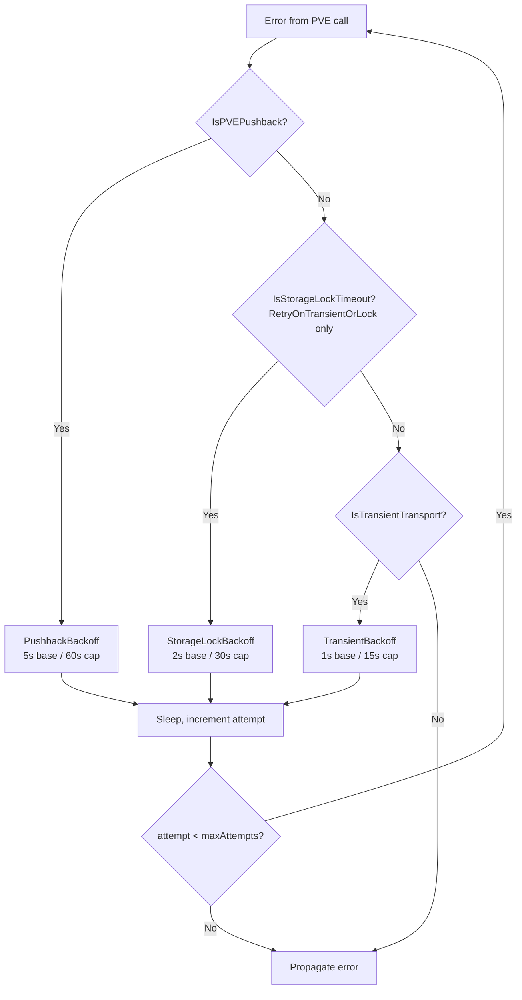

# PVE Transient Transport Faults

This document covers how the CPI absorbs pvedaemon worker recycling, pveproxy backend stalls, HTTP 429 pushback, and the auth-ticket EOF that follows. [PVE Storage Locking](pve-storage-locking.md) covers the per-storage lockfile class, and [PVE Endpoint Failover and Discovery](endpoint-failover.md) covers how the CPI moves between the nodes you list in `pve.endpoints`, which changes how several of these faults play out.

## What PVE does

`pvedaemon` runs a fixed pool of HTTP workers (default 3) behind `pveproxy`. Each worker has a built-in **per-worker request quota** plus a soft memory limit; when either is hit, the worker exits cleanly and the parent respawns a fresh one. Every in-flight TCP connection to the exiting worker is dropped with no HTTP response.

The shape pveproxy returns to the client depends on where the worker died:

- **Mid-response** → empty body and a TCP RST. SDKs that expect JSON report it as `EOF` or `failed to parse response`.

- **While pveproxy forwards the request** → the call breaks after pveproxy has connected to the worker, while it sends the request or reads the reply, and pveproxy relays its HTTP client's non-standard **HTTP 596** to the client. The worker may already have the request, so the CPI treats a 596 as unanswered, as `pveAnswered` in `internal/pve/disk_transfer.go` does. When pveproxy can't connect to a worker at all, it sends **HTTP 595** instead, which is the connect failure, and nothing reached the backend.

- **During TLS handshake** → SDK reports `connection refused` or `tls: read on closed connection`.

## How the failure surfaces

Three distinct error strings show up in CPI logs when the pool holds one endpoint:

```
API request failed: HTTP 596 (code: 596)
```

```
auto-login failed: authentication failed: failed to parse login response: EOF
```

```
operation get-config timed out after 30s
```

The first hits any API call. The second is specific to `POST /access/ticket` — the SDK's first call on a new connection requiring a fresh ticket. The third is the SDK's `TimeoutError` wrapper.

When you list more than one endpoint, a fourth shape appears. A walk over the list that reached no endpoint ends with one error that names each endpoint and its cause.

```
no Proxmox endpoint answered (pve1:8006: dial timeout; pve2:8006: connection refused)
```

The substring detector `pve.IsTransientTransport` covers all four (plus generic `*ConnectionError` and any 5xx). The fourth is recognized as a connection error, because the walk's error unwraps to a single dial error. It is the one error in the list that tells you about more than one node at a time.

## When the CPI hits it

A BOSH director driving a Cloud Foundry deploy launches a dozen or more concurrent `create_vm` calls within a second. With 3 pvedaemon workers, the in-flight-to-worker ratio is ~10:1, so a worker recycle during the burst window is statistically guaranteed — once every few hundred requests in the field.

Observed at Task 343 (cf deploy retry):

```
13:15:44 pve pvedaemon[5599]: worker 1072563 finished
13:15:44 pve pvedaemon[5599]: starting 1 worker(s)
13:15:44 pve pvedaemon[5599]: worker 1106002 started
```

Two in-flight `create_vm` POSTs riding worker 1072563 died at exactly that timestamp — one with HTTP 596 (the forwarded call broke, so the CPI couldn't tell whether the worker had the request), one with auth-EOF (login response truncated).

## The retry strategy

The CPI absorbs the recycle window with a predicate, exponential backoff, and a bounded attempt count. Worker restart is sub-second, so the transient backoff curve is tighter than the storage-lock curve: `1s × 1.5^attempt`, ±30% jitter, capped at 15s, default 8 attempts.

`RetryOnTransient` retries on **two** predicates:

- `IsTransientTransport` — pvedaemon worker cycle, 5xx, connection errors (see predicate surface below).
- `IsPVEPushback` — HTTP 429 and PVE phrase set (see [HTTP 429 / PVE Pushback](#http-429--pve-pushback)). When pushback fires, the CPI uses `PushbackBackoff` (5s base, 60s cap) instead of the standard transient curve. The log field is `reason=pushback`.

`RetryOnTransientOrLock` extends this further by also retrying `IsStorageLockTimeout` errors. All storage-touching handler call sites use `RetryOnTransientOrLock`; non-storage call sites use `RetryOnTransient`.

Implementation lives in `internal/pve/retry.go`:

- `pve.IsTransientTransport(err)`, which lives in `internal/pve/error_map.go`, returns false at once for `ErrTetherConflict`, `ErrSendByPassed`, and a refused redirect. Otherwise it is a predicate over `sdkerrors.ErrServer`, `*ConnectionError`, `*TimeoutError`, `net.Error.Timeout()`, and the substrings `"failed to parse login response"`, `"auto-login failed"`, `"(code: 596)"`, `"http 596"`.

- `pve.TransientBackoff(attempt)` — 1s × 1.5^n, ±30% jitter, cap 15s.

- `pve.RetryOnTransient(ctx, logger, label, maxAttempts, op)` — retries on `IsTransientTransport` or `IsPVEPushback`. Default `maxAttempts` is `DefaultTransientMaxAttempts` (8).

- `pve.RetryOnTransientOrLock(ctx, logger, label, maxAttempts, op)` — combines all three predicates with per-attempt backoff selection. Default `maxAttempts` is `DefaultStorageLockMaxAttempts` (10).

### HTTP 429 / PVE Pushback

PVE returns HTTP 429 when the node's task queue is full or resource contention is detected. Plain-text task-body errors also carry pushback signals through a conservative phrase set:

- `"too many requests"`
- `"worker busy"`
- `"worker pool"`
- `"unable to acquire lock"`
- `"lock-acquire timeout"`
- `"got timeout"`

The `IsPVEPushback` predicate matches HTTP 429 responses first (via `*sdkerrors.APIError.HTTPCode == 429`), then the phrase set case-insensitively. When it fires, the CPI applies `PushbackBackoff` with base=5s, cap=60s — longer than `StorageLockBackoff` (2s/30s) because worker-pool saturation takes longer to drain than a single per-storage lock hold does.

Operator knobs: `pve.retry.pushback.base_ms` and `pve.retry.pushback.cap_ms` in the BOSH manifest control the backoff bounds. `ConfigurePushbackBackoff` reads these at startup and stores them process-wide.

**Note on phrase overlap:** the `"got timeout"` phrase also appears in storage-lock errors (`"can't lock file … got timeout"`), so `IsPVEPushback` is a superset of `IsStorageLockTimeout` for plain-text errors. Both return true for the same lock-timeout string. In `RetryOnTransientOrLock`, pushback takes priority and applies the longer `PushbackBackoff` curve.

### max_inflight_per_node semaphore

An additional concurrency gate operates above the retry layer. When `pve.max_inflight_per_node` is set to a positive integer, the CPI acquires a per-node counting semaphore slot before issuing any mutating API call on that node. The semaphore is backed by a buffered channel (`nodeInflightRegistry` in `internal/cpi/handlers/inflight.go`) keyed by PVE node name. This caps the burst rate to PVE — reducing worker-recycle and pushback frequency at the source rather than absorbing them with retries.

### Retry decision flow



### Where the helpers are wired

| Surface | Wrapper | Reason |
|---------|---------|--------|
| `vmid.listClusterVMIDs` | `RetryOnTransient` | `GET /cluster/resources` runs before every VMID allocation; an auth-EOF here aborts `create_vm` before any work. |
| `vmid.listStorageVMIDs` | `RetryOnTransient` | Same as above for the disk-VMID storage scan. |
| `create_vm.AllocateWithRetry` callback | `IsTransientTransport` added to `isRetryable` predicate; `cleanupVM` runs on both create-error and await-error transient branches. | A 596 mid-POST may leave the VMID partially registered; sweep before next attempt. |
| `create_vm` resize-virtio0 | `RetryOnTransientOrLock` | Resize can hit storage lock or worker cycle. |
| `create_disk` CreateVolume | `RetryOnTransientOrLock` | Same dual exposure. |
| `delete_vm`, `delete_disk`, `delete_stemcell`, `delete_snapshot` | `RetryOnTransientOrLock` | Storage mutations on the cleanup path. |
| `resize_disk`, `snapshot_disk` | `RetryOnTransientOrLock` | Storage mutations. |
| `create_stemcell` upload, `agent/configdrive` upload/delete | `RetryOnTransientOrLock` | Streaming uploads need file reopen inside the callback; pattern already in place. |
| `attach_disk`, `detach_disk` | `RetryOnTransient` (no lock) | Pure config PUT, no storage lock, but worker cycle still applies. |

## How failover and the send-by deadline change the retry

The endpoint pool sits below both retry layers. A CPI helper calls the SDK, the SDK's retry middleware calls the HTTP client, and the failover transport sits under that. So a request that the CPI retries is not always sent to the same node twice. What happens depends on whether the request is a read or a mutation.

### Reads move on

A read, which here includes the ticket login, moves to the next endpoint on any transport error, on a header deadline, and once on a 502, 503, or 595 that the entry node caused. The retry that follows therefore usually finds a live node, and the transient backoff you see in the log is often the only trace of a node that was down. A 596 is the exception. It means pveproxy's own connection to the worker broke after the request may have reached it, so the transport returns the response, demotes the entry endpoint, and lets the CPI's retry decide.

### Mutations stay put

A mutation that may have reached a node is tethered to that node, and every retry of it, from the SDK or from a CPI helper, goes back to the same node and nowhere else. This is deliberate. The helpers in this page replay a write after a dropped connection, and sending the replay to another node would run the write twice. So when `RetryOnTransient` retries a `create_vm` that died with a 596 or an EOF, the retry still goes to the node that may have the first copy. The transient backoff then rides out a worker recycle on that node exactly as it did before. If that node is down, the retry fails in the connect phase within a few seconds, which proves nothing was sent, and the retry waits out its backoff and tries again.

A mutation that fails while the connection is still being made is the one case that moves. Go writes no request byte before it has a connection, so nothing could have reached any node, and the walk tries the next endpoint, unless another request with the same key holds the tether.

### Errors the retry helpers never repeat

Three refusals look like transport faults but cannot change on a second attempt, so `IsTransientTransport` returns false for each one.

- `ErrSendByPassed`
  The request carried a send-by deadline that had already passed, and the transport sent no byte. The cluster lock puts that deadline on its sentinel delete. The deadline is past for every later attempt as well, so a retry would only repeat the refusal through its whole backoff. This holds even when the bound passed while the dial was in flight, which the SDK reports as a connection error.

- `ErrTetherConflict`
  A mutation was refused because its tether key may have reached two endpoints in one call, or two calls tethered the same key to different endpoints. Nothing a retry could change would let it send.

- A refused redirect
  The SDK, v3.13.1 and later, refuses every HTTP redirect from the Proxmox API, and the CPI's pool refuses one too, before any dial. A server that redirects answers every retry the same way, so the request is attempted once. The CPI reports it to the Director as an error that is not retriable, because a retriable one would spend the Director's `max_vm_create_tries` on the same answer.

The send-by refusal is not an error for the code that asked for it. A steal of an expired cluster lock treats it as an abandoned steal and waits one poll. The expired-lock sweep leaves the sentinel for the next sweep. See [PVE Endpoint Failover and Discovery](endpoint-failover.md#the-cluster-locks-send-by-deadline) for why the lock needs the deadline.

### Task polls keep going

The default task poll used to return on the first transient fault, which a retry helper above it could then answer by submitting the whole mutation again. The poll now re-polls a transient fault at the poll interval until the task's deadline, and at the deadline it returns the poll-timeout error that never licenses a resubmit. This matters most when the task's own node is down. Every entry node answers 595 for that path, and the transport returns it because it is about another node. The call now waits for the task's whole deadline before it fails, which is slower, and it no longer risks starting a second copy of a task that may still be running.

### The worst case with several endpoints

A walk that reaches no endpoint costs at most about 45 seconds, since each hop is limited to the 5-second dial and the 10-second TLS handshake, and the walk starts no new hop after 30 seconds of connecting. The walk's error looks like a dial error, so the SDK does not retry it and the CPI helper keeps its eight attempts. The worst case with every endpoint refusing connections is therefore about eight walks plus the backoff, which comes to roughly seven minutes. One host that silently drops packets used to cost about 17 minutes. A whole-pool outage of a minute or two, such as a switch reboot, is still ridden out by the helper's curve, which is why the helpers keep retrying.

Endpoints that accept TLS and then never answer cost more. A hop can wait up to 60 seconds for response headers on top of the connect time, so a walk can last about 165 seconds. A walk whose final hop meets a hung endpoint waits for the 30-minute client timeout, exactly as a single hung host does. These deadlines apply only when the pool holds more than one endpoint. With one endpoint the CPI sets no dial deadline and no header deadline unless you set `pve.api_dial_timeout_sec` or `pve.api_tls_handshake_timeout_sec` yourself.

### Credentials and server text in these errors

Errors in these retry lines pass through the SDK's scrubbing before the CPI sees them. A URL in an error keeps only its scheme, host, and path, so a ticket in a query string never reaches `cpi.log`. Control characters in a value the server chose are escaped, a single server-chosen value is cut at 1 KiB, and the whole text of a cause is cut at 8 KiB. If an `error=` field in a retry line looks shorter than the original error, that is why.

## Diagnosing

In `/var/vcap/sys/log/cpi/cpi.log` on the director, retries from `RetryOnTransient` or `RetryOnTransientOrLock` appear as:

```
pve: retrying after retryable fault op=create_vm reason=transient_transport attempt=1 max_attempts=8 backoff_ms=1185 error="..."
pve: retrying after retryable fault op=create_disk reason=pushback attempt=2 max_attempts=10 backoff_ms=7312 error="..."
pve: retrying after retryable fault op=create_disk reason=storage_lock attempt=3 max_attempts=10 backoff_ms=4218 error="..."
```

When the pool holds more than one endpoint, a retry can also follow a Warn line from the failover transport.

```
pve endpoint failover: pve1:8006 unreachable (dial tcp: i/o timeout), request sent to pve2:8006, which stays active for this call
```

That line means one node was unreachable and the call moved to another. It is not a retry, and the call usually succeeds without one. [PVE Endpoint Failover and Discovery](endpoint-failover.md#log-lines) lists every failover line with its level.

The `reason` field identifies which predicate fired. Watch the mix during a deploy:

- All `storage_lock` → storages saturated; split or throttle (see [PVE Storage Locking](pve-storage-locking.md)).

- All `transient_transport` → pvedaemon worker pool too small for the burst rate.

- All `pushback` → PVE task queue saturated; reduce `director.workers` or lower `pve.max_inflight_per_node`.

- Multiple reasons interleaved → multiple bottlenecks active; the storage-lock side dominates wall time, so address it first.

On the PVE node:

```
journalctl -u pvedaemon --since '<deploy-start>' --until '<deploy-end>' | grep -E 'worker .* finished|starting 1 worker'
```

Worker-cycle events should be visible at exactly the failed timestamps in the CPI log. One cycle per failure is the smoking gun.

## Operator-side knobs

The CPI's retry absorbs typical recycle windows. If retries routinely climb past attempt 4, the worker pool is undersized for the deploy concurrency:

1. **Raise pvedaemon worker count.** Edit `/etc/default/pvedaemon`:

   ```
   MAX_WORKERS=8
   ```

   Then `systemctl restart pvedaemon`. Each worker is ~80 MB resident; eight workers are fine on any PVE host with 8+ GB RAM.

2. **Raise pveproxy worker count similarly.** `/etc/default/pveproxy` `MAX_WORKERS=8`, `systemctl restart pveproxy.service spiceproxy.service`.

3. **Cap per-node concurrency.** Set `pve.max_inflight_per_node` in the BOSH manifest to a value at or below your pvedaemon worker count. This prevents burst saturation at the source.

4. **Tune pushback backoff.** `pve.retry.pushback.base_ms` and `pve.retry.pushback.cap_ms` adjust how aggressively the CPI backs off under HTTP 429. Higher values reduce retry storms; lower values recover faster when pushback is short-lived.

5. **List more than one endpoint.** Set `pve.endpoints` to every node you want the CPI to use. A call then moves to another node when one is unreachable, and a read can leave a node whose pveproxy stopped answering. See [PVE Endpoint Failover and Discovery](endpoint-failover.md). Listing endpoints does not remove worker recycling, since a write that may have reached a recycling node stays tethered to it.

6. **Throttle the director.** Lower `director.workers` or per-instance-group `max_in_flight`. Cheapest if you cannot edit the PVE node, and also helps with storage-lock contention.

See [PVE Host Tuning](pve-host-tuning.md) for full sizing guidance, verification, and the related storage-side knobs.

## References

- `internal/pve/retry.go` — helper implementations: `TransientBackoff`, `PushbackBackoff`, `RetryOnTransient`, `RetryOnTransientOrLock`.

- `internal/pve/error_map.go` — `IsTransientTransport`, `IsPVEPushback`, `IsStorageLockTimeout` predicates.

- `internal/pve/pushback_seam.go` — `ConfigurePushbackBackoff` and `pushbackDefaults` process-wide seam.

- `internal/pve/endpointpool/` holds the failover transport, its outcome table, the tethers, and the send-by check (`ErrSendByPassed`, `ErrTetherConflict`, `EntryUnreachableError`).

- `internal/pve/endpoint_plan.go` decides when the pool is installed and sets the 5-second dial and 10-second handshake defaults for a pool of more than one endpoint.

- `internal/cpi/handlers/inflight.go` — `nodeInflightRegistry` per-node semaphore.

- `internal/cpi/handlers/create_vm.go` — `isRetryable` composing all three predicates and per-attempt rollback wiring.

- PVE source (for the curious): `/usr/share/perl5/PVE/Daemon.pm` `finish_workers()` — the worker-recycle path.
